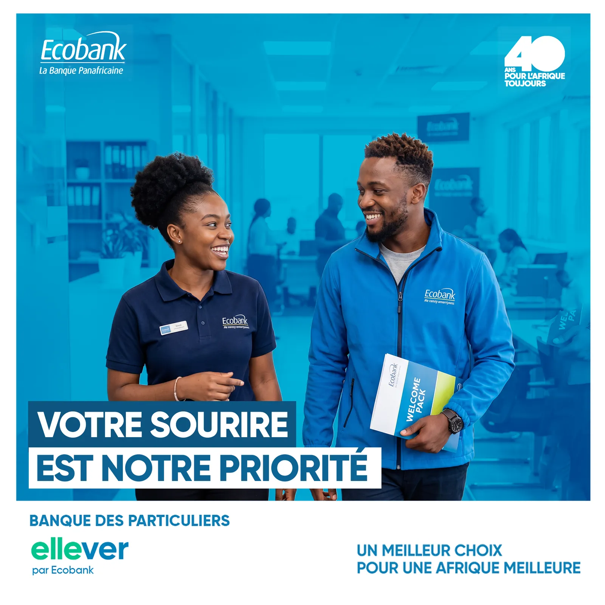
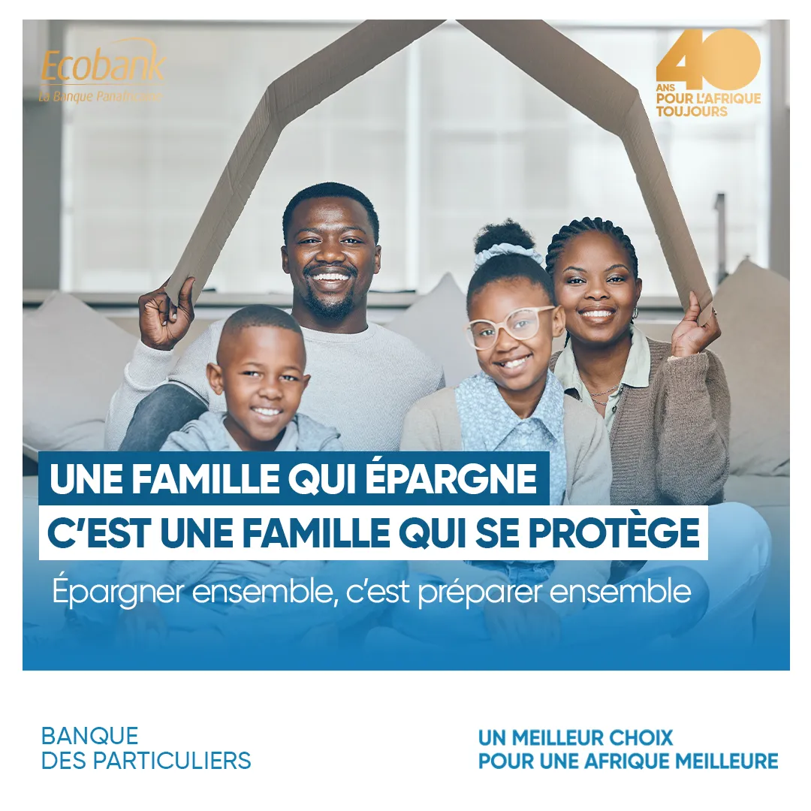
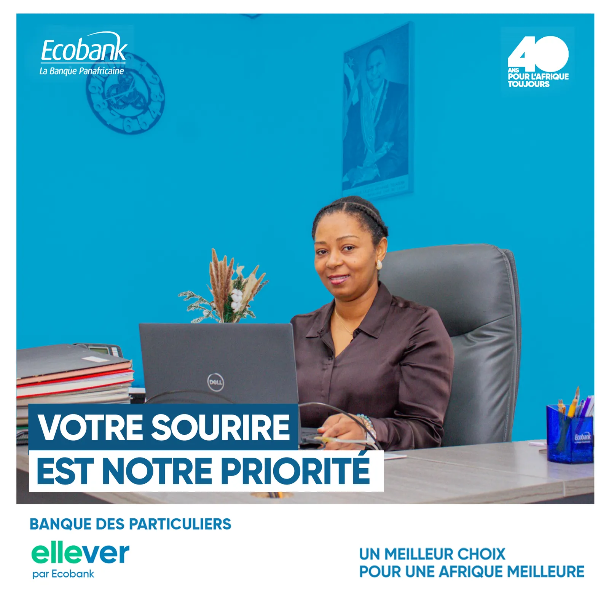

# Ecobank — 40 ans & ellever

<!-- wiki:infobox -->

| Ecobank — 40 ans & ellever | |
| --- | --- |
| Client | [Ecobank](../organisations/ecobank.md) |
| Via | [MATANGA Agency](../organisations/matanga-agency.md) |
| Période | 2026 |
| Casquette | Direction créative & artistique |
| Catégorie | Campagne |
| Disciplines | social · KV-OOH · branding |
| Folio | [Étude de cas ↗](https://xtincell.powerupgraders.com/work/ecobank) |
| État de la fiche | Standard |
<!-- /wiki:infobox -->

**Ecobank — 40 ans & ellever** est une campagne réalisée pour [Ecobank](../organisations/ecobank.md), via [MATANGA Agency](../organisations/matanga-agency.md) (2026).

## Contexte

Visuels de campagne pour la banque panafricaine Ecobank autour de son 40e anniversaire, de l'offre banque des particuliers et du programme femmes « ellever ».

## Galerie

<!-- wiki:galerie -->

<!-- /wiki:galerie -->

## Preuves et médias

- Visuels : `public/work/cases/ecobank/` (4 fichiers)

## Sources

- Archives de travail rangées sous « MATANGA — EXPORT DU TRAVAIL » sur les disques (relevé du 2026-11-09)
- Folio — `scripts/cases.spec.json`, entrée `ecobank`

<!-- wiki:liens-entrants -->
---
**Pages liées** : [Alexandre « Xtincell » Djengue](../personnes/alexandre-djengue.md)
<!-- /wiki:liens-entrants -->
