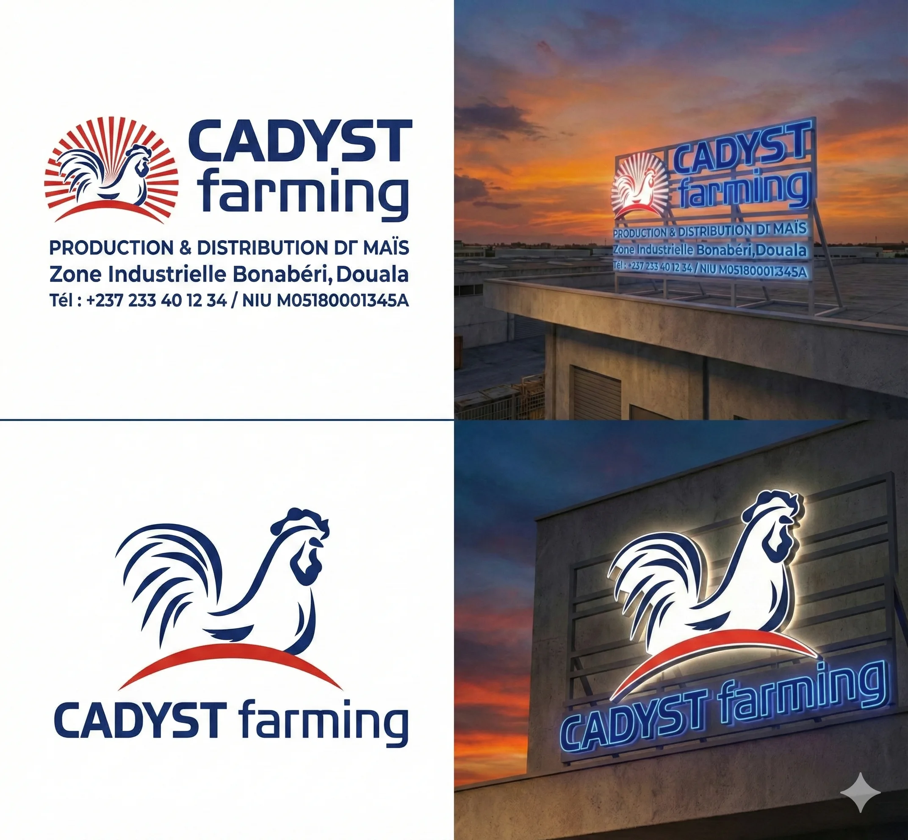
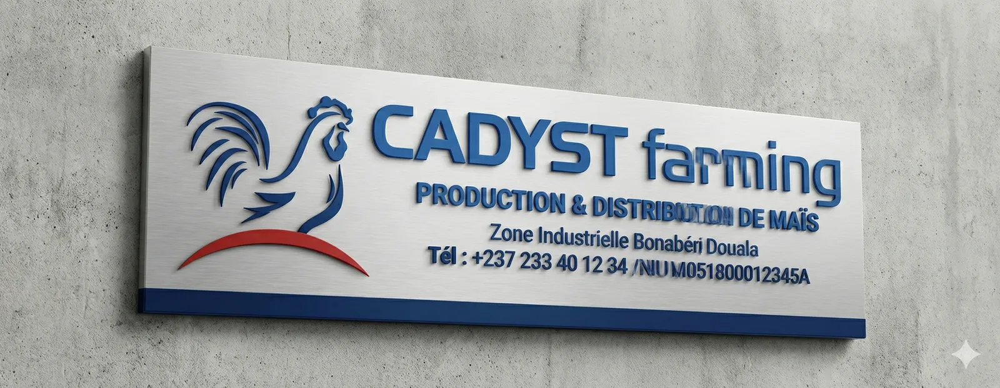

# Cadyst Farming — Enseigne

<!-- wiki:infobox -->

| Cadyst Farming — Enseigne | |
| --- | --- |
| Client | [Groupe Cadyst](../organisations/groupe-cadyst.md) |
| Via | [MATANGA Agency](../organisations/matanga-agency.md) |
| Période | 2025 |
| Casquette | Exécution |
| Catégorie | Campagne |
| Disciplines | branding · KV-OOH |
| Folio | [Étude de cas ↗](https://xtincell.powerupgraders.com/work/enseigne) |
| État de la fiche | Standard |
<!-- /wiki:infobox -->

**Cadyst Farming — Enseigne** est une campagne réalisée pour [Groupe Cadyst](../organisations/groupe-cadyst.md), via [MATANGA Agency](../organisations/matanga-agency.md) (2025).

## Contexte

Conception et mise en situation de l'enseigne pour Cadyst Farming (production/distribution de maïs, Douala) : logo coq bleu décliné en enseigne lumineuse de toit et plaque métal.

## Galerie

<!-- wiki:galerie -->

<!-- /wiki:galerie -->

## Preuves et médias

- Visuels : `public/work/cases/enseigne/` (3 fichiers)

## Sources

- Archives de travail rangées sous « MATANGA — EXPORT DU TRAVAIL » sur les disques (relevé du 2026-11-09)
- Folio — `scripts/cases.spec.json`, entrée `enseigne`

<!-- wiki:liens-entrants -->
<!-- /wiki:liens-entrants -->
