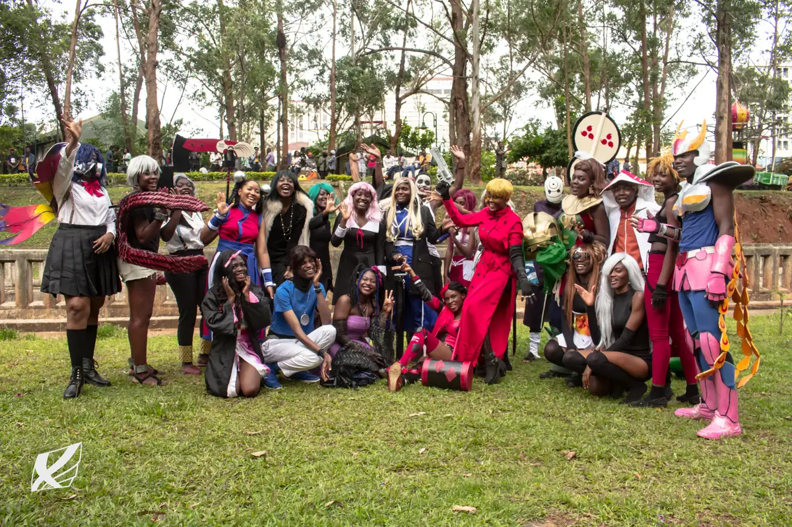
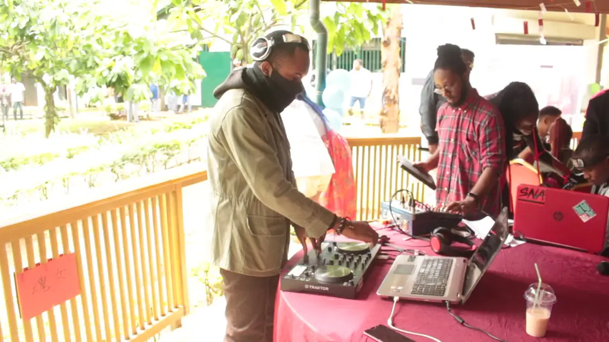
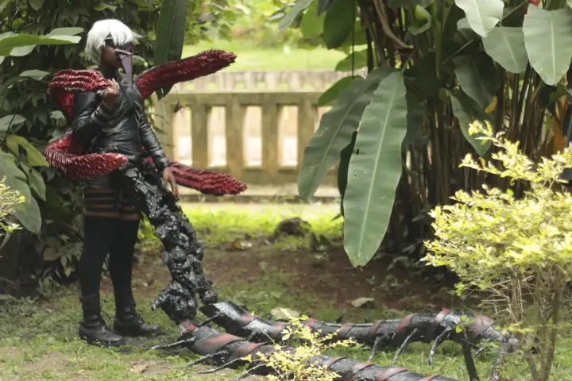
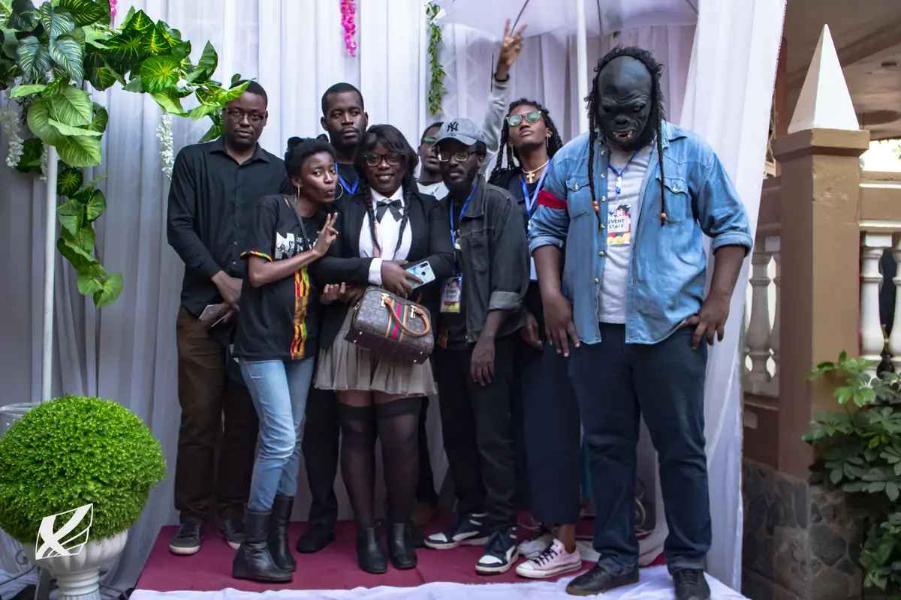
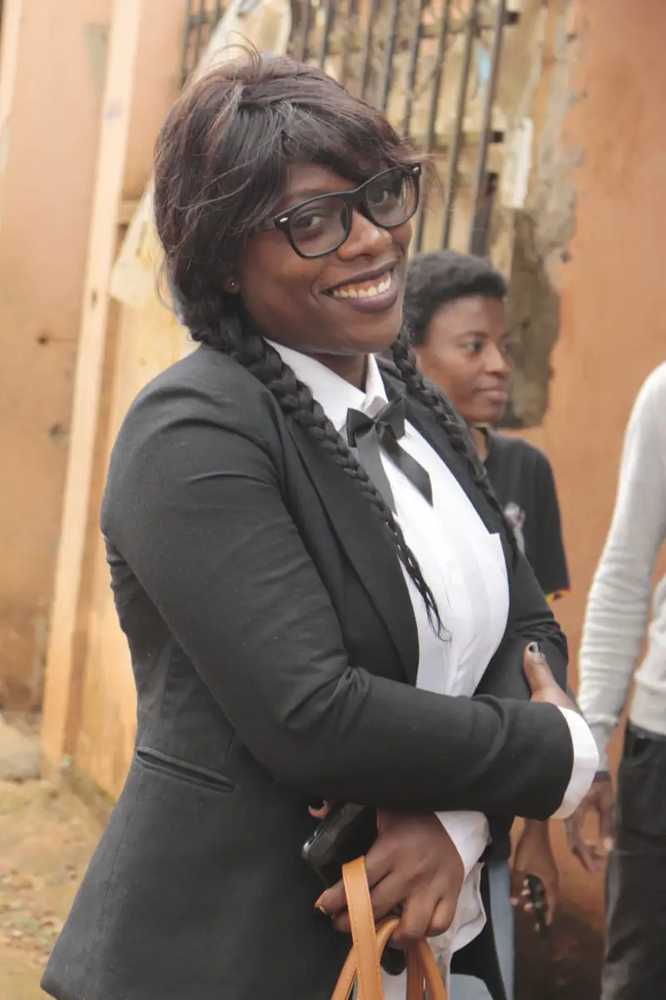
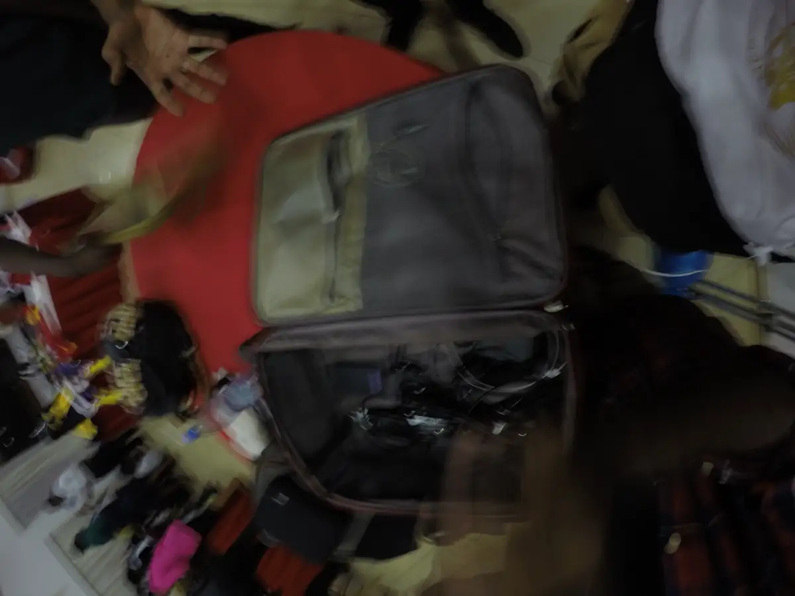

# Cosplay Land 237 — concert anime et journée cosplay (20 et 26 septembre 2020)

<!-- wiki:infobox -->

| Cosplay Land 237 — concert anime et journée cosplay (20 et 26 septembre 2020) | |
| --- | --- |
| Client | [Kamer Otaku Festival (KOF)](../organisations/kamer-otaku-festival.md) |
| Via | [UPgraders](../organisations/upgraders.md) |
| Période | 20 septembre → 10 octobre 2020 |
| Casquette | Exécution |
| Catégorie | Événement |
| Rôle | Couverture photo et vidéo |
| Folio | _pas encore sur le site_ |
| État de la fiche | Standard |
<!-- /wiki:infobox -->

**Cosplay Land 237 — concert anime et journée cosplay (20 et 26 septembre 2020)** est un événement couvert en photo et en vidéo par Alexandre « Xtincell » Djengue (20 septembre → 10 octobre 2020).

## Description

- **Lieu** : salle de fêtes décorée d'arches de verdure (écran géant, scène)
- **Organisateur ou client** : Cosplay Land 237 (rangé avec KOF 2020)
- **Ce que montrent les images** : 20/09/2020 de 14 h à 19 h : chansons d'anime devant des images de manga projetées, stand de figurines, staff en cosplay de majordome, invités.
  - 26/09/2020 : portraits de cosplay dans la verdure, groupe devant le roll-up « Cosplay Land 237 », régie vidéo.
  - 20 et 26/09/2020 : concert de chansons d'anime devant un écran, puis cosplays dans le parc ; photos signées Cosplay Land 237 et Xtincell.
- **Identification** : même salle (arches de verdure, écran) et même jour que les photos signées « Cosplay Land 237 » du dossier KOF 2020 « week21 » ; badge « Event staff »
- **Fiabilité** : confirmé / confirmé (même événement que « week21 ») / confirmé (événement) ; lien KOF à vérifier

## Galerie

<!-- wiki:galerie -->

<!-- /wiki:galerie -->

## Archives

- `KOF - Kamer Otaku Fest\2020\Cosplay Land 237 — concert anime « JAMP » (20-09-2020)` (371 fichiers, disque P:)
- `KOF - Kamer Otaku Fest\2020\CPL — cosplays (26-27-09-2020) (déduit)` (507 fichiers, disque P:)
- `KOF - Kamer Otaku Fest\2020\week21 — cosplays (29-09-2020) (déduit)` (615 fichiers, disque P:)

## Sources

- Notes « Événements couverts » établies lors du rangement des disques (28/10/2026), à partir des images, des dates de prise de vue et des livrables

<!-- wiki:liens-entrants -->
<!-- /wiki:liens-entrants -->
