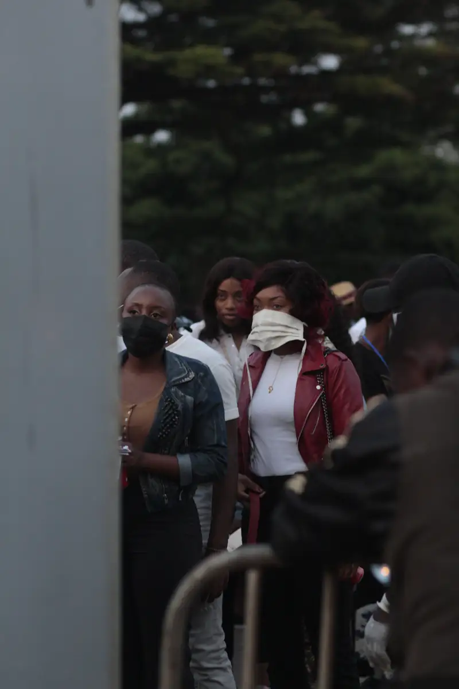
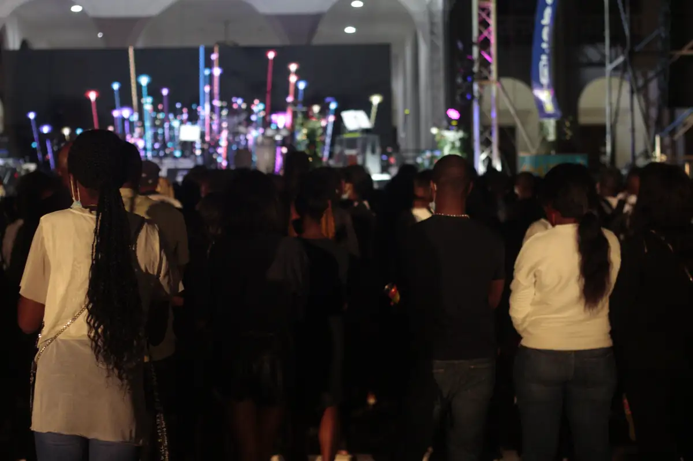
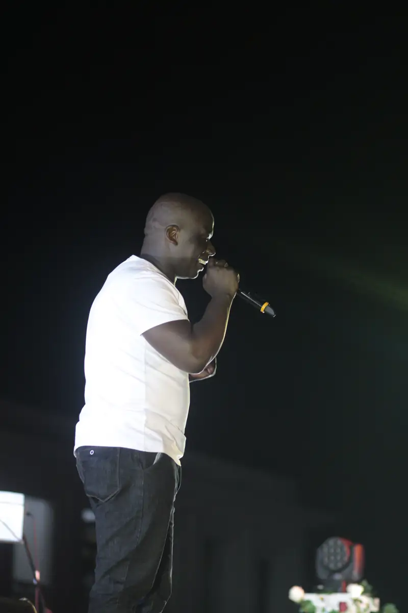
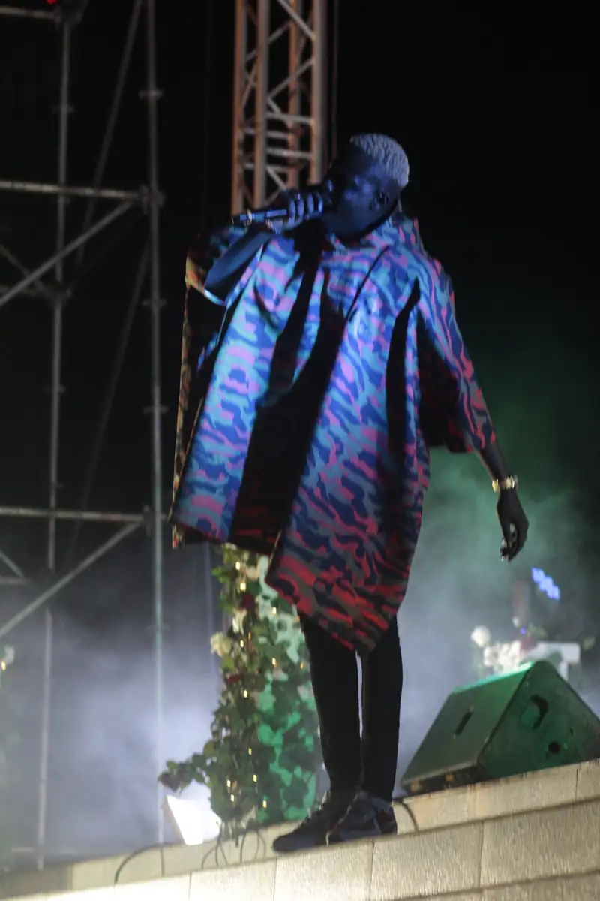

# Concert de fin d'année en plein air (classé « TayC, décembre 2020 », déduit)

<!-- wiki:infobox -->

| Concert de fin d'année en plein air (classé « TayC, décembre 2020 », déduit) | |
| --- | --- |
| Période | 26-27 décembre 2020 |
| Casquette | Exécution |
| Catégorie | Événement |
| Rôle | Couverture photo et vidéo |
| Fait partie de | [Universal Music Africa — image d’artistes](uma-artistes.md) |
| Folio | _pas encore sur le site_ |
| État de la fiche | À vérifier |
<!-- /wiki:infobox -->

**Concert de fin d'année en plein air (classé « TayC, décembre 2020 », déduit)** est un événement couvert en photo et en vidéo par Alexandre « Xtincell » Djengue (26-27 décembre 2020).

## Description

- **Lieu** : grande scène en plein air devant un bâtiment colonial (sponsors Yoba et MTN MoMo), Douala probable
- **Organisateur ou client** : non lu (Universal Music Africa supposé)
- **Ce que montrent les images** : 26-27/12/2020 en soirée : installation, prestations sous écrans LED, public, bâche « Pas de cash, pas de carte, fais un MoMo ».
- **Identification** : bâches Yoba et MTN MoMo ; TayC non reconnu formellement sur la planche
- **Fiabilité** : déduit (artiste à vérifier)

## Date

Les dates de prise de vue et le classement des disques placent ce concert les 26 et 27 décembre 2020. Le récapitulatif photo du concert de Tayc au Cameroun est pourtant publié sur Facebook le 3 janvier 2022, ce qui suggère décembre 2021. L’année reste à trancher ([confrontation des sources](../sources.md#confrontation-élément-par-élément)). _Sources : [disques](../sources.md#disques), [facebook](../sources.md#facebook)._

## Galerie

<!-- wiki:galerie -->

<!-- /wiki:galerie -->

## Archives

- `Universal Music - artistes\2020\TayC (décembre 2020)` (2 203 fichiers, disque P:)

## Sources

- Notes « Événements couverts » établies lors du rangement des disques (28/10/2026), à partir des images, des dates de prise de vue et des livrables
- Export du compte Facebook (2023) — voir [facebook](../sources.md#facebook)

<!-- wiki:liens-entrants -->
---
**Pages liées** : [Universal Music Africa — image d’artistes](uma-artistes.md)
<!-- /wiki:liens-entrants -->
