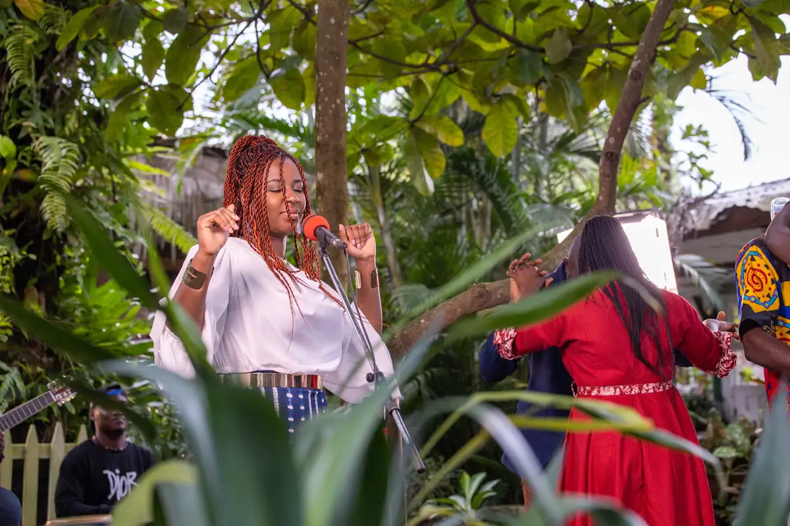
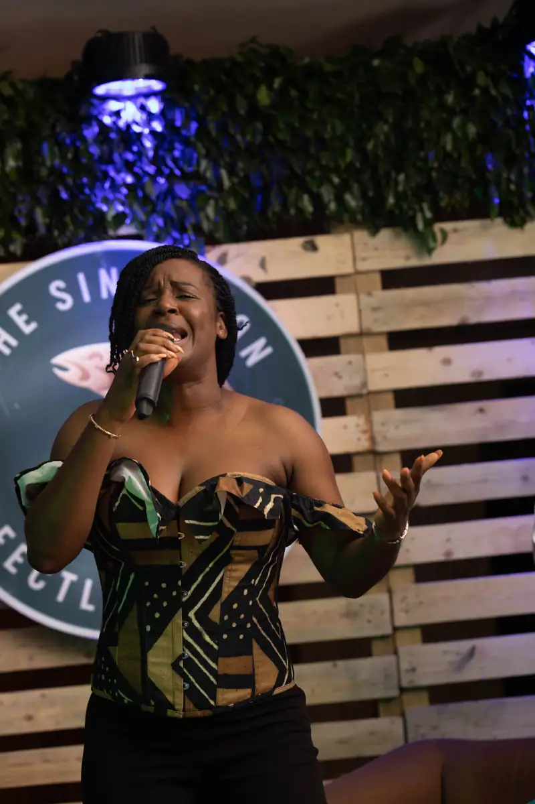
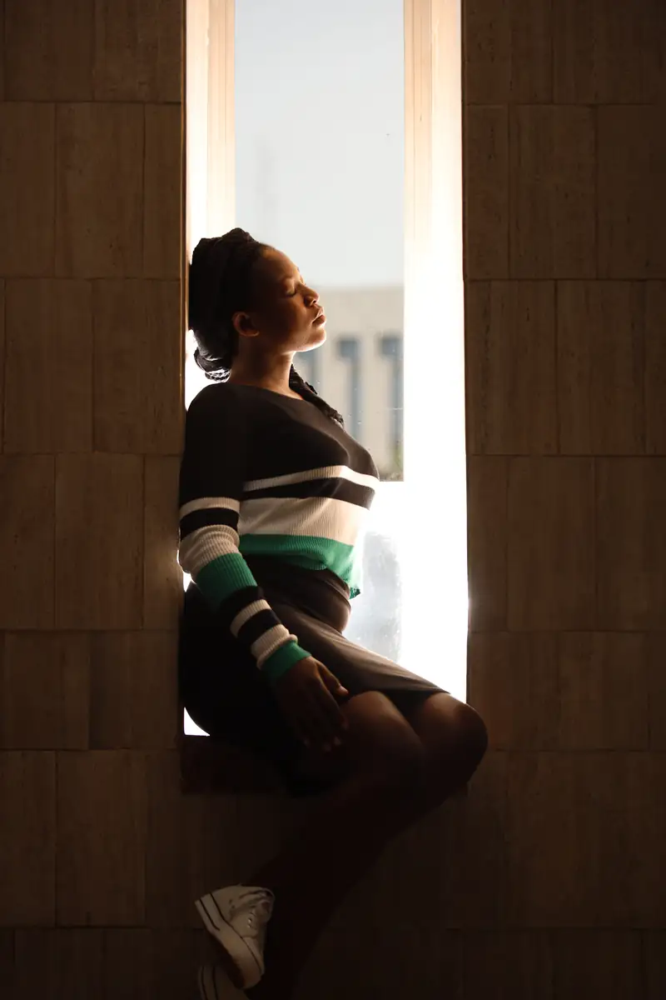
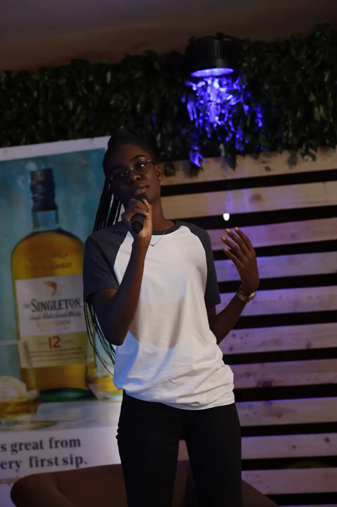
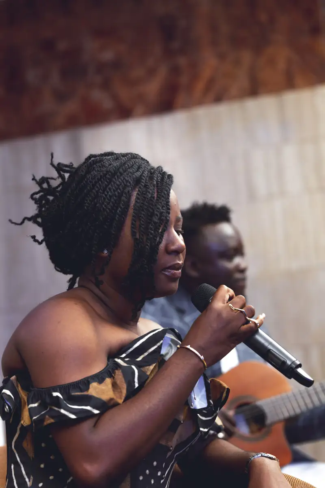

# Charlotte Dipanda — sortie de l'album et soirées The Singleton (mai-juin 2021)

<!-- wiki:infobox -->

| Charlotte Dipanda — sortie de l'album et soirées The Singleton (mai-juin 2021) | |
| --- | --- |
| Client | [Universal Music Africa](../organisations/universal-music-africa.md) |
| Via | [UPgraders](../organisations/upgraders.md) |
| Période | 14 mai → 2 juin 2021 |
| Casquette | Exécution |
| Catégorie | Événement |
| Rôle | Couverture photo et vidéo |
| Fait partie de | [Universal Music Africa — image d’artistes](uma-artistes.md) |
| Folio | _pas encore sur le site_ |
| État de la fiche | Standard |
<!-- /wiki:infobox -->

**Charlotte Dipanda — sortie de l'album et soirées The Singleton (mai-juin 2021)** est un événement couvert en photo et en vidéo par Alexandre « Xtincell » Djengue (14 mai → 2 juin 2021).

## Description

- **Lieu** : lounge The Singleton (palettes, végétal, éclairage bleu), Douala
- **Organisateur ou client** : The Singleton (Diageo) avec Universal Music Africa
- **Ce que montrent les images** : Installation du lieu, live et duos devant le logo « The Singleton — Perfectly Balanced », dédicaces sur un tonneau, photos devant le panneau Universal Music Africa ; portraits d'une invitée le lendemain.
  - 14 et 21/05/2021 : Charlotte Dipanda chante en live dans le jardin, sous l'enseigne « The Singleton — Perfectly Balanced » et devant la bâche « Nouvel album Charlotte Dipanda ».
  - 14-22/05/2021 et 02/06/2021 : écoute et dédicaces devant l'enseigne Singleton et le logo Universal Music Africa, live au jardin, rencontre avec le public.
  - Séance de dédicaces sur le tonneau Singleton, photos avec les fans devant les panneaux Universal Music Africa et The Singleton.
  - 21/05/2021 de 19 h 45 à 23 h 20 : même soirée que le n° 128.
  - 15/05/2021 de 16 h à 17 h 30 : présentation de l'album.
  - Invités posant devant un mur Universal Music en palettes et devant un mur The Singleton ; prise de parole au micro.
- **Identification** : logo « The Singleton — Perfectly Balanced » ; panneau « Universal Music Africa » ; néon « Charlotte Dipanda »
- **Fiabilité** : confirmé

## Galerie

<!-- wiki:galerie -->

<!-- /wiki:galerie -->

## Archives

- `Universal Music - artistes\2021\Dipanda` (16 fichiers, disque C:)
- `Universal Music - artistes\2021\Projets   UNIVERSAL` (552 fichiers, disque C:)
- `Singleton (Diageo)\2021\Soirée Singleton (21-22 mai 2021)` (2 316 fichiers, disque P:)
- `Universal Music - artistes\2021\Charlotte Dipanda — dédicace` (168 fichiers, disque P:)
- `Universal Music - artistes\2021\Charlotte Dipanda (found.000)` (125 fichiers, disque P:)
- `Universal Music - artistes\2021\Charlotte Dipanda — sortie d'album (15-05-2021)` (454 fichiers, disque P:)
- `Singleton (Diageo)\2021\Soirée Singleton (21-22 mai 2021)\Photos reçues (21-05-2021)` (5 fichiers, disque P:)

## Sources

- Notes « Événements couverts » établies lors du rangement des disques (28/10/2026), à partir des images, des dates de prise de vue et des livrables

<!-- wiki:liens-entrants -->
---
**Pages liées** : [Alexandre « Xtincell » Djengue](../personnes/alexandre-djengue.md)
<!-- /wiki:liens-entrants -->
