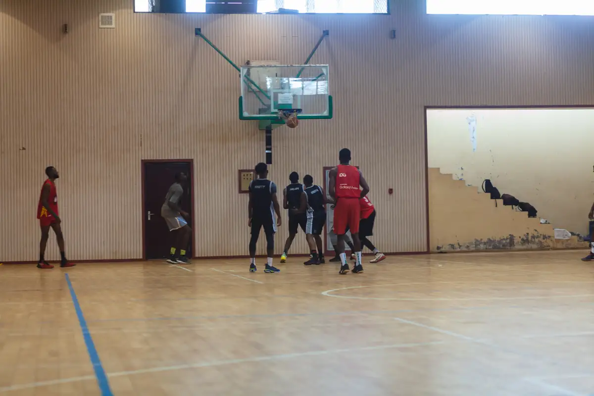
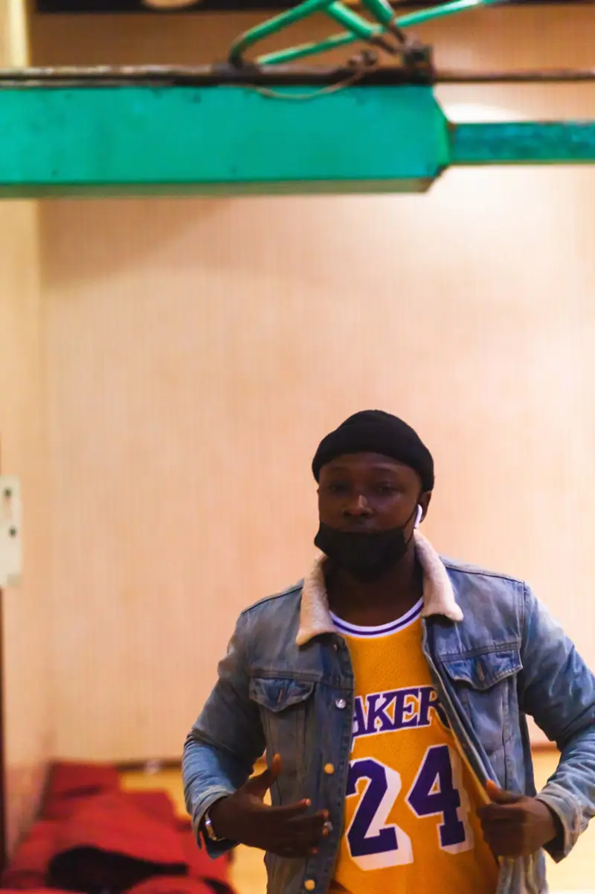
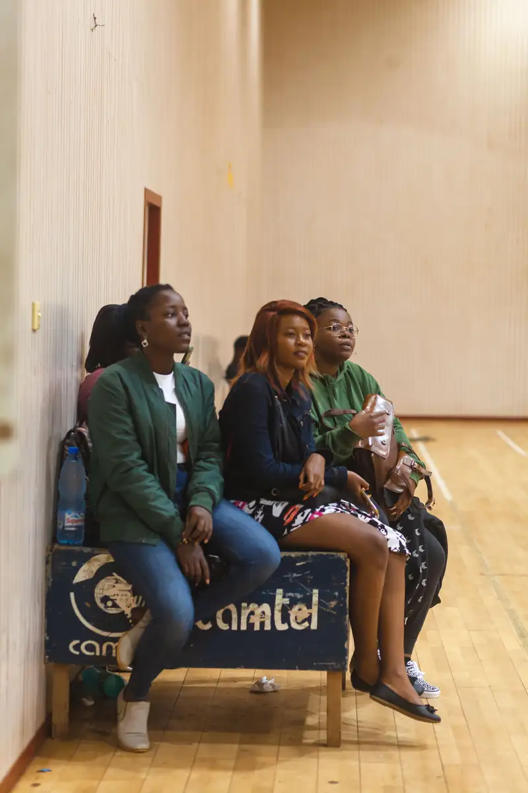
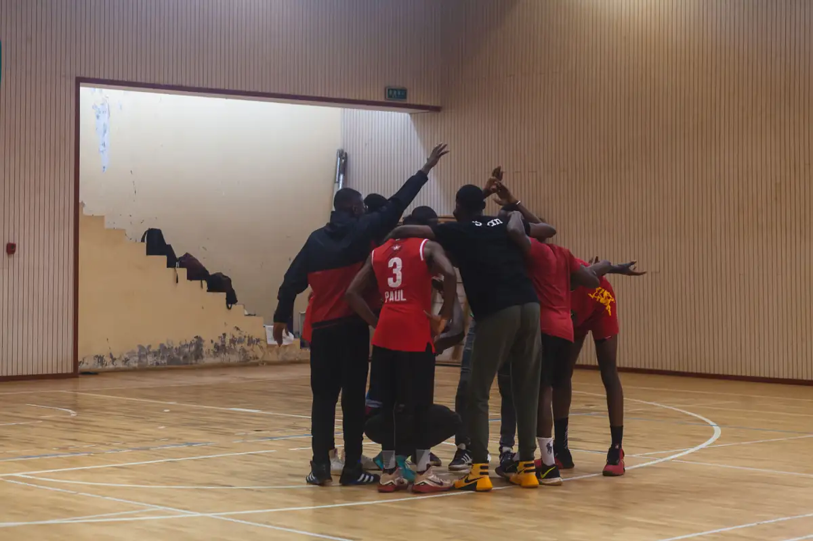
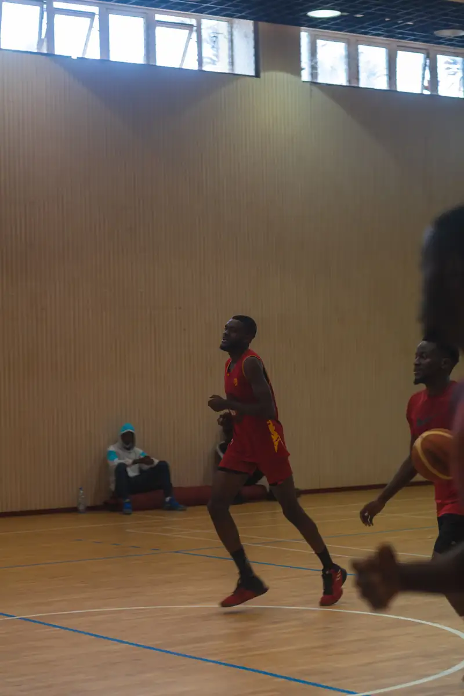
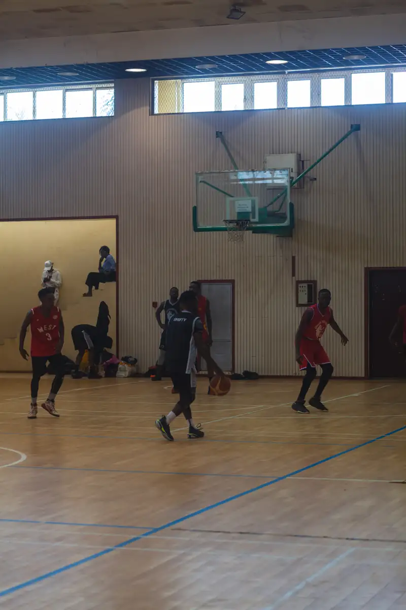

# Match de basket amical (« Basuke »)

<!-- wiki:infobox -->

| Match de basket amical (« Basuke ») | |
| --- | --- |
| Période | 18-22 juin 2021 |
| Casquette | Exécution |
| Catégorie | Événement |
| Rôle | Couverture photo et vidéo |
| Folio | _pas encore sur le site_ |
| État de la fiche | À vérifier |
<!-- /wiki:infobox -->

**Match de basket amical (« Basuke »)** est un événement couvert en photo et en vidéo par Alexandre « Xtincell » Djengue (18-22 juin 2021).

## Description

- **Lieu** : gymnase couvert au parquet (coffres Camtel)
- **Organisateur ou client** : non identifié (« basuke » = basket en japonais, communauté otaku probable)
- **Ce que montrent les images** : 19/06/2021 au matin : échauffement, match, public assis le long des murs, photo de groupe des deux équipes.
- **Identification** : date EXIF 19/06/2021 (le lot est daté du 25/06 par erreur) ; aucun logo de club lisible
- **Fiabilité** : client inconnu

## Galerie

<!-- wiki:galerie -->

<!-- /wiki:galerie -->

## Archives

- `_À identifier\P — 2021-06-19 — Match de basket amical (« Basuke »)` (539 fichiers, disque P:)

## Sources

- Notes « Événements couverts » établies lors du rangement des disques (28/10/2026), à partir des images, des dates de prise de vue et des livrables

<!-- wiki:liens-entrants -->
<!-- /wiki:liens-entrants -->
