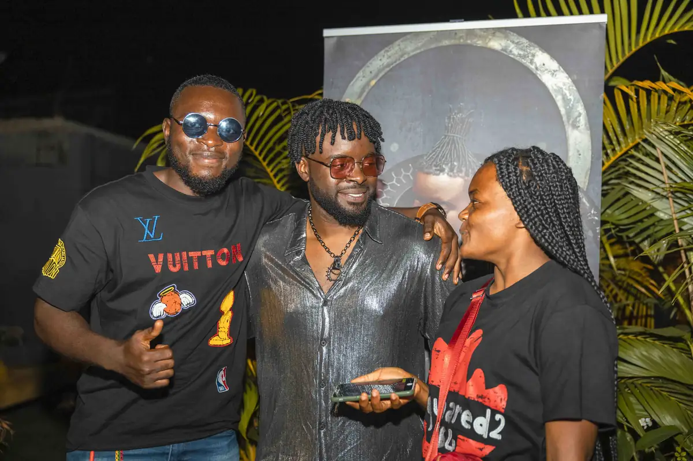
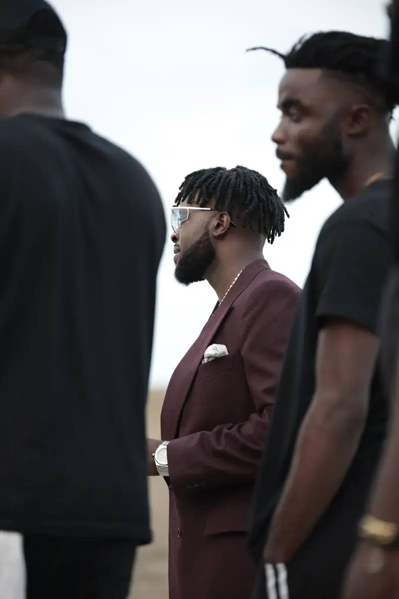
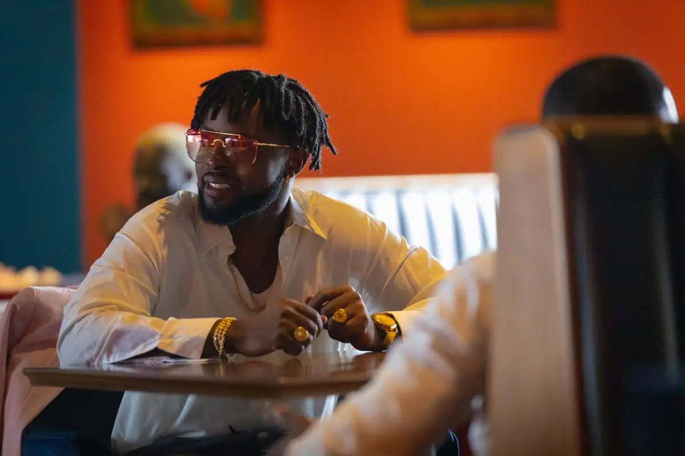
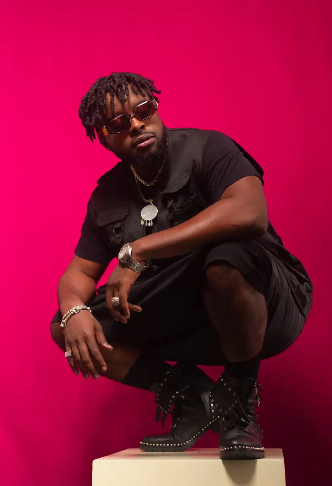
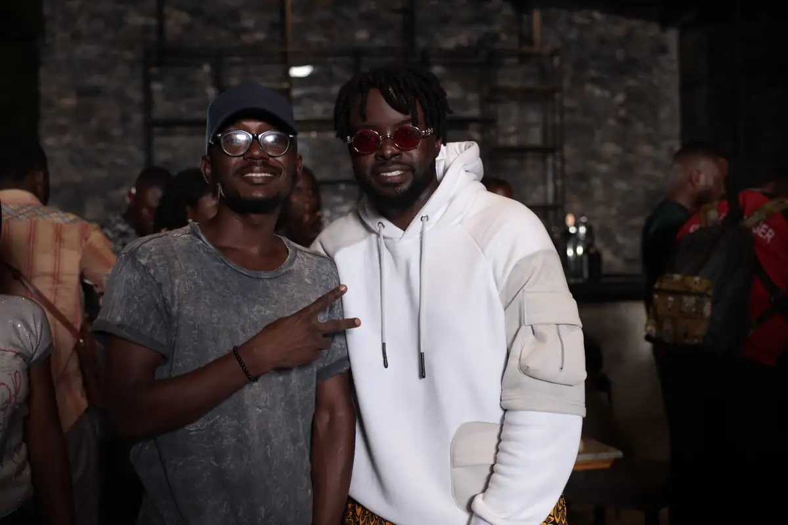
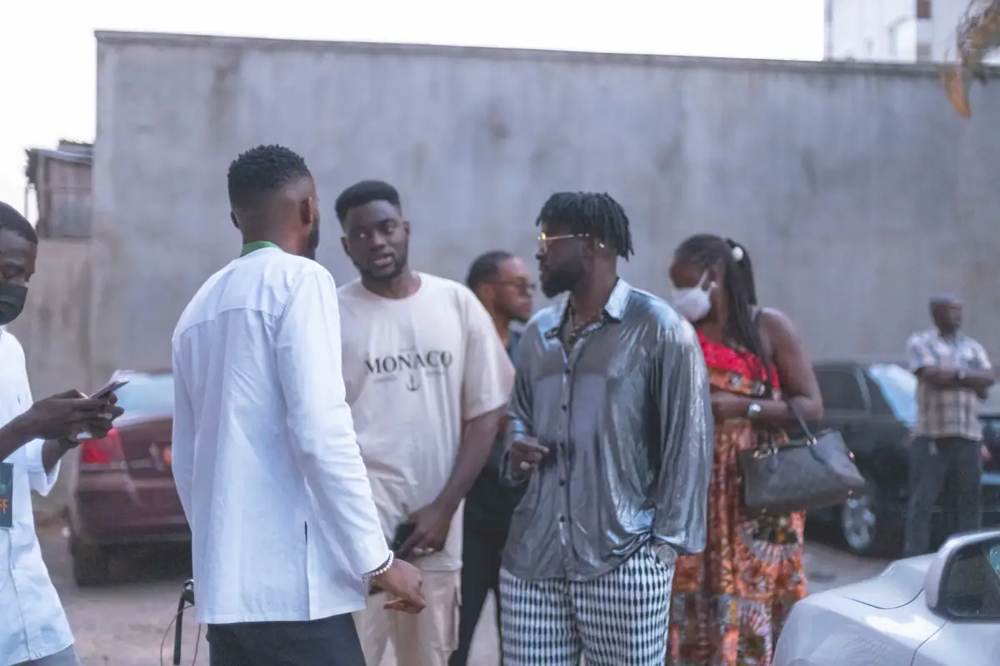

# Locko — photos livrées de l'année 2021 (JPG)

<!-- wiki:infobox -->

| Locko — photos livrées de l'année 2021 (JPG) | |
| --- | --- |
| Client | [LOCKO](../organisations/locko.md) |
| Via | [UPgraders](../organisations/upgraders.md) |
| Période | 25 juillet → 29 décembre 2021 |
| Casquette | Exécution |
| Catégorie | Événement |
| Rôle | Couverture photo et vidéo |
| Fait partie de | [Universal Music Africa — image d’artistes](uma-artistes.md) |
| Folio | _pas encore sur le site_ |
| État de la fiche | Standard |
<!-- /wiki:infobox -->

**Locko — photos livrées de l'année 2021 (JPG)** est un événement couvert en photo et en vidéo par Alexandre « Xtincell » Djengue (25 juillet → 29 décembre 2021).

## Description

- **Lieu** : plusieurs lieux
- **Organisateur ou client** : Locko
- **Ce que montrent les images** : Sélection retouchée couvrant le shooting en combinaison orange (26/07), la session d'écoute « Era » (26/11), la promo « Era » (05 et 12/12), un concert (22/12), le plateau Canal+ avec le roll-up « Era » (27/12) et le showcase au BOJ (29/12).
- **Identification** : noms de fichiers datés ; roll-up « Era » ; décor Canal+
- **Fiabilité** : confirmé

## Galerie

<!-- wiki:galerie -->

<!-- /wiki:galerie -->

## Archives

- `LOCKO\2021\Shooting   LOCKO` (809 fichiers, disque C:)

## Sources

- Notes « Événements couverts » établies lors du rangement des disques (28/10/2026), à partir des images, des dates de prise de vue et des livrables

<!-- wiki:liens-entrants -->
<!-- /wiki:liens-entrants -->
