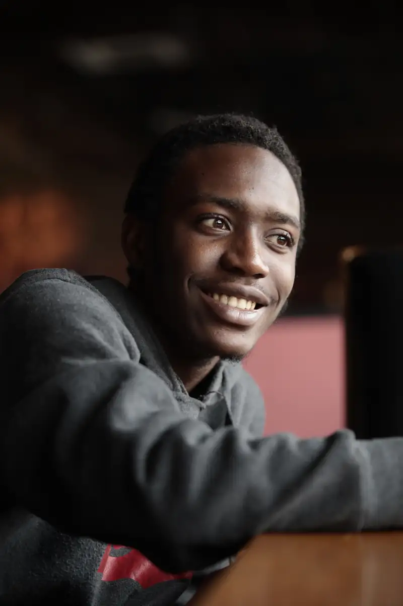
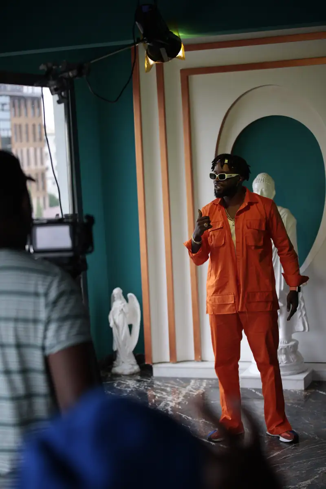
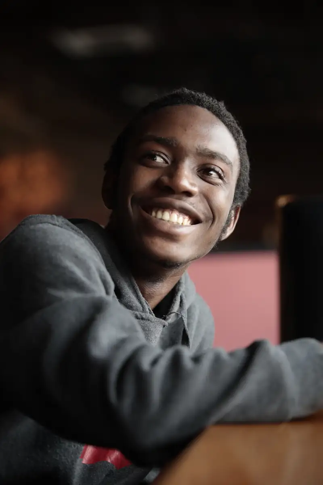
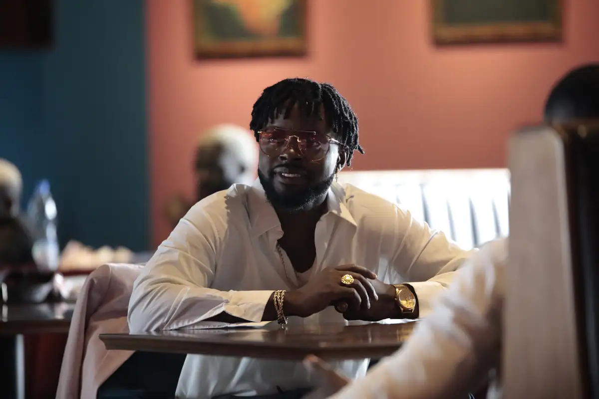
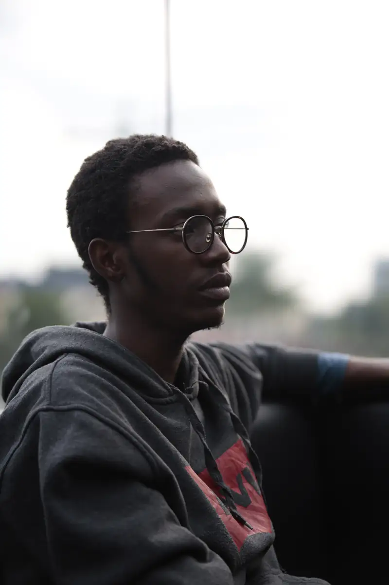
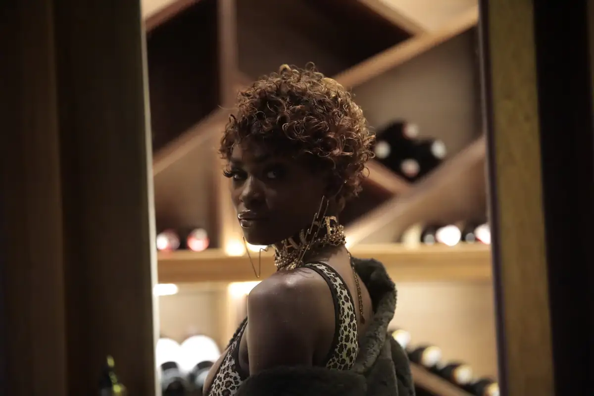

# Locko — shooting ou tournage en combinaison orange

<!-- wiki:infobox -->

| Locko — shooting ou tournage en combinaison orange | |
| --- | --- |
| Client | [LOCKO](../organisations/locko.md) |
| Via | [UPgraders](../organisations/upgraders.md) |
| Période | 26 juillet 2021 |
| Casquette | Exécution |
| Catégorie | Événement |
| Rôle | Couverture photo et vidéo |
| Fait partie de | [Universal Music Africa — image d’artistes](uma-artistes.md) |
| Folio | _pas encore sur le site_ |
| État de la fiche | À vérifier |
<!-- /wiki:infobox -->

**Locko — shooting ou tournage en combinaison orange** est un événement couvert en photo et en vidéo par Alexandre « Xtincell » Djengue (26 juillet 2021).

## Description

- **Lieu** : restaurant-bar avec terrasse vitrée, en ville
- **Organisateur ou client** : Locko
- **Ce que montrent les images** : Séance dans un restaurant aux murs verts et portraits encadrés : combinaison orange, costume rose sur mur de fleurs, maquillage, plans dans la cave à vin.
- **Identification** : mots-clés Lightroom « Locko » sur ce jour ; même artiste que la promo « Era »
- **Fiabilité** : déduit

## Galerie

<!-- wiki:galerie -->

<!-- /wiki:galerie -->

## Archives

- `LOCKO\2021\Shooting (26-07-2021) (déduit)` (819 fichiers, disque P:)

## Sources

- Notes « Événements couverts » établies lors du rangement des disques (28/10/2026), à partir des images, des dates de prise de vue et des livrables

<!-- wiki:liens-entrants -->
<!-- /wiki:liens-entrants -->
