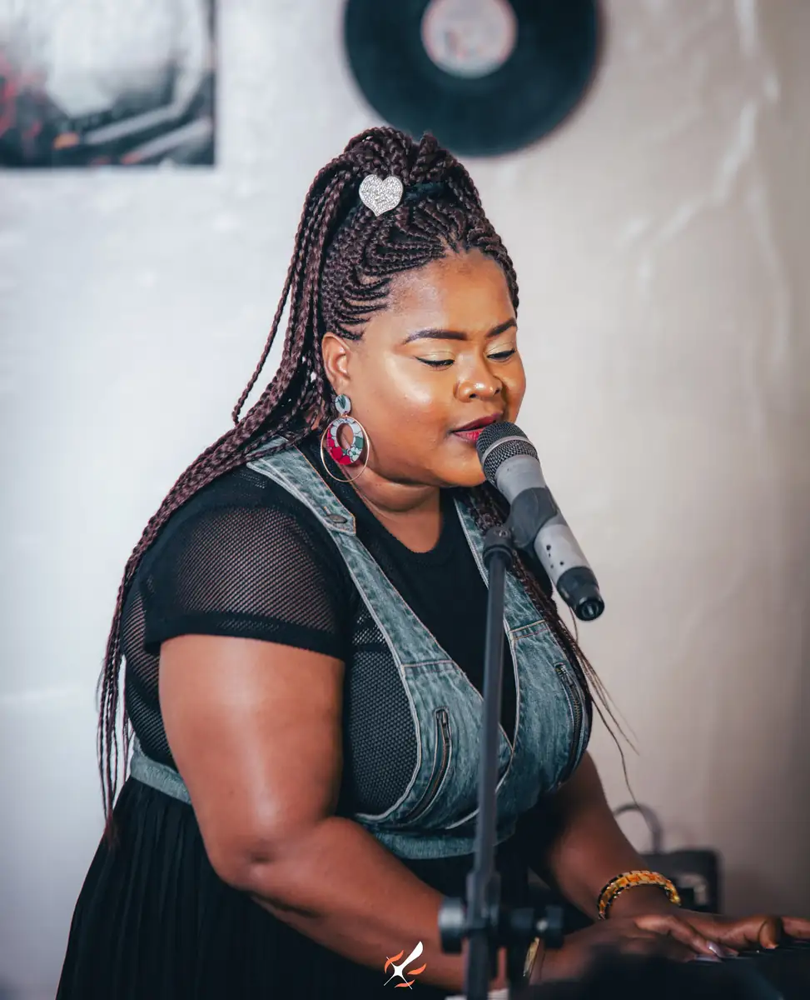
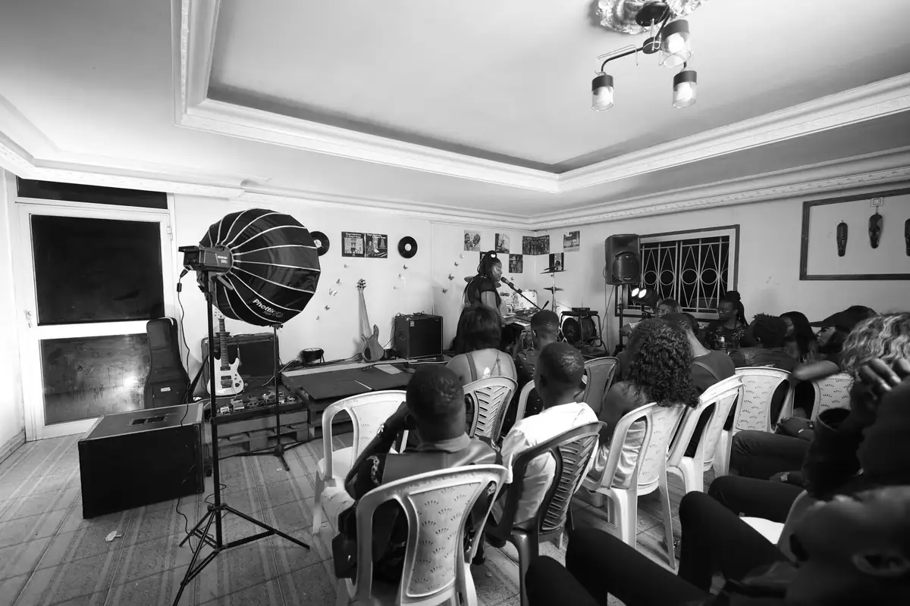
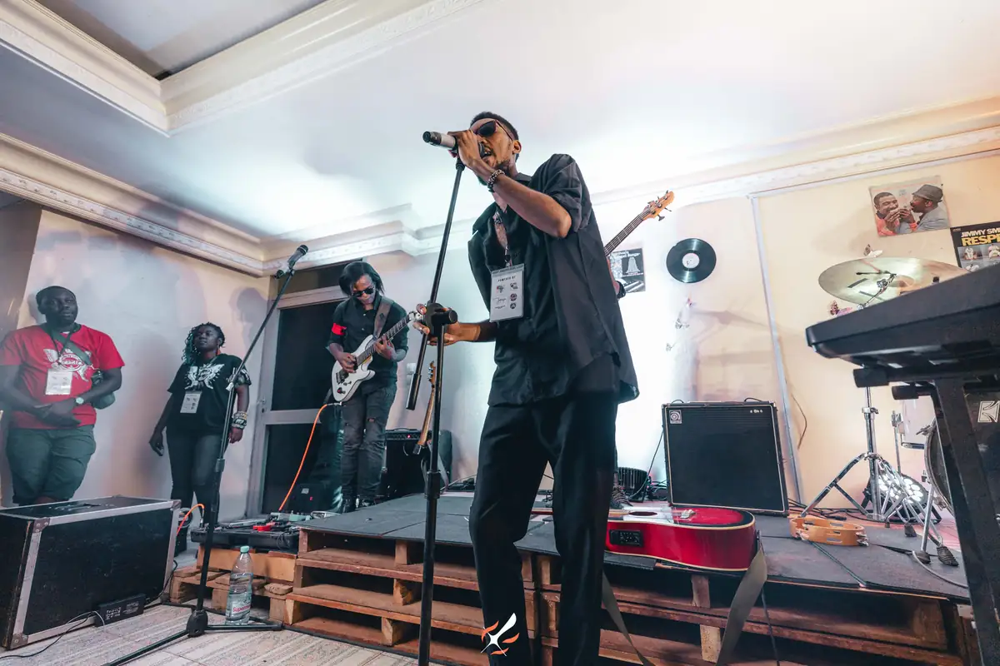
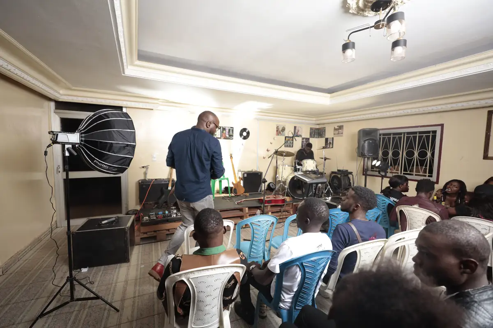
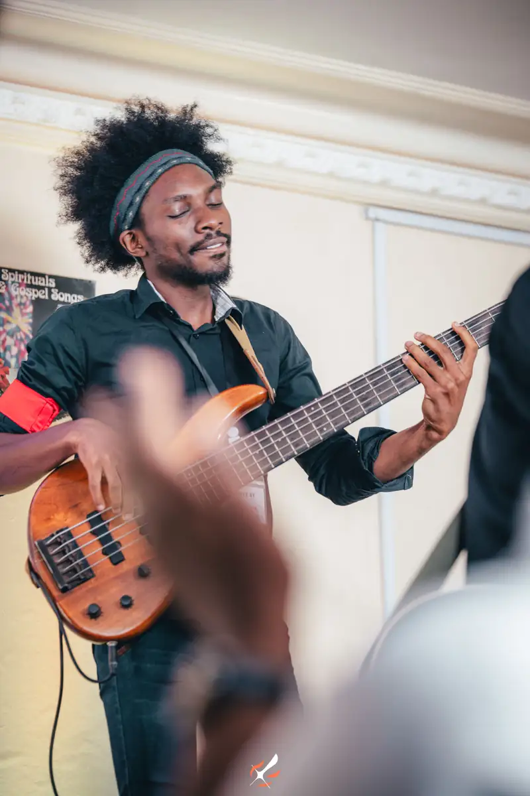
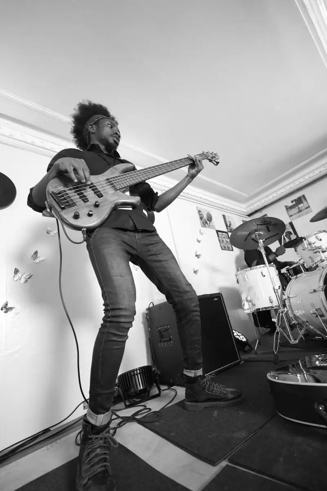

# Session live d'un groupe dans un bar à vinyles (noir et blanc)

<!-- wiki:infobox -->

| Session live d'un groupe dans un bar à vinyles (noir et blanc) | |
| --- | --- |
| Période | 30-31 juillet 2021 |
| Casquette | Exécution |
| Catégorie | Événement |
| Rôle | Couverture photo et vidéo |
| Folio | _pas encore sur le site_ |
| État de la fiche | À vérifier |
<!-- /wiki:infobox -->

**Session live d'un groupe dans un bar à vinyles (noir et blanc)** est un événement couvert en photo et en vidéo par Alexandre « Xtincell » Djengue (30-31 juillet 2021).

## Description

- **Lieu** : petite salle aux murs couverts de vinyles et de pochettes (« Jimmy Smith — Respect »)
- **Organisateur ou client** : non identifié
- **Ce que montrent les images** : 30/07/2021 de 20 h 40 à minuit : concert intimiste, musiciens badgés, livré en noir et blanc.
- **Identification** : badges des musiciens (festival ou programme de résidence probable) ; aucun nom lisible
- **Fiabilité** : client inconnu

## Galerie

<!-- wiki:galerie -->

<!-- /wiki:galerie -->

## Archives

- `_À identifier\P — 2021-07-30 → 31 — Session live d'un groupe (noir et blanc)` (285 fichiers, disque P:)

## Sources

- Notes « Événements couverts » établies lors du rangement des disques (28/10/2026), à partir des images, des dates de prise de vue et des livrables

<!-- wiki:liens-entrants -->
<!-- /wiki:liens-entrants -->
