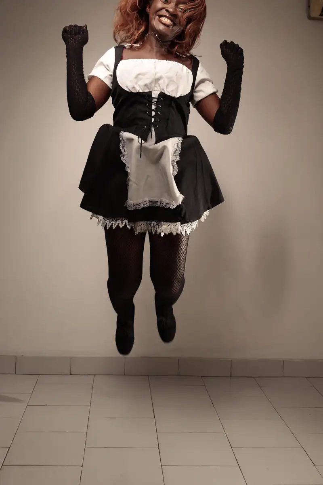
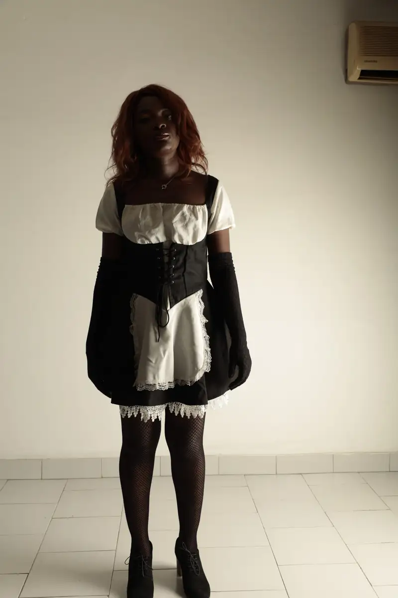
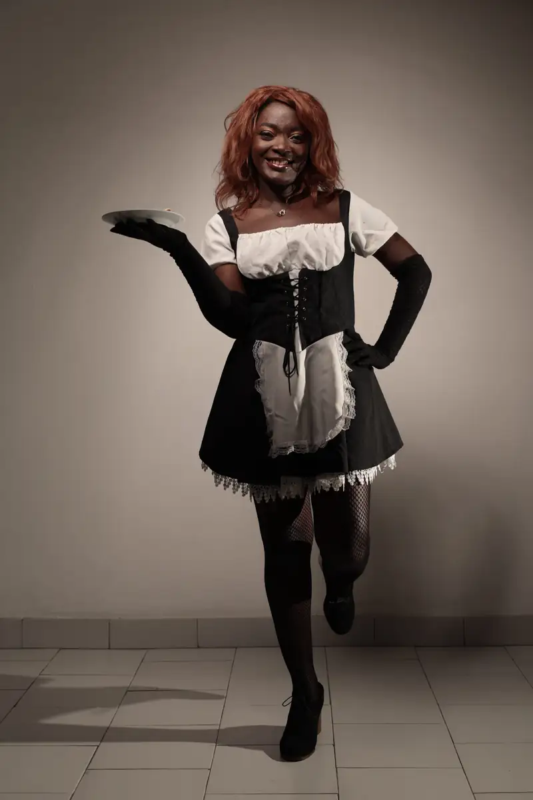
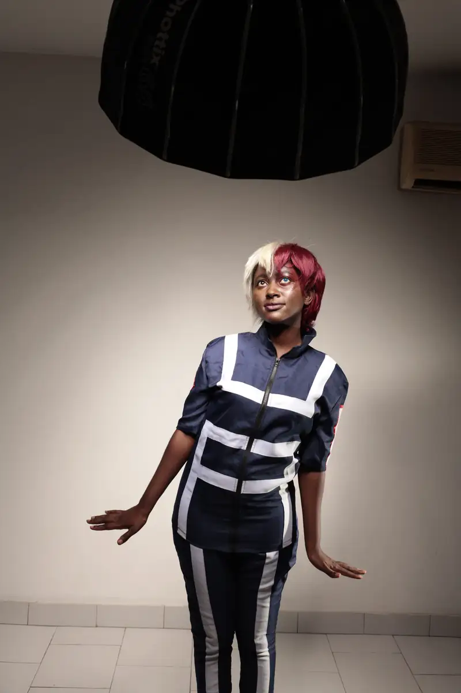
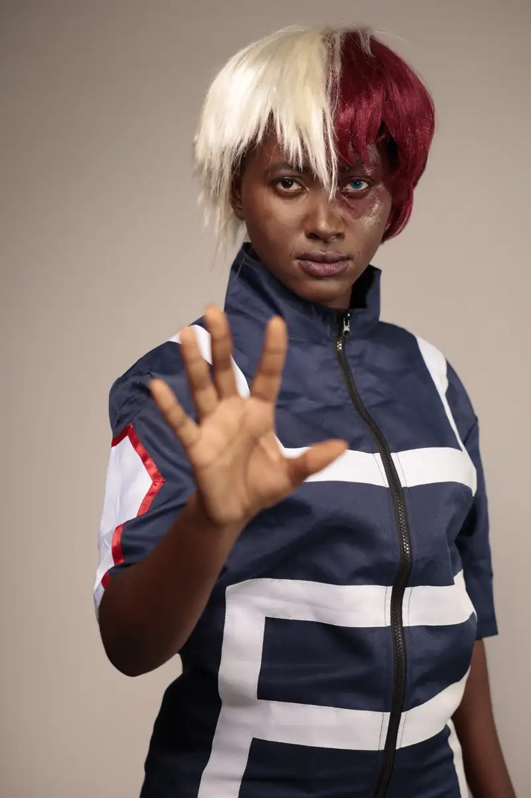
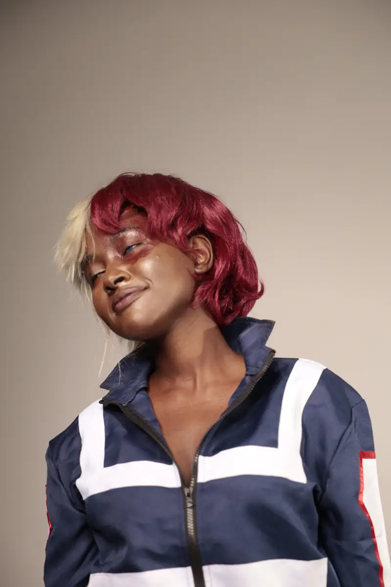

# Shooting cosplay en studio (septembre 2021)

<!-- wiki:infobox -->

| Shooting cosplay en studio (septembre 2021) | |
| --- | --- |
| Client | [Kamer Otaku Festival (KOF)](../organisations/kamer-otaku-festival.md) |
| Via | [UPgraders](../organisations/upgraders.md) |
| Période | 30 septembre 2021 |
| Casquette | Exécution |
| Catégorie | Événement |
| Rôle | Couverture photo et vidéo |
| Folio | _pas encore sur le site_ |
| État de la fiche | Standard |
<!-- /wiki:infobox -->

**Shooting cosplay en studio (septembre 2021)** est un événement couvert en photo et en vidéo par Alexandre « Xtincell » Djengue (30 septembre 2021).

## Description

- **Lieu** : studio photo (fond beige)
- **Organisateur ou client** : KOF (dossier)
- **Ce que montrent les images** : 30/09/2021 : portraits de cosplay, maquillage.
- **Identification** : dossier KOF 2021
- **Fiabilité** : confirmé (dossier)

## Galerie

<!-- wiki:galerie -->

<!-- /wiki:galerie -->

## Archives

- `KOF - Kamer Otaku Fest\2021\Shooting cosplay (septembre 2021)` (606 fichiers, disque P:)

## Sources

- Notes « Événements couverts » établies lors du rangement des disques (28/10/2026), à partir des images, des dates de prise de vue et des livrables

<!-- wiki:liens-entrants -->
<!-- /wiki:liens-entrants -->
