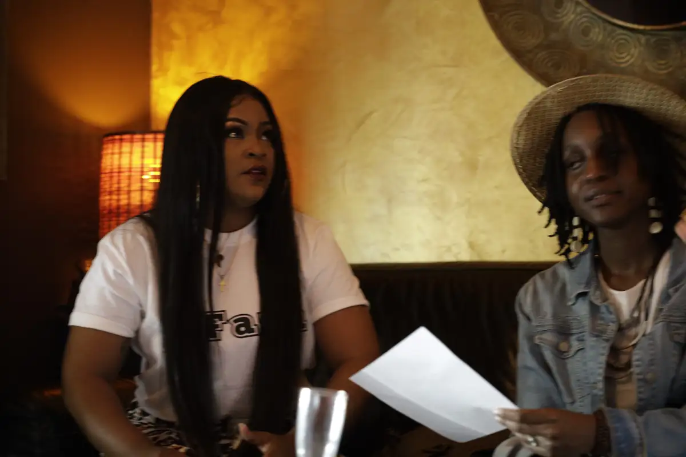

# Mimie — tournée promo du single « Faya »

<!-- wiki:infobox -->

| Mimie — tournée promo du single « Faya » | |
| --- | --- |
| Client | [Universal Music Africa](../organisations/universal-music-africa.md) |
| Via | [UPgraders](../organisations/upgraders.md) |
| Période | 6 octobre 2021 |
| Casquette | Exécution |
| Catégorie | Événement |
| Rôle | Couverture photo et vidéo |
| Fait partie de | [Universal Music Africa — image d’artistes](uma-artistes.md) |
| Folio | _pas encore sur le site_ |
| État de la fiche | À vérifier |
<!-- /wiki:infobox -->

**Mimie — tournée promo du single « Faya »** est un événement couvert en photo et en vidéo par Alexandre « Xtincell » Djengue (6 octobre 2021).

## Description

- **Lieu** : restaurants-lounges, Douala
- **Organisateur ou client** : Mimie / Universal Music Africa (déduit)
- **Ce que montrent les images** : Interviews et rencontres dans plusieurs restaurants, équipe et fans en tee-shirts « #Faya », selfies avec le personnel.
- **Identification** : tee-shirts « #Faya » ; « Faya » de Mimie feat. Locko, sorti le 11/08/2021, million de vues en un mois (Cameroon Tribune, 04/10/2021)
- **Fiabilité** : déduit

## Galerie

<!-- wiki:galerie -->

<!-- /wiki:galerie -->

## Archives

- `Universal Music - artistes\2021\Mimie — promo du single « Faya » (06-10-2021) (déduit)` (731 fichiers, disque P:)

## Sources

- Notes « Événements couverts » établies lors du rangement des disques (28/10/2026), à partir des images, des dates de prise de vue et des livrables

<!-- wiki:liens-entrants -->
<!-- /wiki:liens-entrants -->
