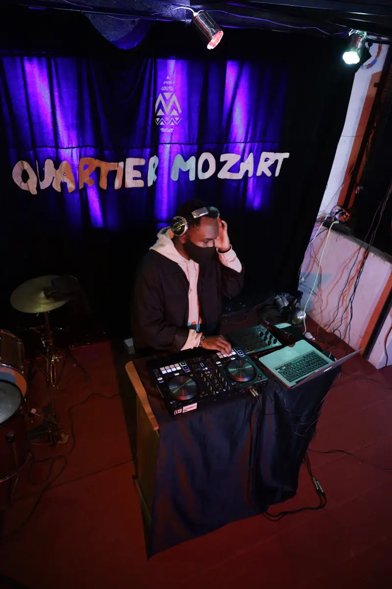
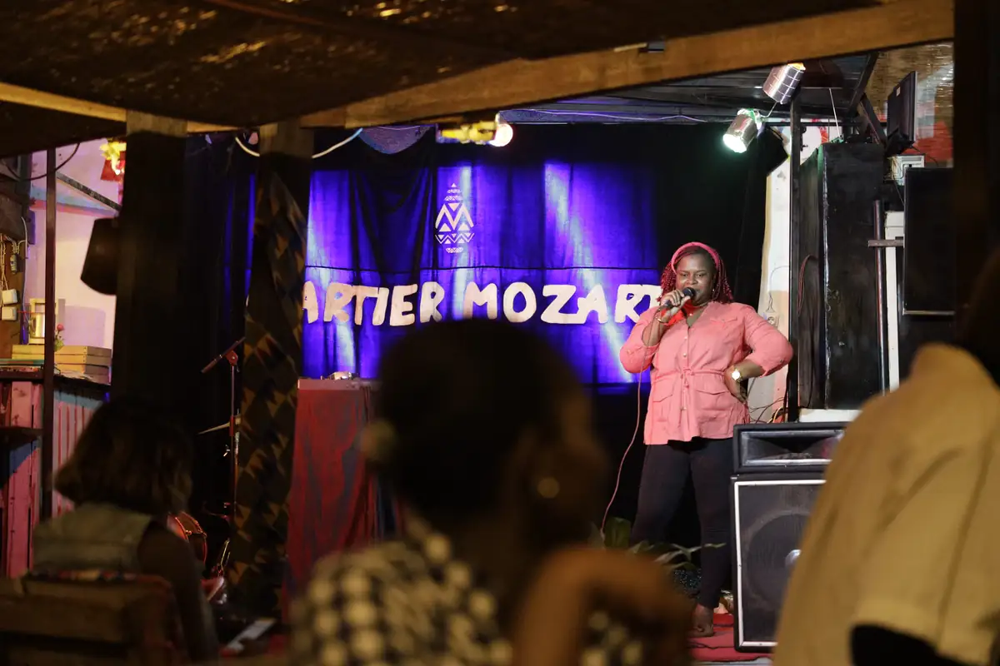
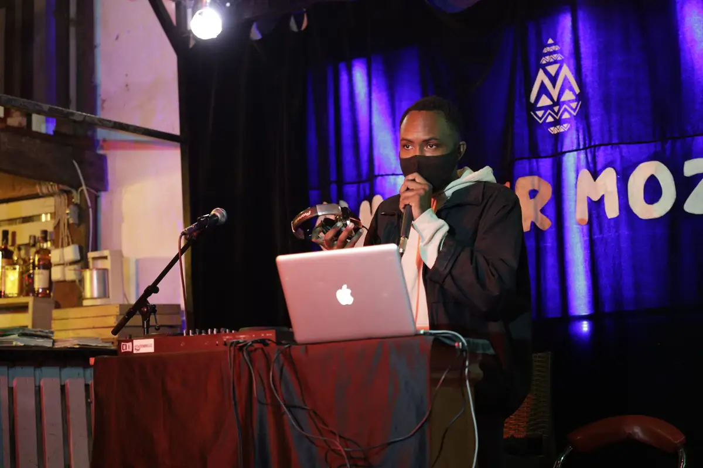
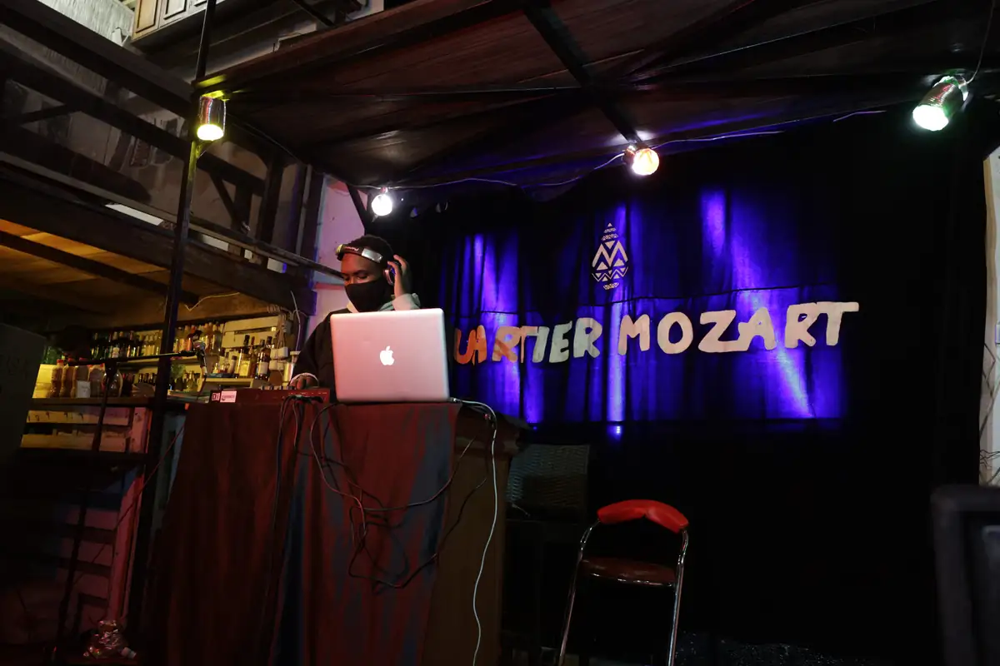
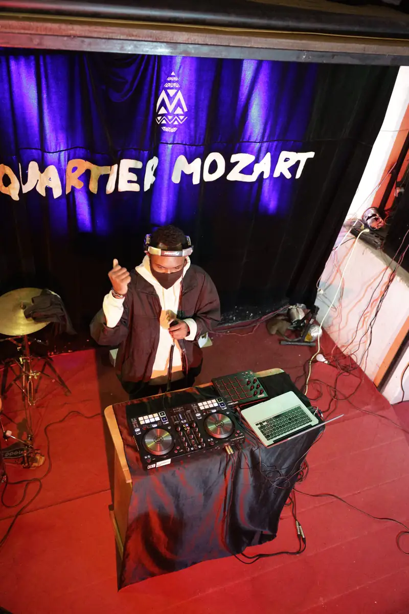
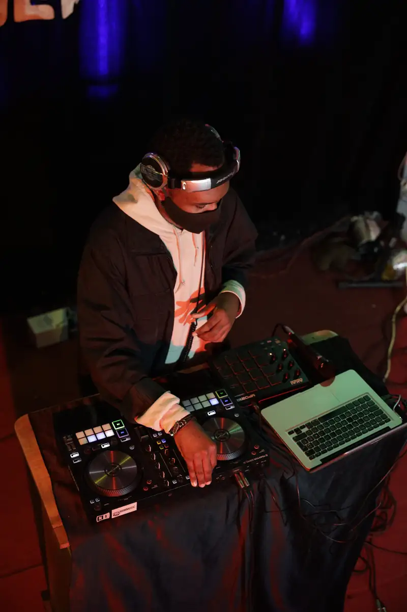

# Soirée DJ « Quartier Mozart » et ramen « Afro »

<!-- wiki:infobox -->

| Soirée DJ « Quartier Mozart » et ramen « Afro » | |
| --- | --- |
| Période | 8 octobre 2021 |
| Casquette | Exécution |
| Catégorie | Événement |
| Rôle | Couverture photo et vidéo |
| Folio | _pas encore sur le site_ |
| État de la fiche | À vérifier |
<!-- /wiki:infobox -->

**Soirée DJ « Quartier Mozart » et ramen « Afro »** est un événement couvert en photo et en vidéo par Alexandre « Xtincell » Djengue (8 octobre 2021).

## Description

- **Lieu** : restaurant-bar avec patio (menu « Afro — Shoyu ramen, Miso ramen »)
- **Organisateur ou client** : collectif « Quartier Mozart » (logo M), non identifié plus avant
- **Ce que montrent les images** : 08/10/2021 de 18 h 30 à 22 h : affiche du menu ramen, bols de ramen, set DJ devant le rideau « Quartier Mozart », puis séance photo d'une invitée.
- **Identification** : rideau « Quartier Mozart » ; affiche « Afro » (ramen)
- **Fiabilité** : client inconnu

## Galerie

<!-- wiki:galerie -->

<!-- /wiki:galerie -->

## Archives

- `_À identifier\P — 2021-10-08 — Soirée DJ « Quartier Mozart »` (276 fichiers, disque P:)

## Sources

- Notes « Événements couverts » établies lors du rangement des disques (28/10/2026), à partir des images, des dates de prise de vue et des livrables

<!-- wiki:liens-entrants -->
<!-- /wiki:liens-entrants -->
