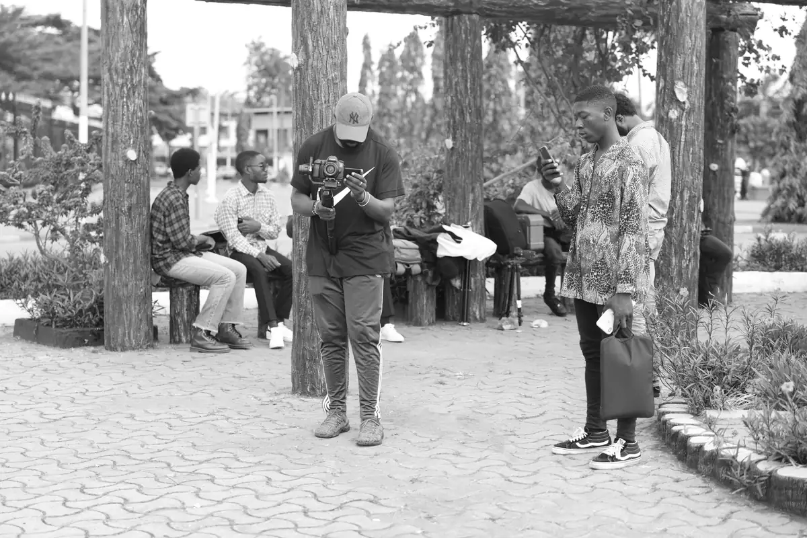
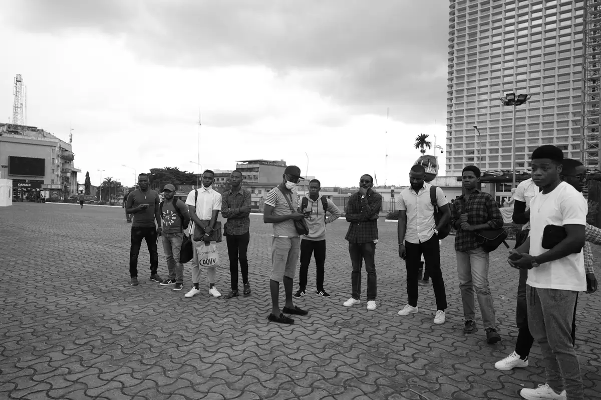
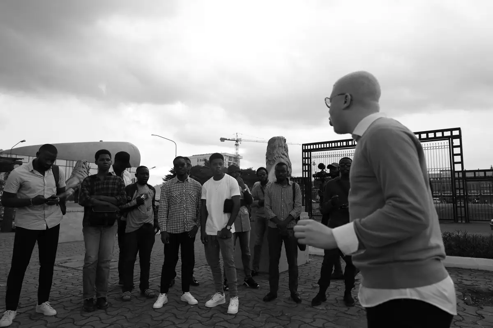
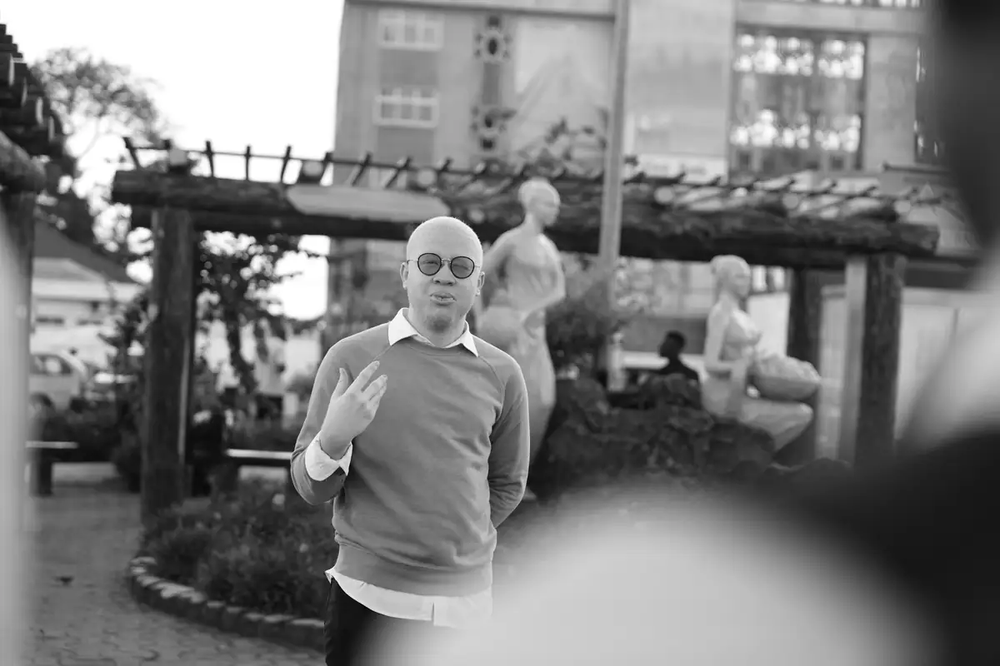

# Visite guidée de Douala (Akwa) puis atelier

<!-- wiki:infobox -->

| Visite guidée de Douala (Akwa) puis atelier | |
| --- | --- |
| Période | 16 octobre 2021 |
| Casquette | Exécution |
| Catégorie | Événement |
| Rôle | Couverture photo et vidéo |
| Folio | _pas encore sur le site_ |
| État de la fiche | À vérifier |
<!-- /wiki:infobox -->

**Visite guidée de Douala (Akwa) puis atelier** est un événement couvert en photo et en vidéo par Alexandre « Xtincell » Djengue (16 octobre 2021).

## Description

- **Lieu** : place à l'obélisque et statues, devant la boulangerie Acropole, Akwa, Douala
- **Organisateur ou client** : non identifié (visite patrimoine ou atelier photo)
- **Ce que montrent les images** : 16/10/2021 de 11 h 30 à 17 h : explications devant les monuments, tournage, lecture de textes sous une galerie, photo de groupe.
- **Identification** : enseignes « Acropole boulangerie-pâtisserie », « PfC cosmetics », « La perle noire » (Akwa)
- **Fiabilité** : lieu confirmé, organisateur inconnu

## Galerie

<!-- wiki:galerie -->

<!-- /wiki:galerie -->

## Archives

- `_À identifier\P — 2021-10-16 — Visite guidée d'Akwa (Douala) et atelier` (267 fichiers, disque P:)

## Sources

- Notes « Événements couverts » établies lors du rangement des disques (28/10/2026), à partir des images, des dates de prise de vue et des livrables

<!-- wiki:liens-entrants -->
<!-- /wiki:liens-entrants -->
