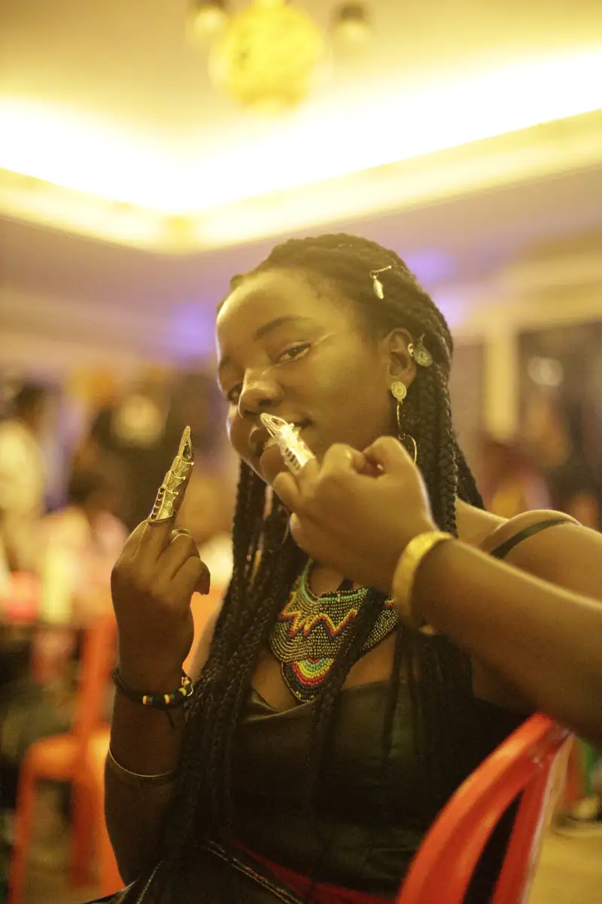
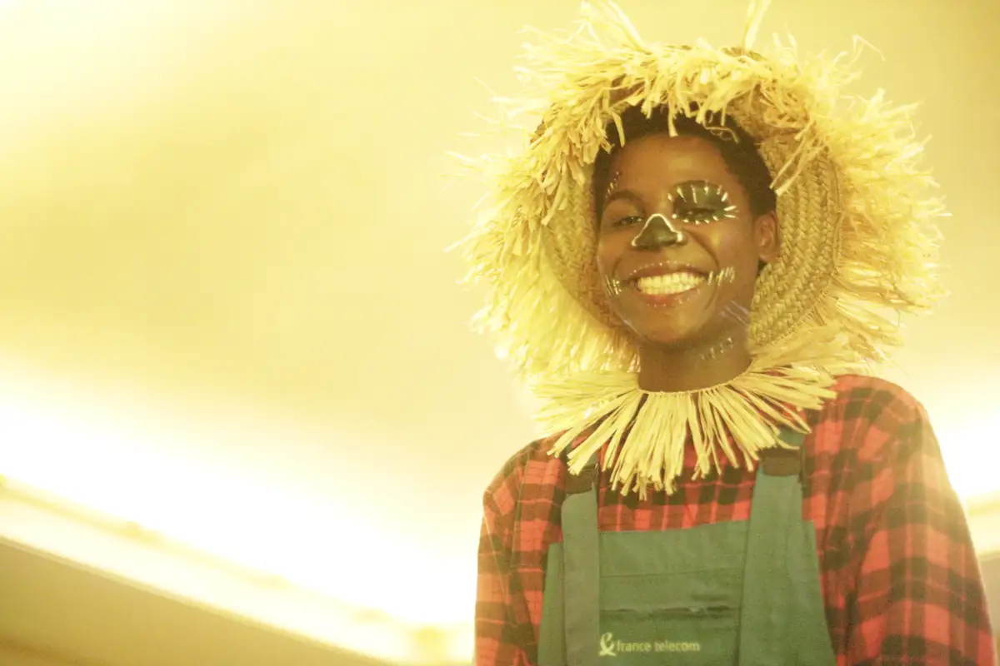
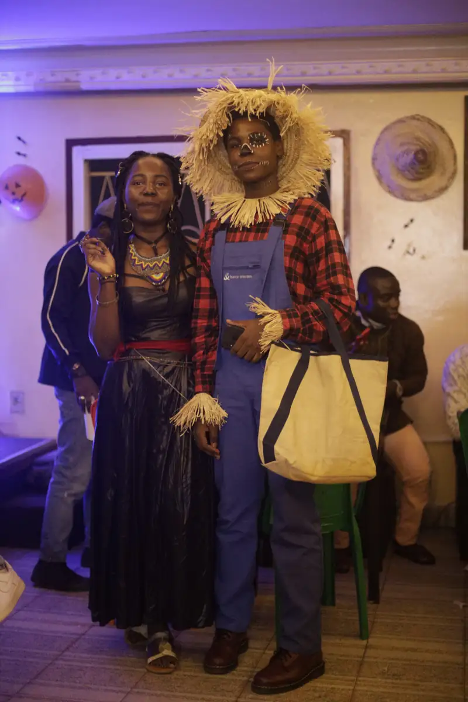
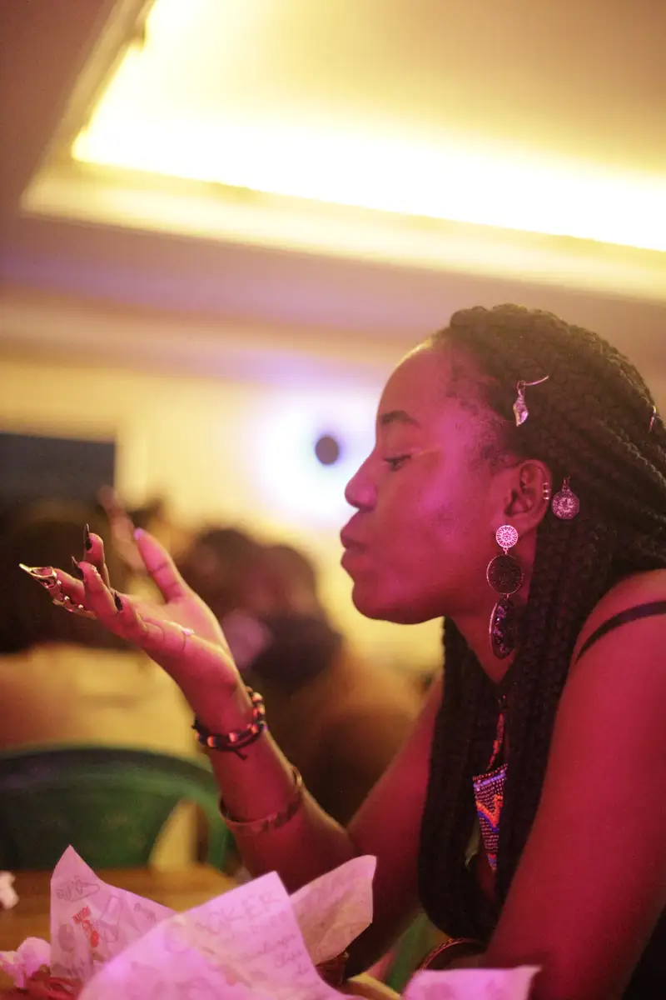
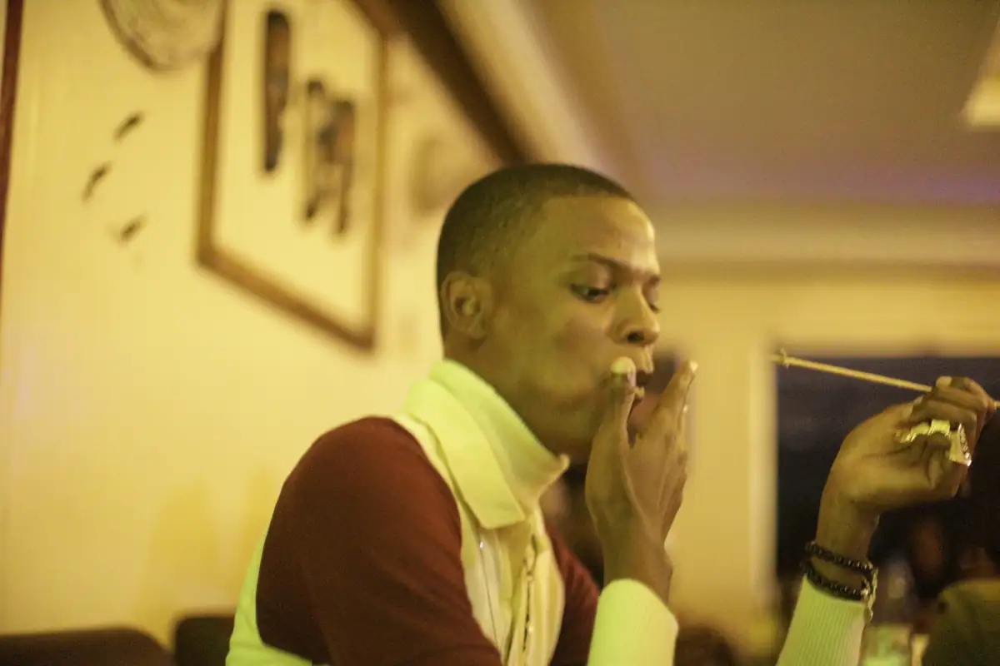
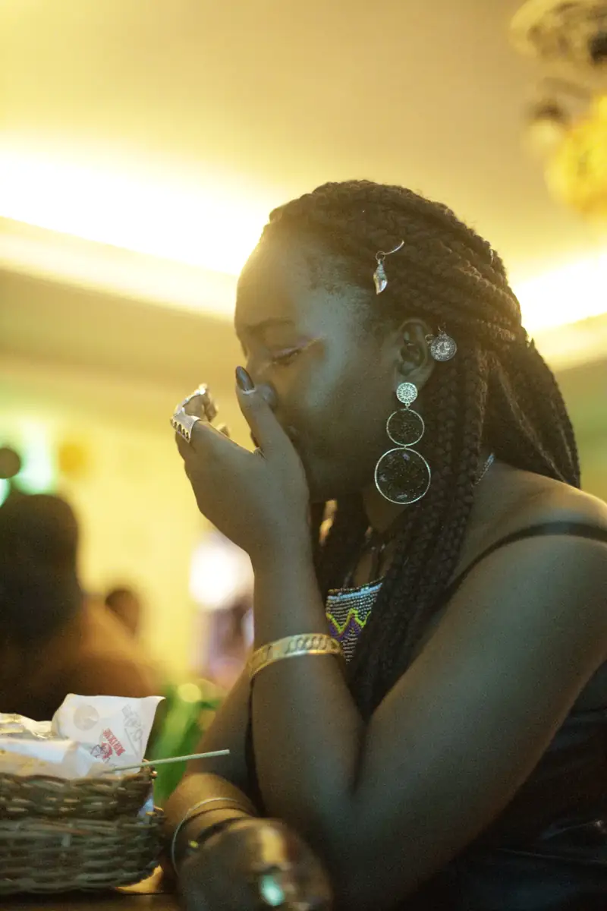

# Soirée d'Halloween dans un bar-studio

<!-- wiki:infobox -->

| Soirée d'Halloween dans un bar-studio | |
| --- | --- |
| Période | 30 octobre 2021 |
| Casquette | Exécution |
| Catégorie | Événement |
| Rôle | Couverture photo et vidéo |
| Folio | _pas encore sur le site_ |
| État de la fiche | À vérifier |
<!-- /wiki:infobox -->

**Soirée d'Halloween dans un bar-studio** est un événement couvert en photo et en vidéo par Alexandre « Xtincell » Djengue (30 octobre 2021).

## Description

- **Lieu** : bar-studio aux murs de vinyles (micro Rode, platines), probablement le même lieu que la session live du 30/07/2021
- **Organisateur ou client** : non identifié
- **Ce que montrent les images** : 30/10/2021 de 10 h à 21 h 30 : micro de studio, invités costumés, portraits sous lumières colorées, DJ devant les vinyles.
- **Identification** : décor d'Halloween (citrouilles, toiles d'araignée) ; aucun nom lisible
- **Fiabilité** : client inconnu

## Galerie

<!-- wiki:galerie -->

<!-- /wiki:galerie -->

## Archives

- `_À identifier\P — 2021-10-30 — Soirée au bar et studio` (281 fichiers, disque P:)

## Sources

- Notes « Événements couverts » établies lors du rangement des disques (28/10/2026), à partir des images, des dates de prise de vue et des livrables

<!-- wiki:liens-entrants -->
<!-- /wiki:liens-entrants -->
