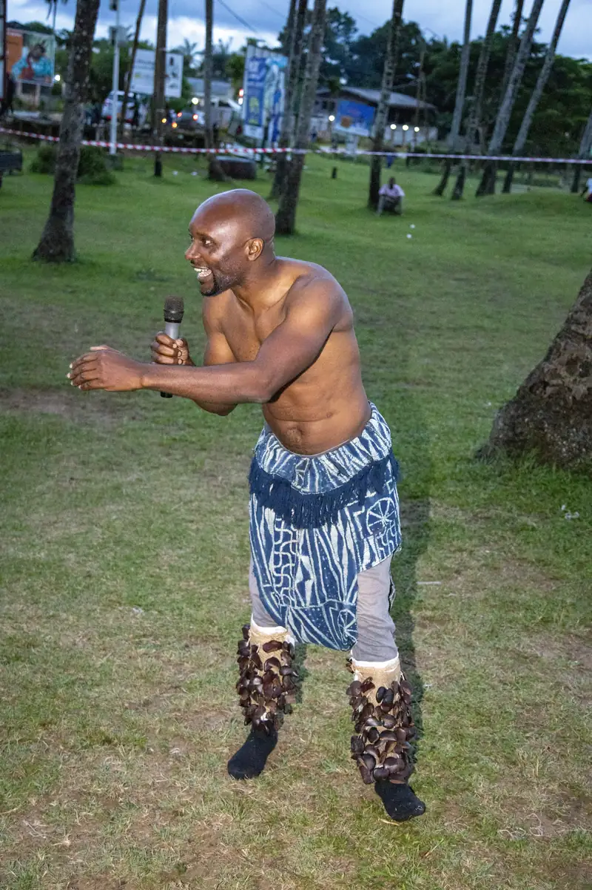
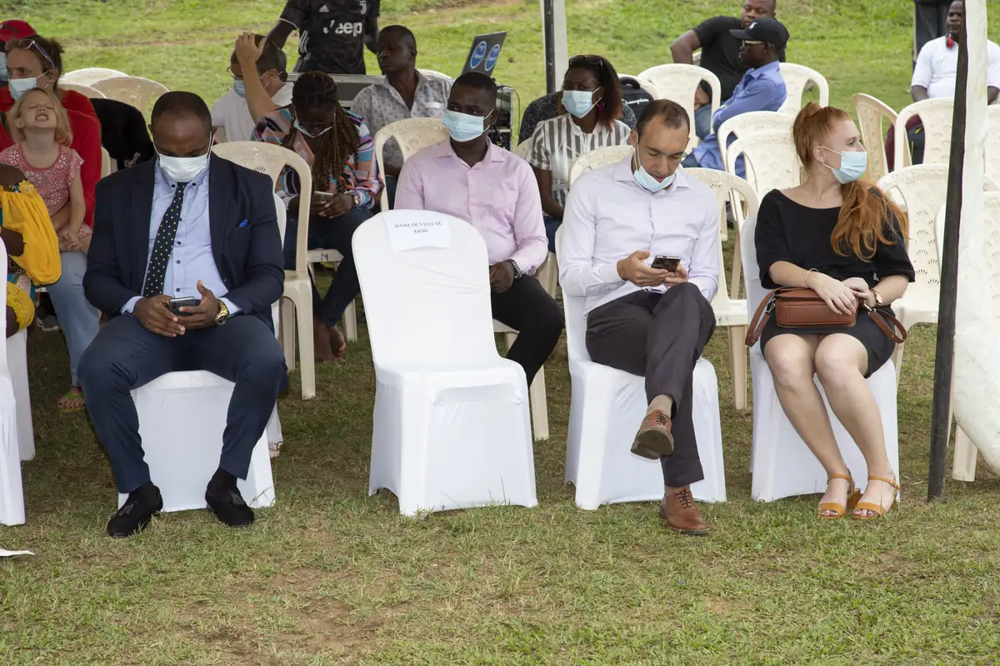
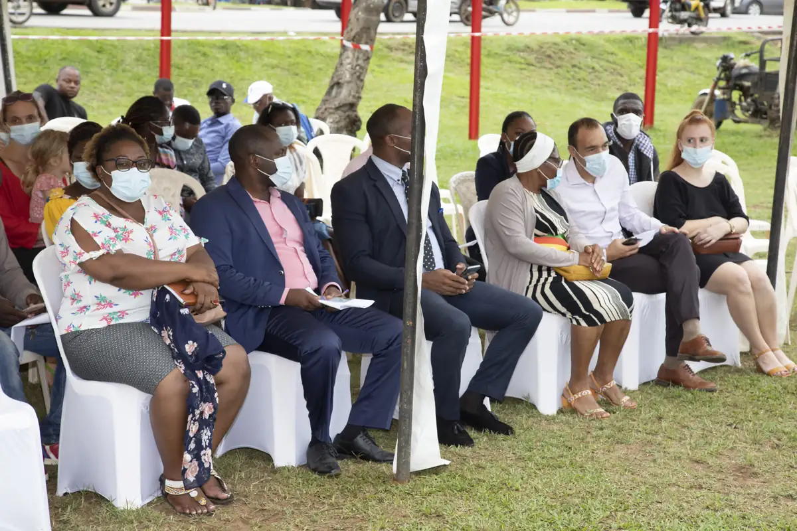
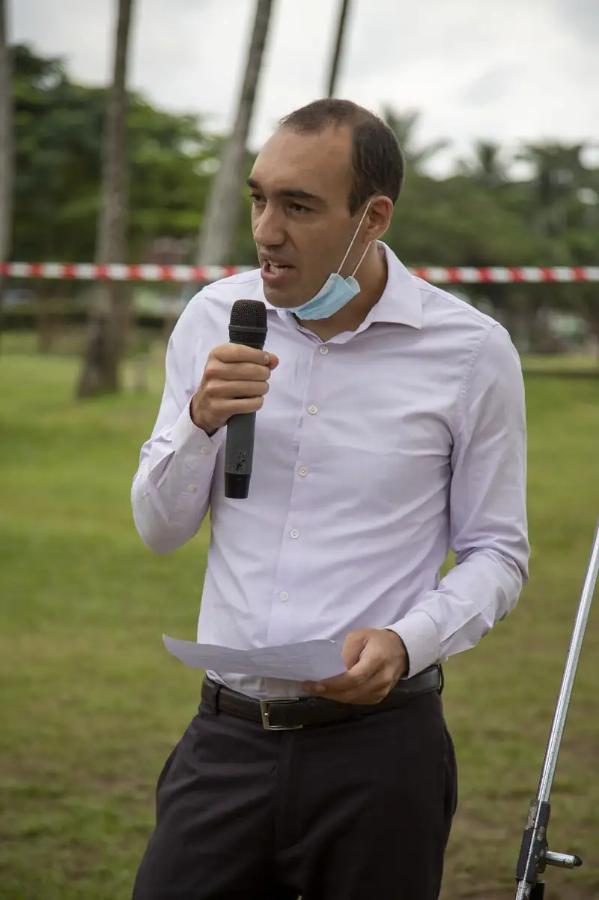

# Street Whale — premier jour (lancement en bord de mer)

<!-- wiki:infobox -->

| Street Whale — premier jour (lancement en bord de mer) | |
| --- | --- |
| Client | [AMMCO](../organisations/ammco.md) |
| Via | [UPgraders](../organisations/upgraders.md) |
| Période | 10-11 novembre 2021 |
| Casquette | Exécution |
| Catégorie | Événement |
| Rôle | Couverture photo et vidéo |
| Fait partie de | [Street Whale](street-whale.md) |
| Folio | _pas encore sur le site_ |
| État de la fiche | À vérifier |
<!-- /wiki:infobox -->

**Street Whale — premier jour (lancement en bord de mer)** est un événement couvert en photo et en vidéo par Alexandre « Xtincell » Djengue (10-11 novembre 2021).

## Description

- **Lieu** : pelouse en bord de mer sous les cocotiers, tentes
- **Organisateur ou client** : AMMCO (African Marine Mammal Conservation Organization)
- **Ce que montrent les images** : Accueil des officiels sous tente, discours, table de matériel (drone, ROV sous-marin), body painting à l'argile blanche sur des danseurs, photo de groupe.
- **Identification** : nom du dossier « 1er jour » ; tee-shirts AMMCO ; matériel de suivi marin
- **Fiabilité** : déduit

## Galerie

<!-- wiki:galerie -->

<!-- /wiki:galerie -->

## Archives

- `AMMCO\2021\1er jour` (101 fichiers, disque C:)

## Sources

- Notes « Événements couverts » établies lors du rangement des disques (28/10/2026), à partir des images, des dates de prise de vue et des livrables

<!-- wiki:liens-entrants -->
<!-- /wiki:liens-entrants -->
