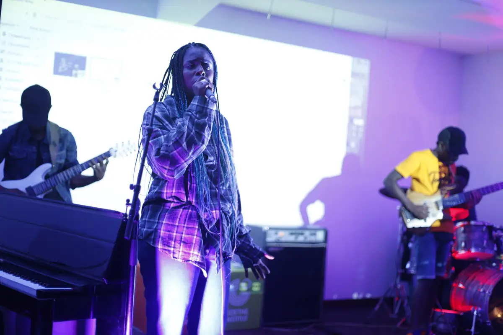
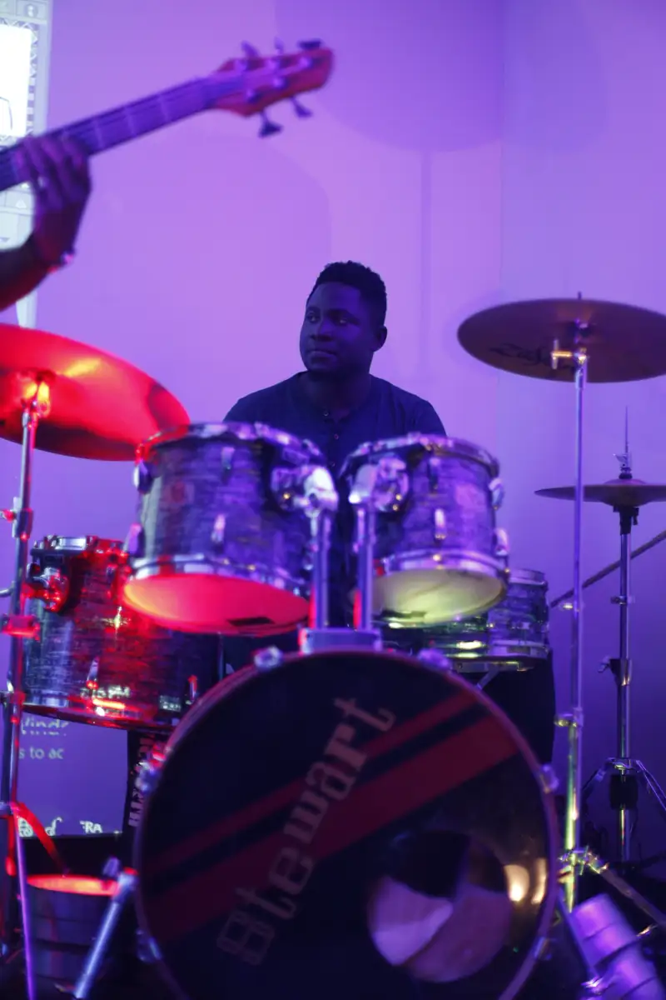
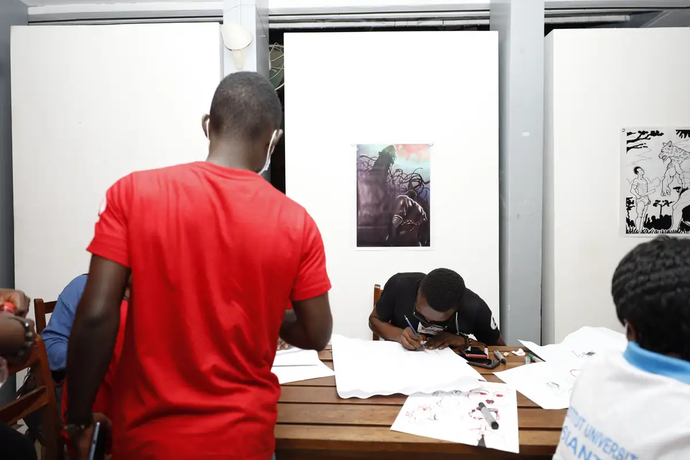
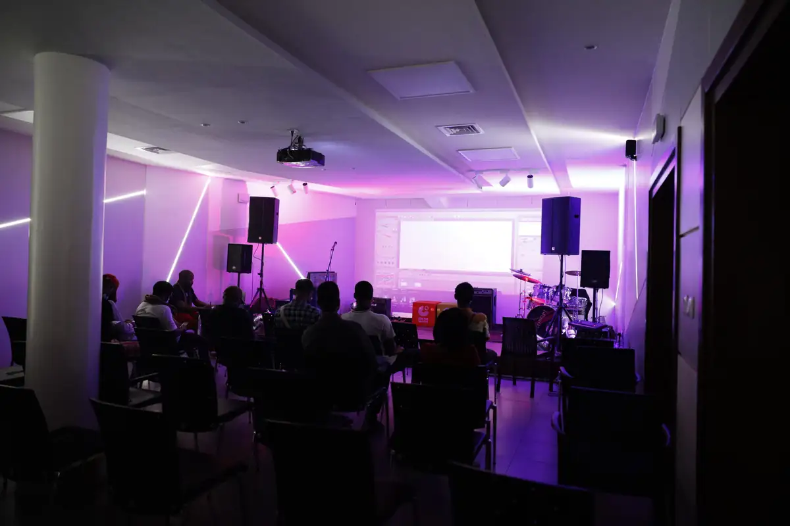
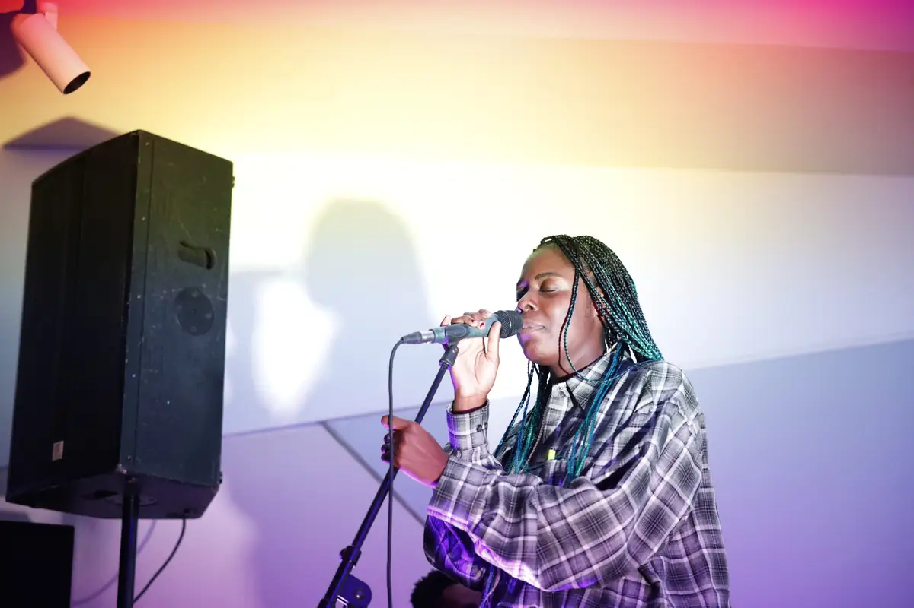
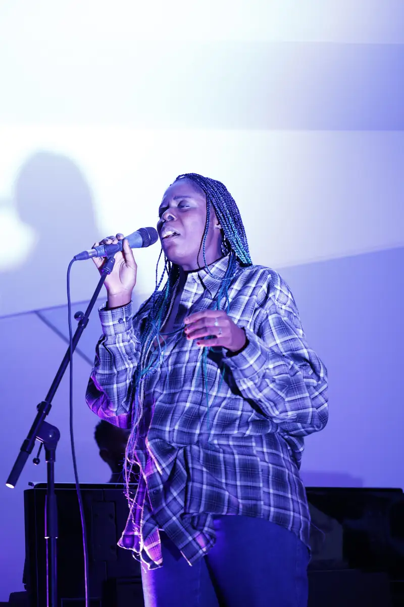

# Concert dessiné (festival Mboa BD 2021)

<!-- wiki:infobox -->

| Concert dessiné (festival Mboa BD 2021) | |
| --- | --- |
| Client | [Mboa BD](../organisations/mboa-bd.md) |
| Via | [UPgraders](../organisations/upgraders.md) |
| Période | 18 novembre 2021 |
| Casquette | Exécution |
| Catégorie | Événement |
| Rôle | Couverture photo et vidéo |
| Fait partie de | [Mboa BD — travaux](mboa-bd-travaux.md) |
| Folio | _pas encore sur le site_ |
| État de la fiche | À vérifier |
<!-- /wiki:infobox -->

**Concert dessiné (festival Mboa BD 2021)** est un événement couvert en photo et en vidéo par Alexandre « Xtincell » Djengue (18 novembre 2021).

## Description

- **Lieu** : salle d'exposition et de concert (institut culturel, drapeau européen visible)
- **Organisateur ou client** : festival Mboa BD (déduit)
- **Ce que montrent les images** : Table de dédicace Blacktrek, puis concert avec un dessin réalisé en direct et projeté derrière le groupe.
- **Identification** : table « Blacktrek » ; dessin live projeté ; 18/11/2021 tombe dans les dates du festival Mboa BD 2021 (17-27/11, Yaoundé puis Douala)
- **Fiabilité** : déduit

## Galerie

<!-- wiki:galerie -->

<!-- /wiki:galerie -->

## Archives

- `Mboa BD\2021\Concert dessiné (18-11-2021) (déduit)` (190 fichiers, disque P:)

## Sources

- Notes « Événements couverts » établies lors du rangement des disques (28/10/2026), à partir des images, des dates de prise de vue et des livrables

<!-- wiki:liens-entrants -->
<!-- /wiki:liens-entrants -->
