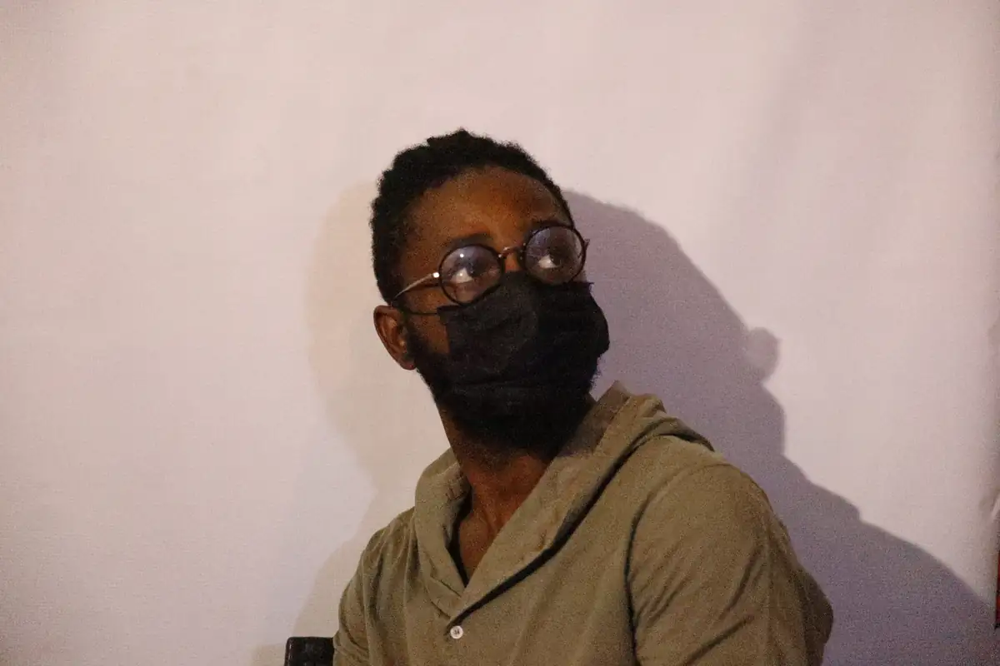
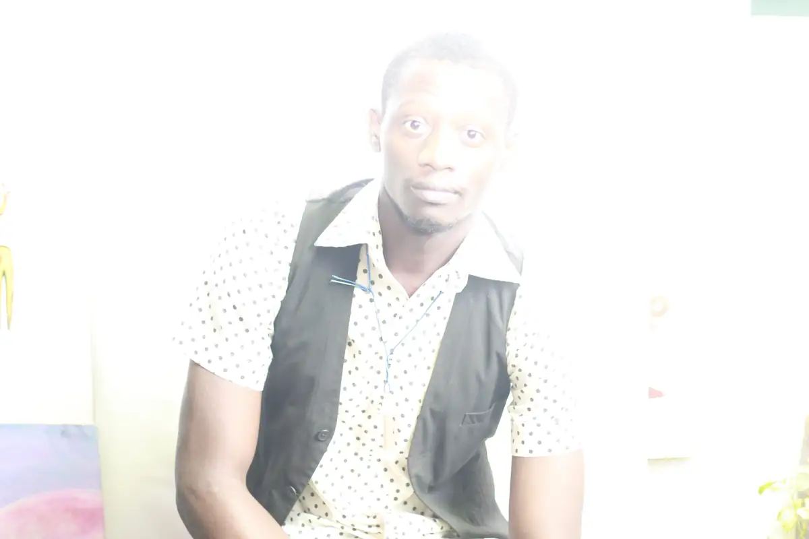
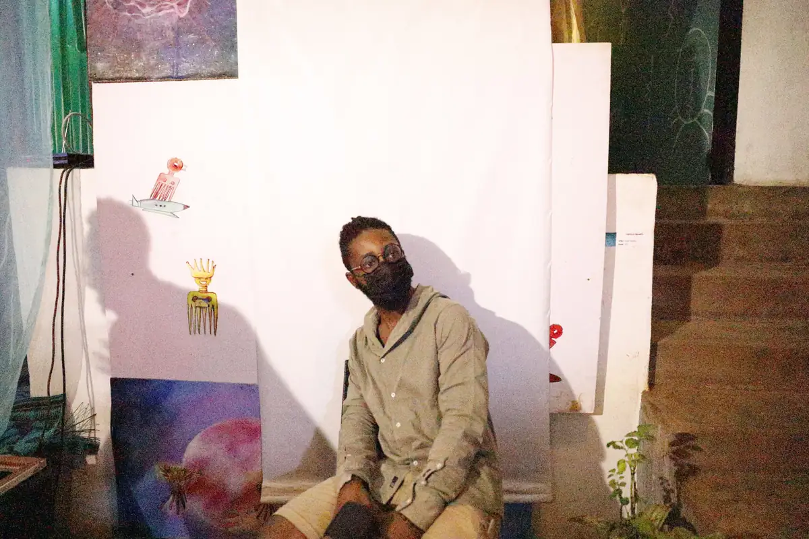
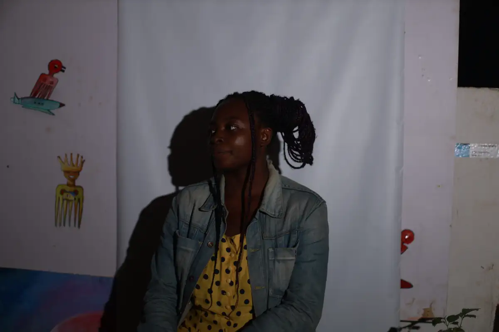
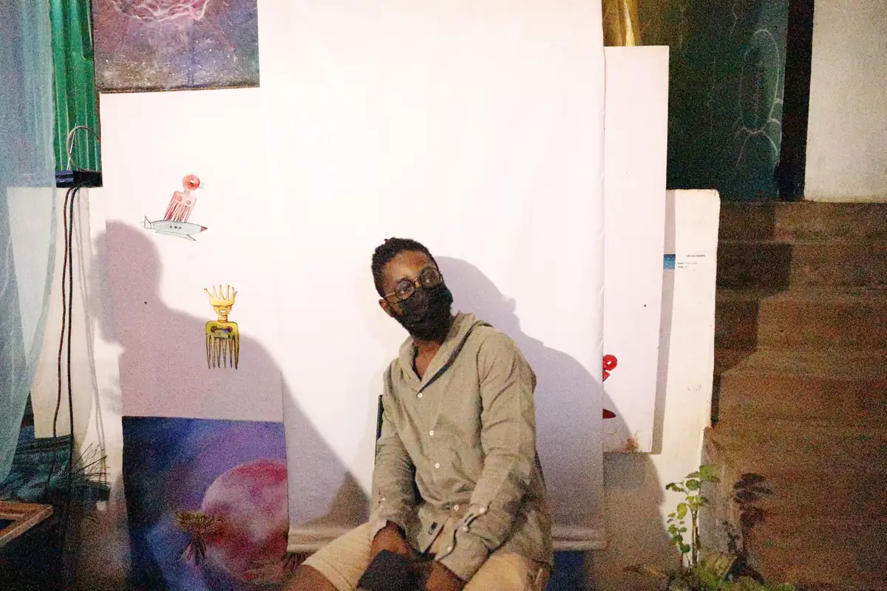
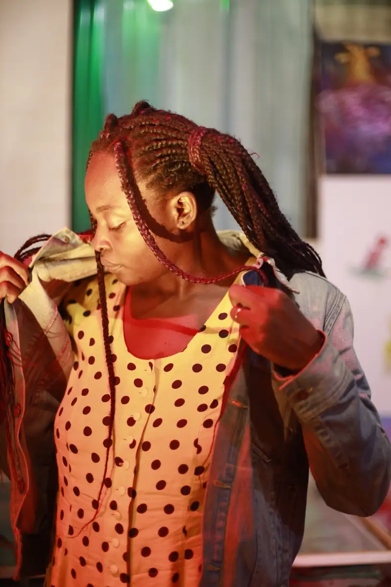

# Exposition — portraits d'artistes et de visiteurs devant les œuvres

<!-- wiki:infobox -->

| Exposition — portraits d'artistes et de visiteurs devant les œuvres | |
| --- | --- |
| Période | 19 novembre 2021 |
| Casquette | Exécution |
| Catégorie | Événement |
| Rôle | Couverture photo et vidéo |
| Folio | _pas encore sur le site_ |
| État de la fiche | À vérifier |
<!-- /wiki:infobox -->

**Exposition — portraits d'artistes et de visiteurs devant les œuvres** est un événement couvert en photo et en vidéo par Alexandre « Xtincell » Djengue (19 novembre 2021).

## Description

- **Lieu** : espace d'art aux murs bruts (dessins encadrés, sculptures de peignes afro)
- **Organisateur ou client** : non identifié (participants avec cordons de badge)
- **Ce que montrent les images** : 19/11/2021 de 18 h à 22 h : portraits posés devant les œuvres et sur fond blanc décoré de peignes afro.
- **Identification** : cordons de badge ; date comprise dans le festival Mboa BD 2021 (lien non établi)
- **Fiabilité** : client inconnu

## Galerie

<!-- wiki:galerie -->

<!-- /wiki:galerie -->

## Archives

- `_À identifier\P — 2021-11-19 — Exposition (portraits devant les œuvres)` (515 fichiers, disque P:)

## Sources

- Notes « Événements couverts » établies lors du rangement des disques (28/10/2026), à partir des images, des dates de prise de vue et des livrables

<!-- wiki:liens-entrants -->
<!-- /wiki:liens-entrants -->
