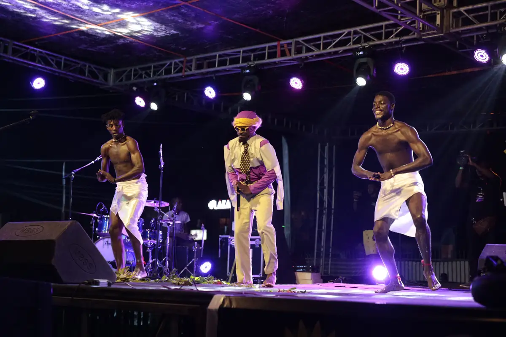
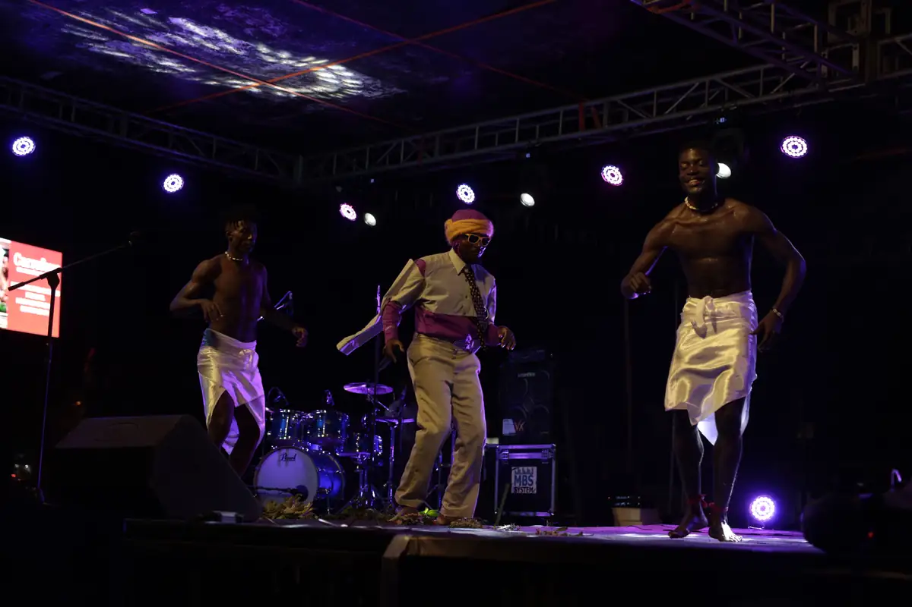
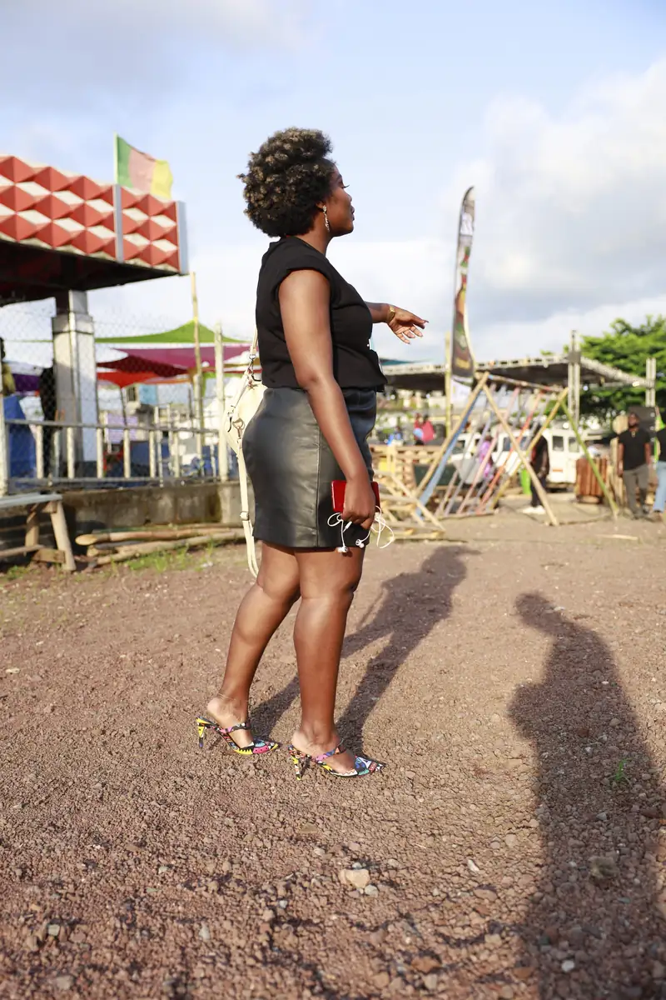
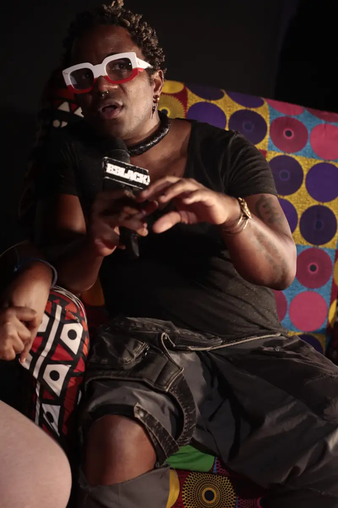
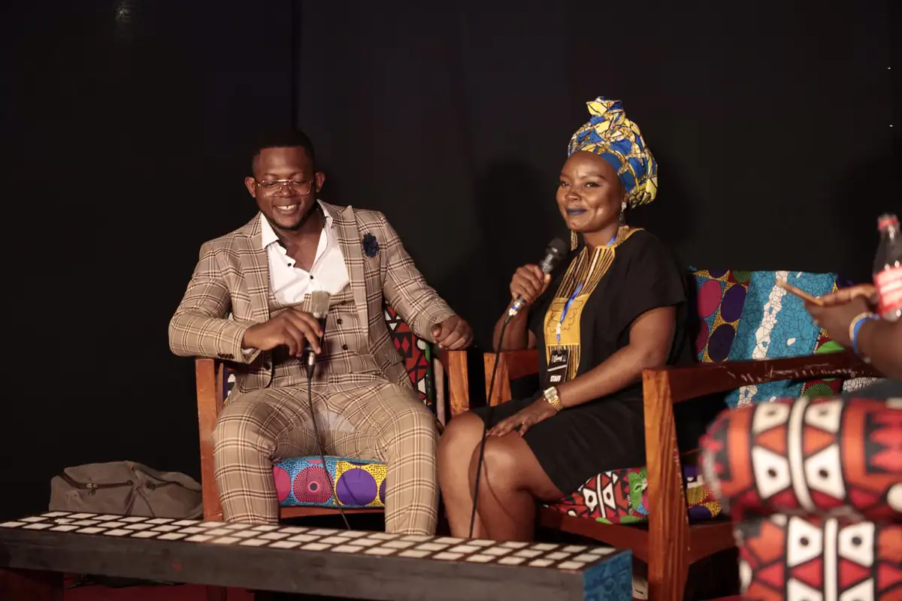
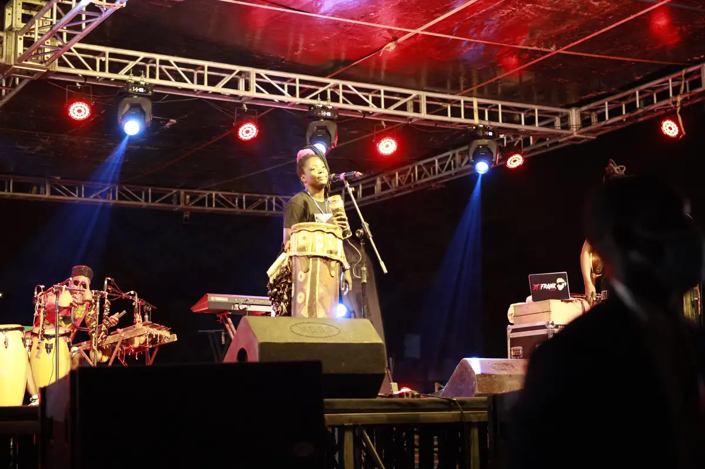

# Festival urbain présenté par KACOD Urban 237

<!-- wiki:infobox -->

| Festival urbain présenté par KACOD Urban 237 | |
| --- | --- |
| Client | [KACOD Urban 237](../organisations/kacod-urban-237.md) |
| Via | [UPgraders](../organisations/upgraders.md) |
| Période | 25-26 novembre 2021 |
| Casquette | Exécution |
| Catégorie | Événement |
| Rôle | Couverture photo et vidéo |
| Fait partie de | [KACOD Urban 237 — travaux](kacod-urban-237-travaux.md) |
| Folio | _pas encore sur le site_ |
| État de la fiche | À vérifier |
<!-- /wiki:infobox -->

**Festival urbain présenté par KACOD Urban 237** est un événement couvert en photo et en vidéo par Alexandre « Xtincell » Djengue (25-26 novembre 2021).

## Description

- **Lieu** : scène extérieure (site à palissades), Douala
- **Organisateur ou client** : KACOD Urban 237 (association, Bonanjo)
- **Ce que montrent les images** : Après-midi et soirée en plein air : scène avec batteur et chanteurs, interviews sur un plateau en tissu wax, danseurs, public ; tee-shirts au logo boombox-tournesol (graffiti, rap, street wear, design).
- **Identification** : roll-ups « kacod urban 237 présente » et « KACOD — association camerounaise de chanteurs… »
- **Fiabilité** : déduit

## Galerie

<!-- wiki:galerie -->

<!-- /wiki:galerie -->

## Archives

- `KACOD Urban 237\2021\Festival (25-26-11-2021) (déduit)` (1 461 fichiers, disque P:)

## Sources

- Notes « Événements couverts » établies lors du rangement des disques (28/10/2026), à partir des images, des dates de prise de vue et des livrables

<!-- wiki:liens-entrants -->
<!-- /wiki:liens-entrants -->
