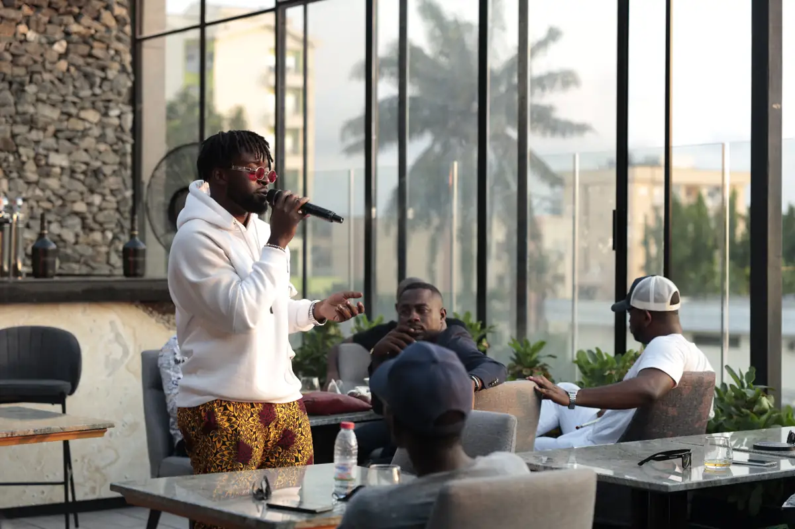
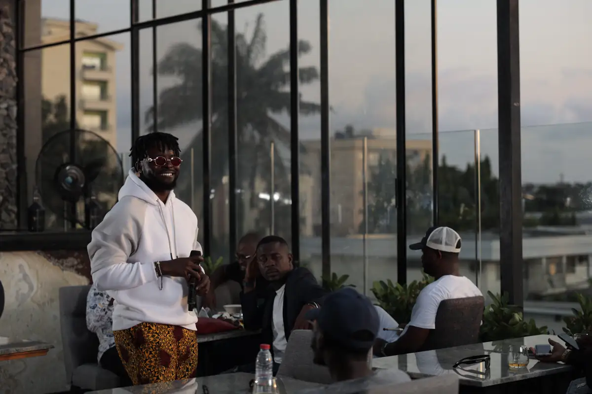
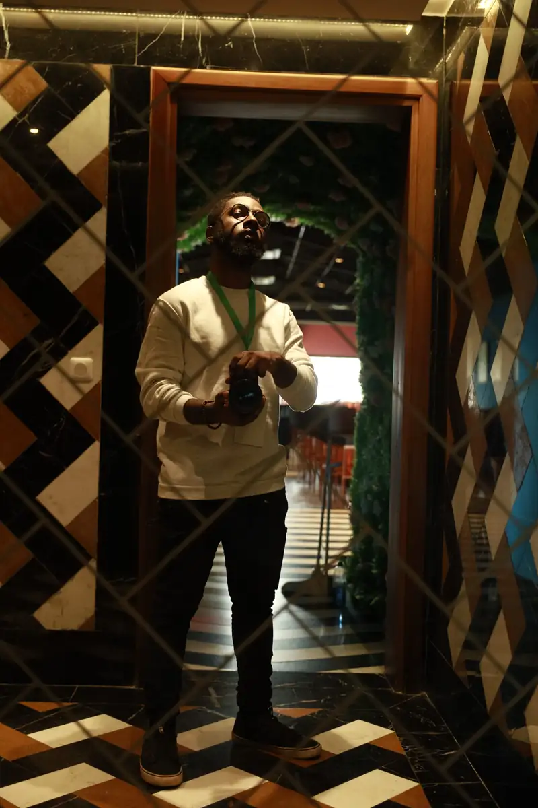
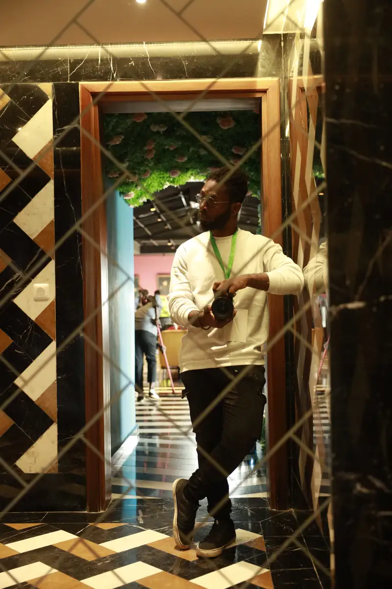
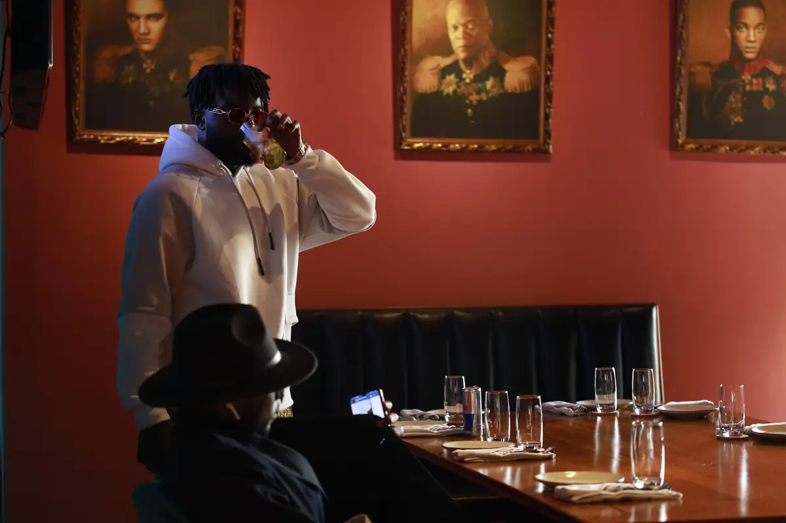
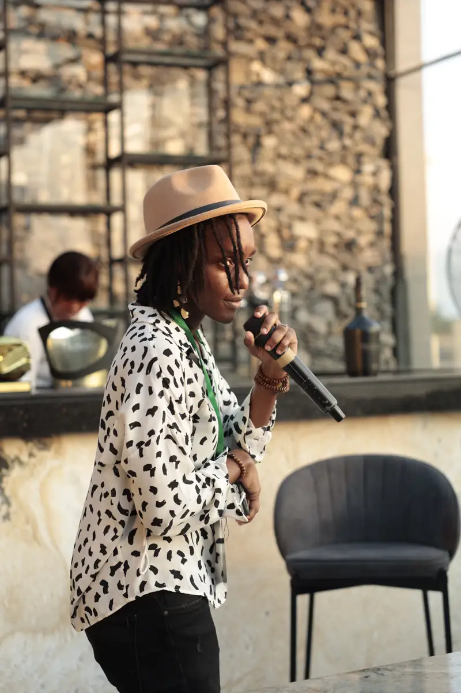

# Locko — session d'écoute de l'album « Era » sur un rooftop

<!-- wiki:infobox -->

| Locko — session d'écoute de l'album « Era » sur un rooftop | |
| --- | --- |
| Client | [Universal Music Africa](../organisations/universal-music-africa.md) |
| Via | [UPgraders](../organisations/upgraders.md) |
| Période | 26 novembre 2021 |
| Casquette | Exécution |
| Catégorie | Événement |
| Rôle | Couverture photo et vidéo |
| Fait partie de | [Universal Music Africa — image d’artistes](uma-artistes.md) |
| Folio | _pas encore sur le site_ |
| État de la fiche | Standard |
<!-- /wiki:infobox -->

**Locko — session d'écoute de l'album « Era » sur un rooftop** est un événement couvert en photo et en vidéo par Alexandre « Xtincell » Djengue (26 novembre 2021).

## Description

- **Lieu** : rooftop-restaurant (mur de pierre, vue sur la ville)
- **Organisateur ou client** : Locko / Universal Music Africa
- **Ce que montrent les images** : De 16 h 20 à 19 h 08 : Locko présente l'album au coucher du soleil, affiche « Era » encadrée, échanges avec les invités.
- **Identification** : affiche de l'album « Era » ; découpé à l'heure EXIF du festival KACOD qui suit le même soir
- **Fiabilité** : confirmé

## Galerie

<!-- wiki:galerie -->

<!-- /wiki:galerie -->

## Archives

- `LOCKO\2021\Session d'écoute « Era » sur un rooftop (26-11-2021)` (922 fichiers, disque P:)

## Sources

- Notes « Événements couverts » établies lors du rangement des disques (28/10/2026), à partir des images, des dates de prise de vue et des livrables

<!-- wiki:liens-entrants -->
<!-- /wiki:liens-entrants -->
