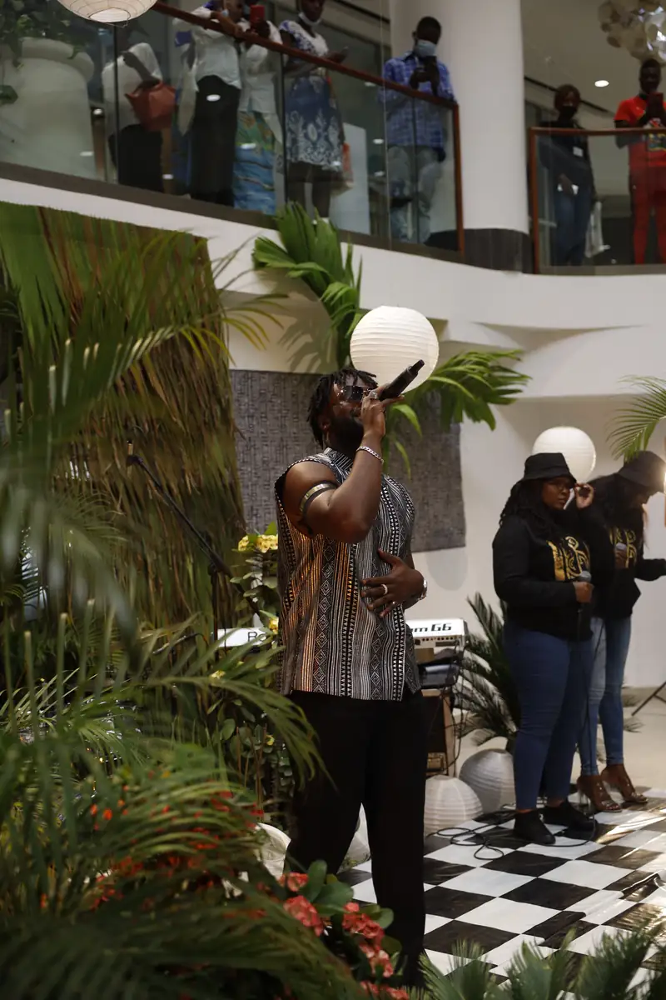
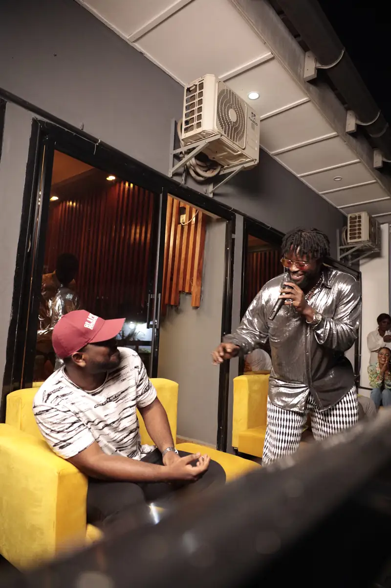
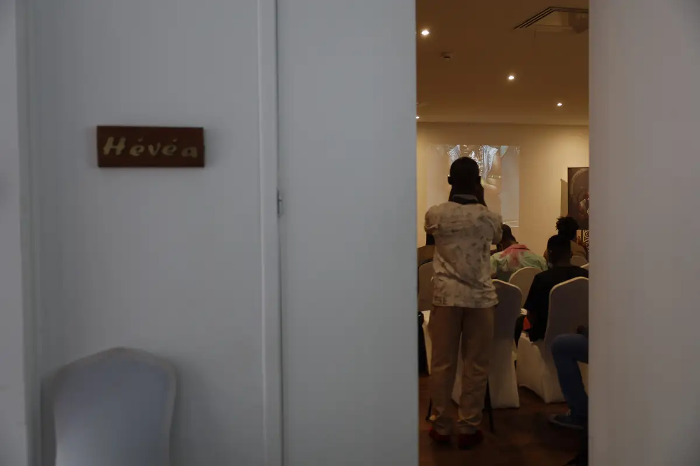
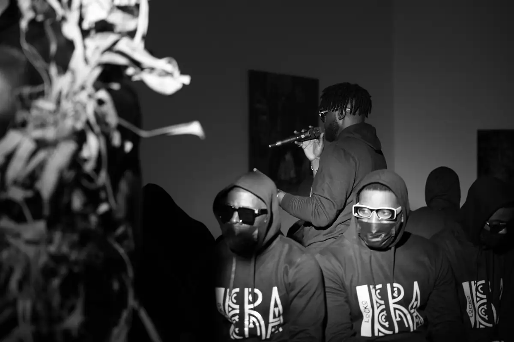
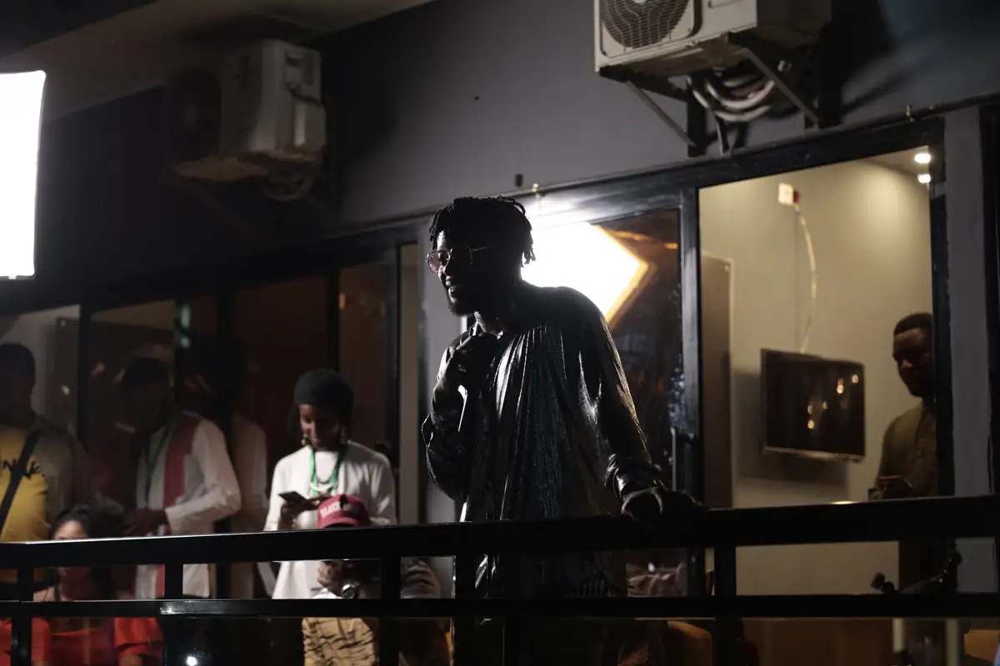
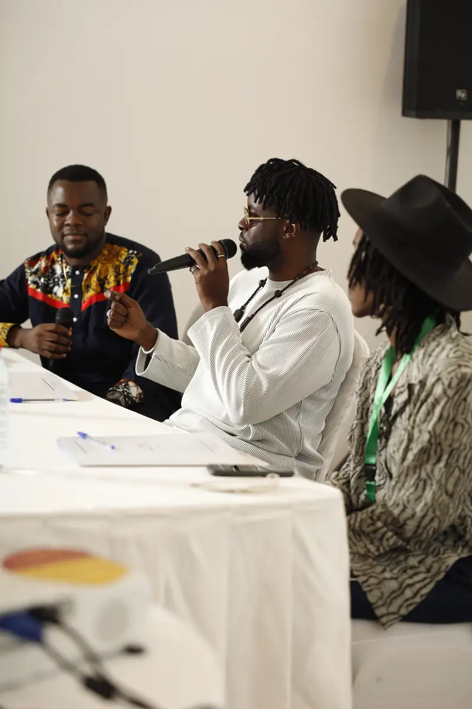

# Locko — promotion de l'album « Era »

<!-- wiki:infobox -->

| Locko — promotion de l'album « Era » | |
| --- | --- |
| Client | [Universal Music Africa](../organisations/universal-music-africa.md) |
| Via | [UPgraders](../organisations/upgraders.md) |
| Période | 5-13 décembre 2021 |
| Casquette | Exécution |
| Catégorie | Événement |
| Rôle | Couverture photo et vidéo |
| Fait partie de | [Universal Music Africa — image d’artistes](uma-artistes.md) |
| Folio | _pas encore sur le site_ |
| État de la fiche | Standard |
<!-- /wiki:infobox -->

**Locko — promotion de l'album « Era »** est un événement couvert en photo et en vidéo par Alexandre « Xtincell » Djengue (5-13 décembre 2021).

## Description

- **Lieu** : centre commercial (05/12), lounge (12/12), salle de conférence d'hôtel (13/12)
- **Organisateur ou client** : Locko / Universal Music Africa
- **Ce que montrent les images** : 05/12 : showcase acoustique dans un centre commercial, fans et escalators ; 12/12 : soirée d'écoute, Locko en chemise argentée ; 13/12 : conférence de presse et ateliers.
- **Identification** : roll-up « LOCKO — ERA — Nouvel album le 17 décembre » ; sweats « ERA » ; « Era » sorti le 17/12/2021 chez Universal Music Africa (presse, Qobuz)
- **Fiabilité** : confirmé

## Galerie

<!-- wiki:galerie -->

<!-- /wiki:galerie -->

## Archives

- `LOCKO\2021\Promo de l'album « Era » (05, 12 et 13-12-2021)` (2 657 fichiers, disque P:)

## Sources

- Notes « Événements couverts » établies lors du rangement des disques (28/10/2026), à partir des images, des dates de prise de vue et des livrables

<!-- wiki:liens-entrants -->
<!-- /wiki:liens-entrants -->
