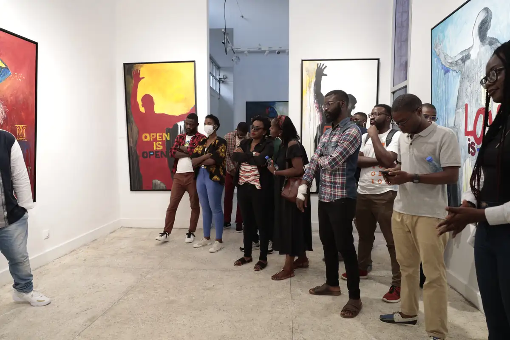
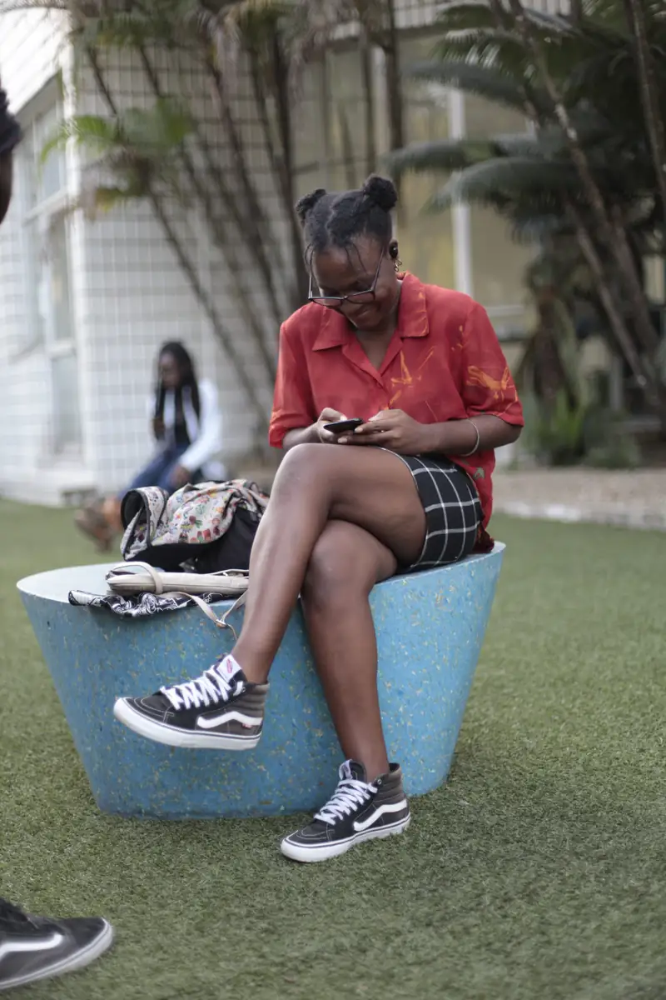
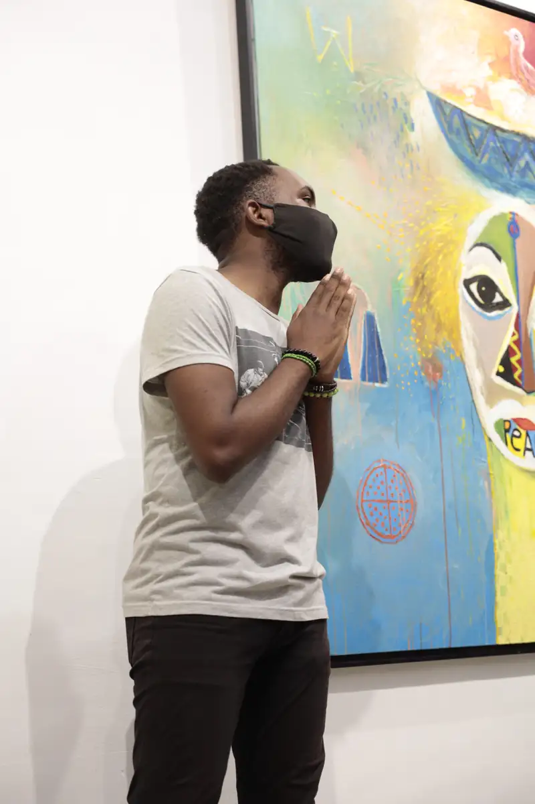
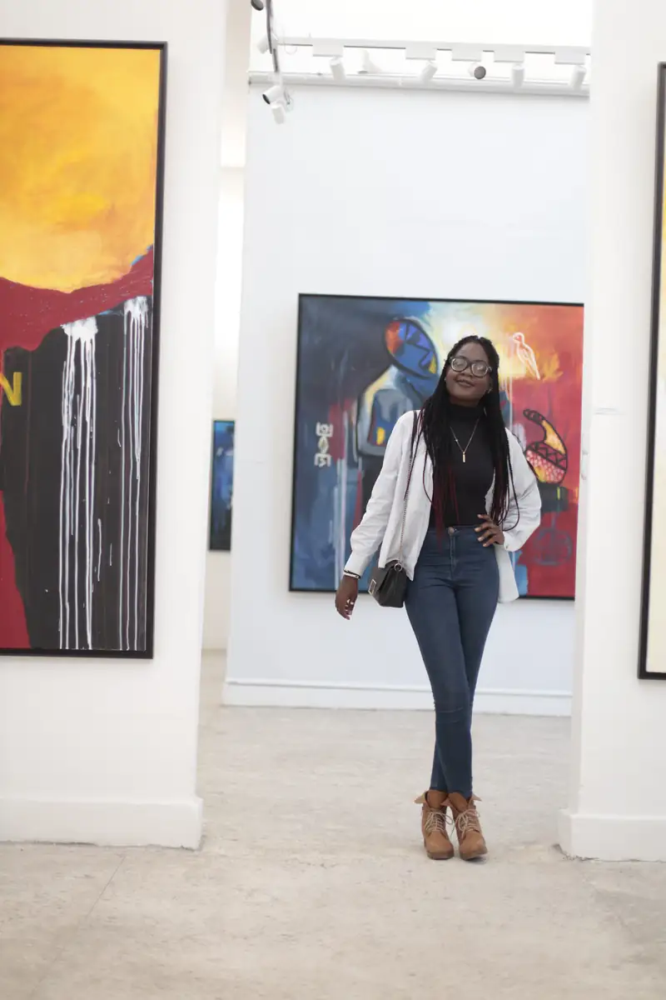
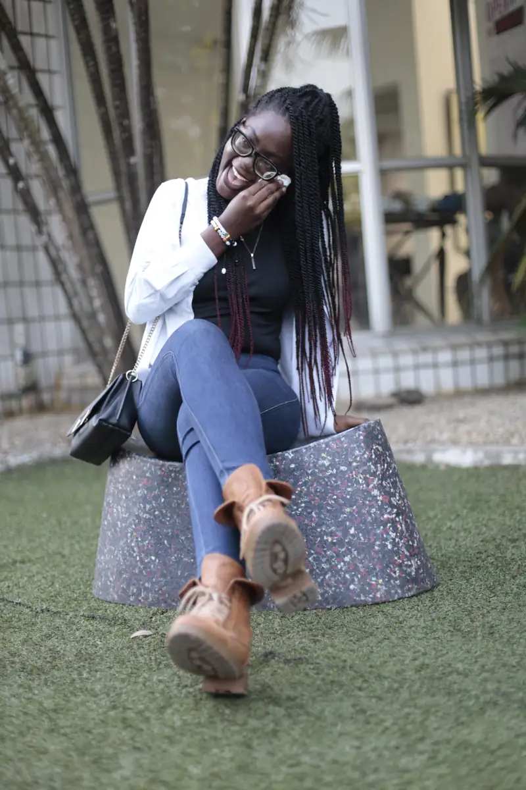
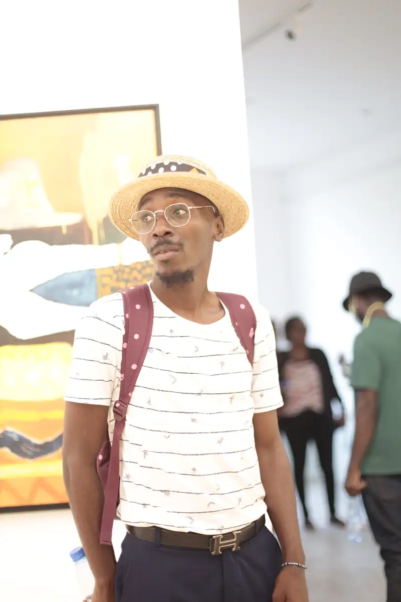

# Vernissage d'une exposition de peinture (« Open is open »)

<!-- wiki:infobox -->

| Vernissage d'une exposition de peinture (« Open is open ») | |
| --- | --- |
| Période | 10 décembre 2021 |
| Casquette | Exécution |
| Catégorie | Événement |
| Rôle | Couverture photo et vidéo |
| Folio | _pas encore sur le site_ |
| État de la fiche | À vérifier |
<!-- /wiki:infobox -->

**Vernissage d'une exposition de peinture (« Open is open »)** est un événement couvert en photo et en vidéo par Alexandre « Xtincell » Djengue (10 décembre 2021).

## Description

- **Lieu** : galerie aux murs blancs avec jardin et gazon, Douala probable
- **Organisateur ou client** : non identifié (galerie)
- **Ce que montrent les images** : 10/12/2021 de 17 h à 18 h 15 : visiteurs posant devant de grandes toiles colorées (portraits cubistes, fond jaune), discussions, photo de groupe dans la salle, affiche « Open is open ».
- **Identification** : affiche « Open is open » ; aucune enseigne de galerie lisible ; le matin, la même carte contenait les photos stock Mambo de Chococam (rangées chez Chococam)
- **Fiabilité** : client inconnu

## Galerie

<!-- wiki:galerie -->

<!-- /wiki:galerie -->

## Archives

- `_À identifier\P — 2021-12-10 — Vernissage d'une exposition de peinture (« Open is open »)` (582 fichiers, disque P:)

## Sources

- Notes « Événements couverts » établies lors du rangement des disques (28/10/2026), à partir des images, des dates de prise de vue et des livrables

<!-- wiki:liens-entrants -->
<!-- /wiki:liens-entrants -->
