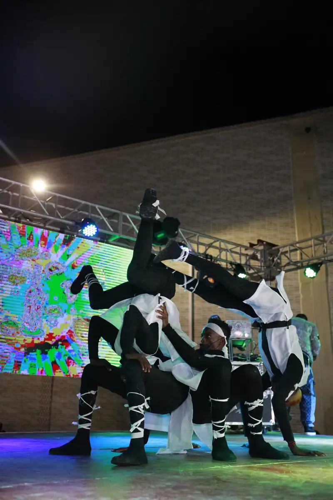
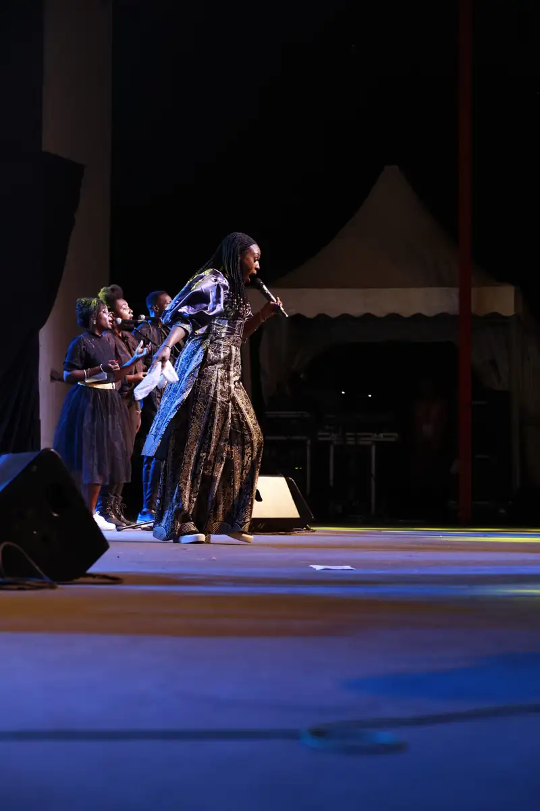
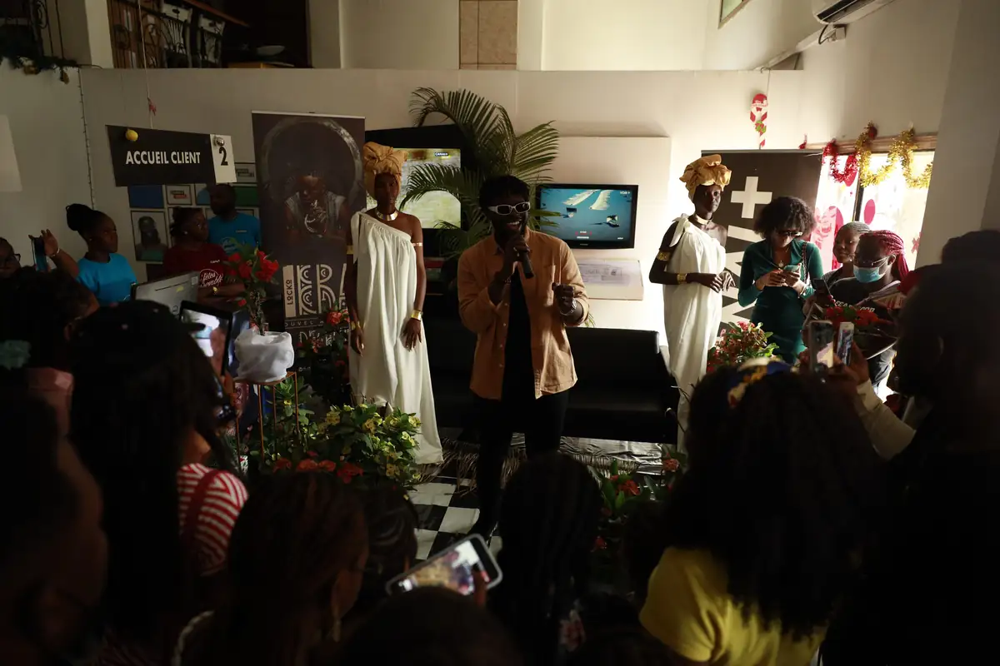
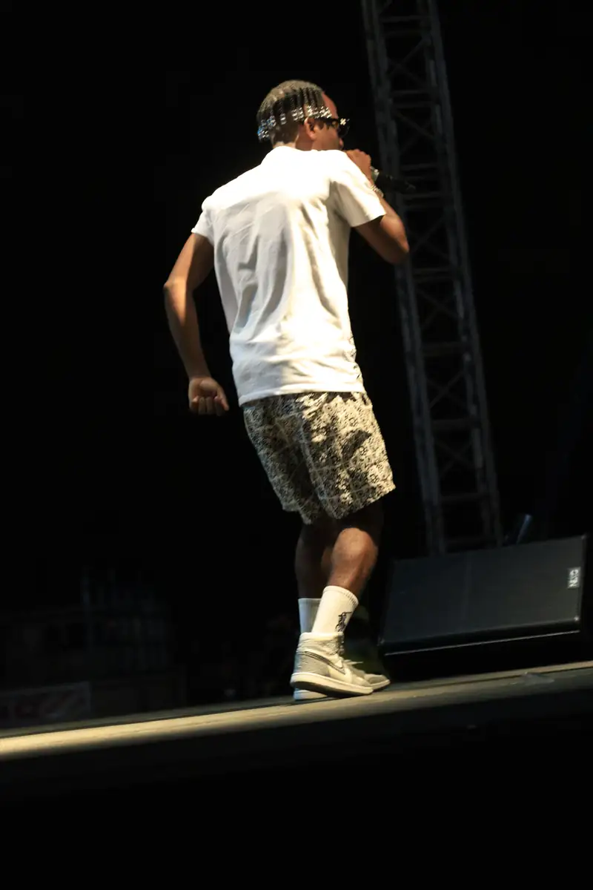
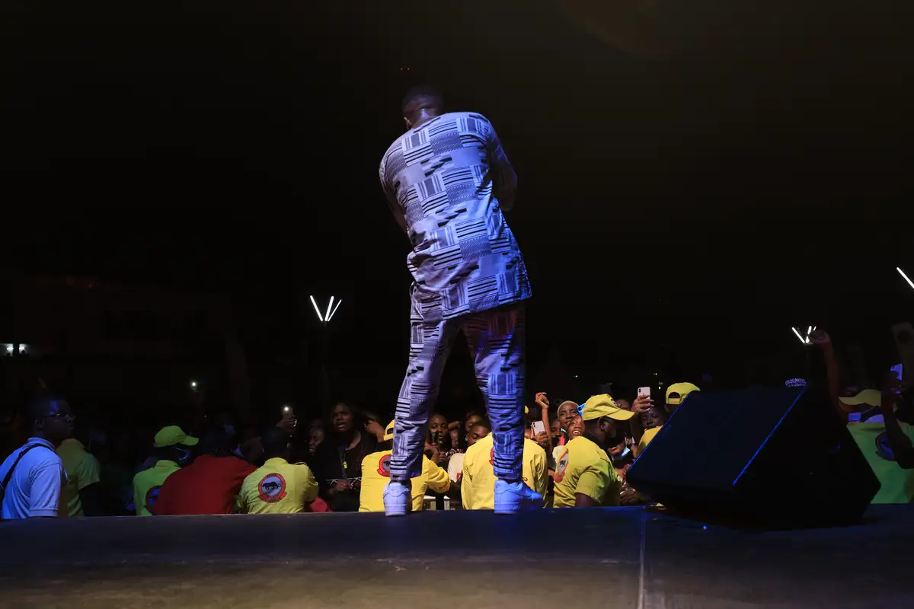
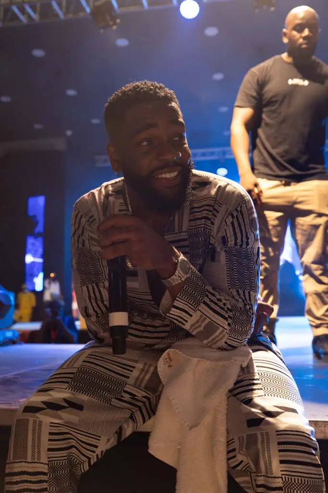

# CanalOlympia — programmation de fin d'année 2021

<!-- wiki:infobox -->

| CanalOlympia — programmation de fin d'année 2021 | |
| --- | --- |
| Client | [CanalOlympia (Canal+)](../organisations/canalolympia-canal.md) |
| Via | [UPgraders](../organisations/upgraders.md) |
| Période | 22 décembre 2021 → 2 janvier 2022 |
| Casquette | Exécution |
| Catégorie | Événement |
| Rôle | Couverture photo et vidéo |
| Fait partie de | [CanalOlympia (Canal+) — travaux](canalolympia-canal-travaux.md) |
| Folio | _pas encore sur le site_ |
| État de la fiche | À vérifier |
<!-- /wiki:infobox -->

**CanalOlympia — programmation de fin d'année 2021** est un événement couvert en photo et en vidéo par Alexandre « Xtincell » Djengue (22 décembre 2021 → 2 janvier 2022).

## Description

- **Lieu** : CanalOlympia (scène extérieure et salle aux sièges rouges)
- **Organisateur ou client** : CanalOlympia (Canal+)
- **Ce que montrent les images** : 22/12/2021 : « Challenge vacances » et arbre de Noël ; 25/12 : concert gospel de Dena Mwana ; 27/12 : décor de paille ; 02/01/2022 : concert du Nouvel An avec danseuses.
- **Identification** : écran « Challenge vacances » ; enseigne CanalOlympia ; même concert de Noël que le dossier Dena Mwana de C:
- **Fiabilité** : déduit

## Galerie

<!-- wiki:galerie -->

<!-- /wiki:galerie -->

## Archives

- `CanalOlympia (Canal+)\2021\Fin d'année 2021 (22-12 → 02-01) (déduit)` (7 161 fichiers, disque P:)

## Sources

- Notes « Événements couverts » établies lors du rangement des disques (28/10/2026), à partir des images, des dates de prise de vue et des livrables

<!-- wiki:liens-entrants -->
<!-- /wiki:liens-entrants -->
