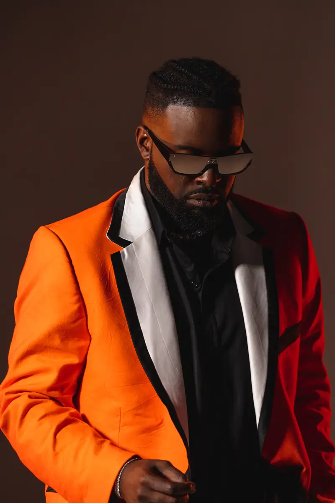
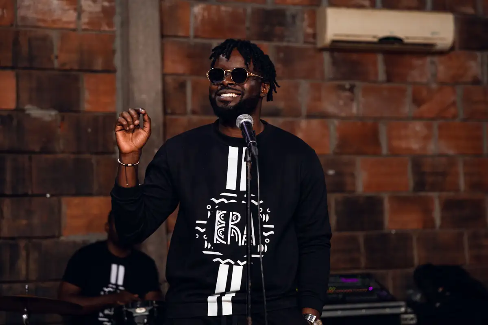
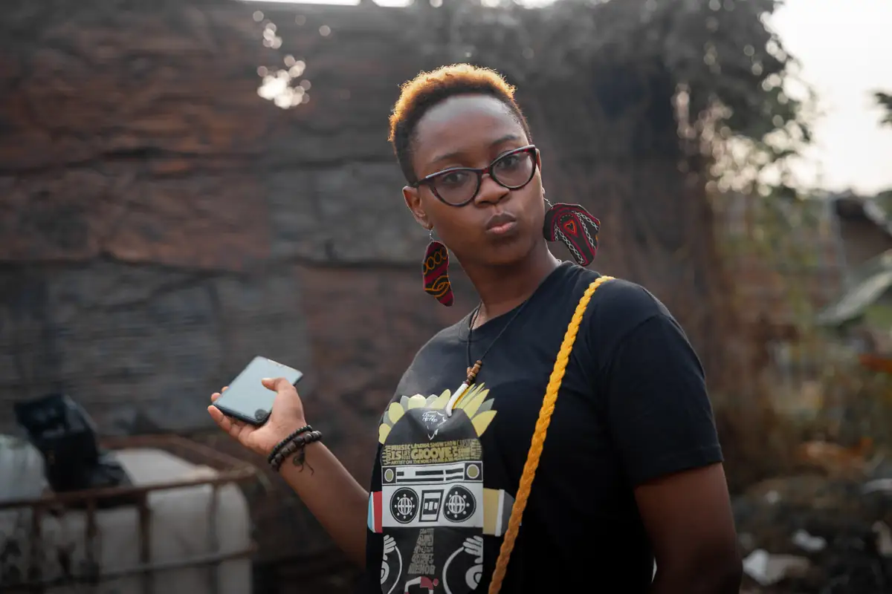
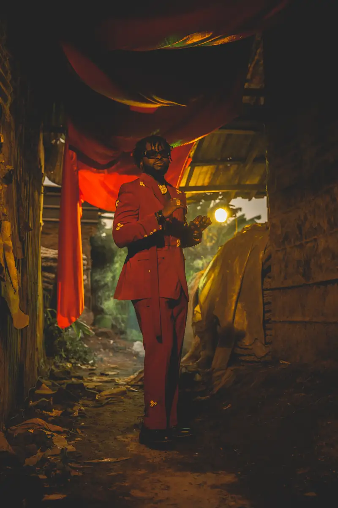
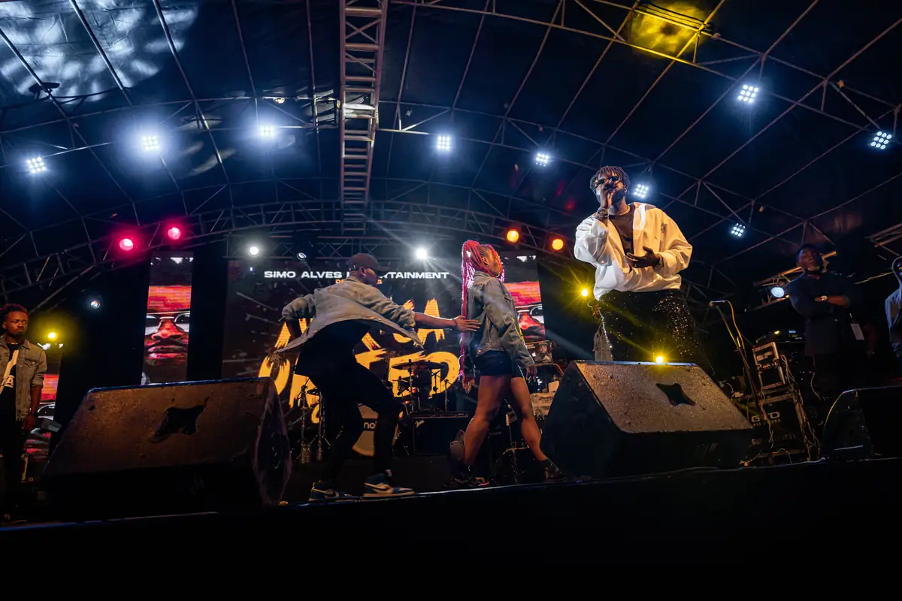
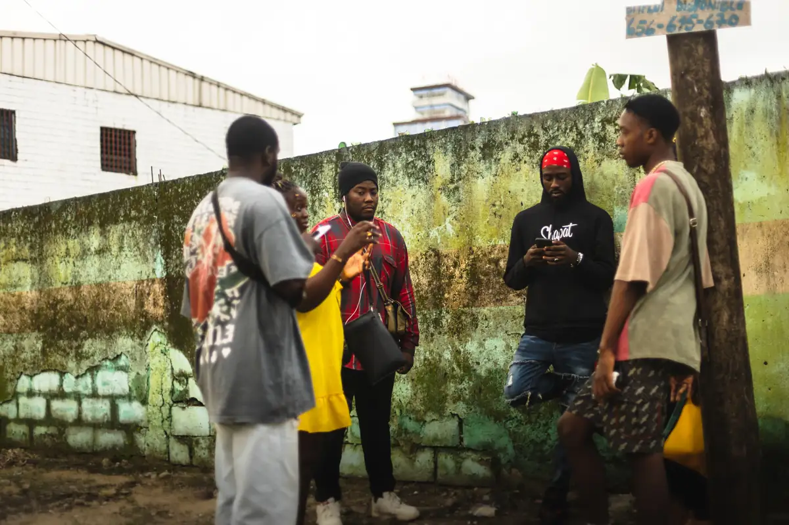

# Locko — photos livrées de l'année 2022 (JPG)

<!-- wiki:infobox -->

| Locko — photos livrées de l'année 2022 (JPG) | |
| --- | --- |
| Client | [LOCKO](../organisations/locko.md) |
| Via | [UPgraders](../organisations/upgraders.md) |
| Période | 12 janvier → 24 août 2022 |
| Casquette | Exécution |
| Catégorie | Événement |
| Rôle | Couverture photo et vidéo |
| Fait partie de | [Universal Music Africa — image d’artistes](uma-artistes.md) |
| Folio | _pas encore sur le site_ |
| État de la fiche | Standard |
<!-- /wiki:infobox -->

**Locko — photos livrées de l'année 2022 (JPG)** est un événement couvert en photo et en vidéo par Alexandre « Xtincell » Djengue (12 janvier → 24 août 2022).

## Description

- **Lieu** : plusieurs lieux
- **Organisateur ou client** : Locko
- **Ce que montrent les images** : Sélection retouchée : tournage de clip (03/02), concert de Saint-Valentin (14/02), MTN Zik Festival (26/02), Africa United (21-22/05), studio d'enregistrement (18/07), shooting studio en costumes orange, vert et wax (10/08), studio (24/08), interview radio en tee-shirt « Era ».
- **Identification** : noms de fichiers datés ; bâches MTN et « Africa United » visibles
- **Fiabilité** : confirmé

## Galerie

<!-- wiki:galerie -->

<!-- /wiki:galerie -->

## Archives

- `LOCKO\2022\Shooting   LOCKO` (425 fichiers, disque C:)

## Sources

- Notes « Événements couverts » établies lors du rangement des disques (28/10/2026), à partir des images, des dates de prise de vue et des livrables

<!-- wiki:liens-entrants -->
<!-- /wiki:liens-entrants -->
