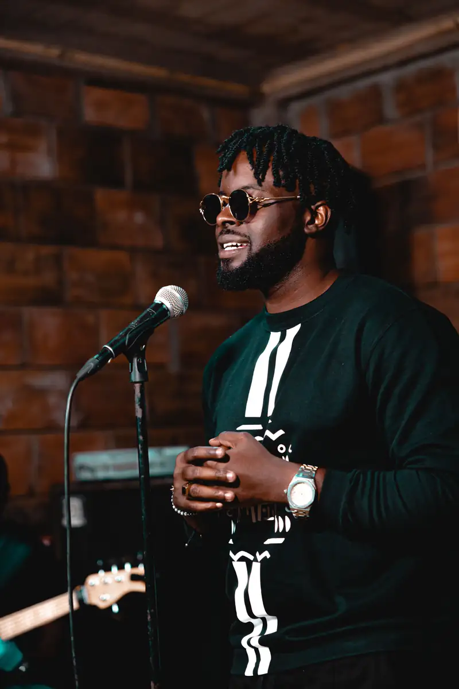
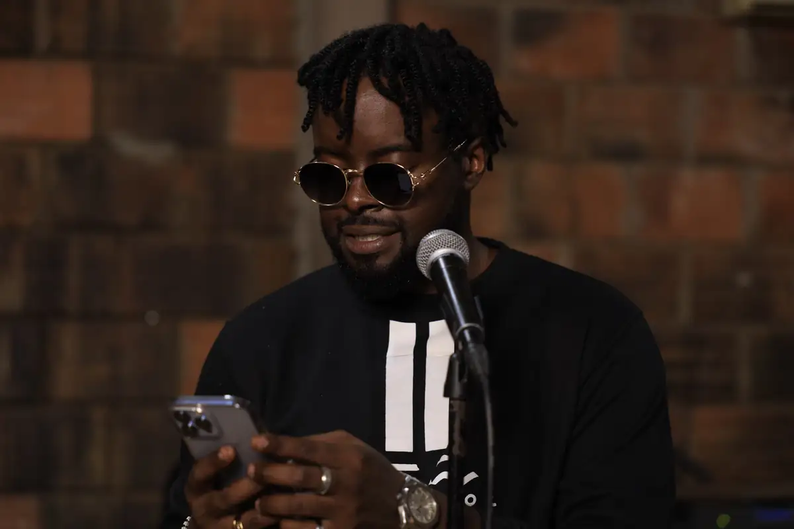
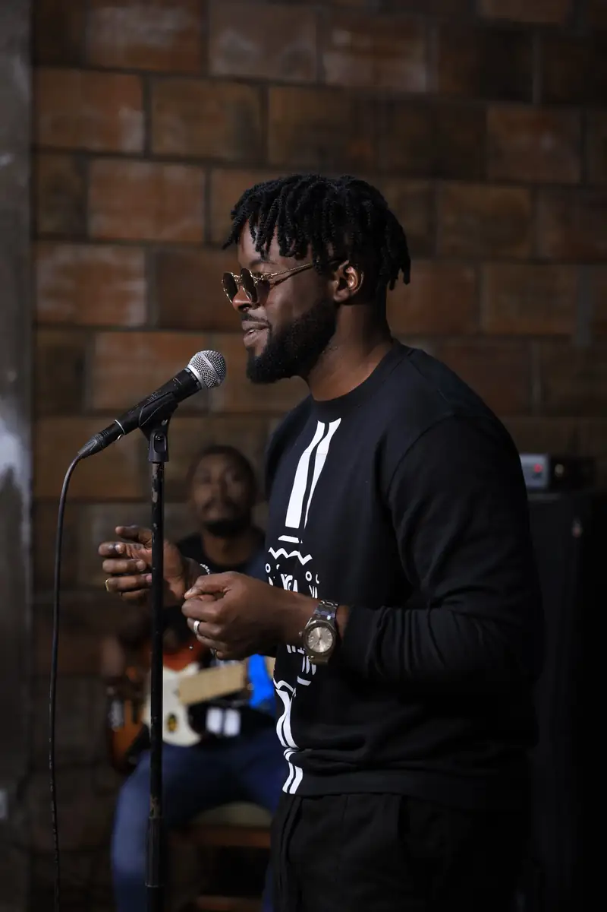
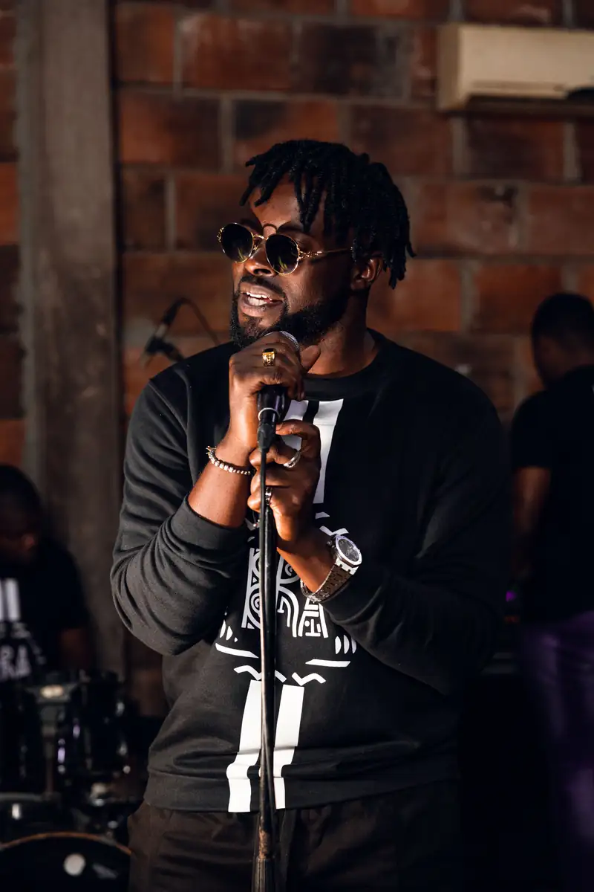
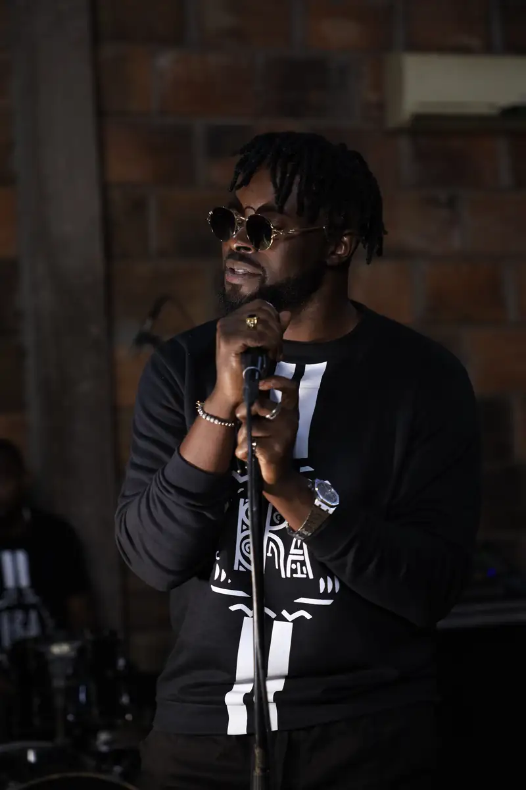
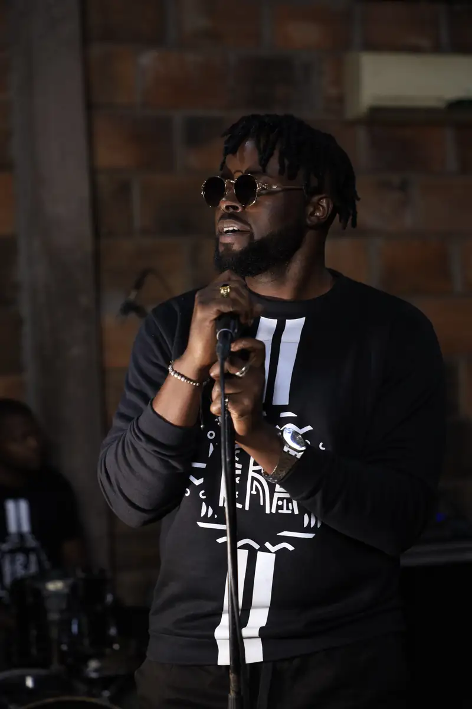

# Locko — répétition live et interview télévisée (12 janvier 2022)

<!-- wiki:infobox -->

| Locko — répétition live et interview télévisée (12 janvier 2022) | |
| --- | --- |
| Client | [LOCKO](../organisations/locko.md) |
| Via | [UPgraders](../organisations/upgraders.md) |
| Période | 12 janvier 2022 |
| Casquette | Exécution |
| Catégorie | Événement |
| Rôle | Couverture photo et vidéo |
| Fait partie de | [Universal Music Africa — image d’artistes](uma-artistes.md) |
| Folio | _pas encore sur le site_ |
| État de la fiche | Standard |
<!-- /wiki:infobox -->

**Locko — répétition live et interview télévisée (12 janvier 2022)** est un événement couvert en photo et en vidéo par Alexandre « Xtincell » Djengue (12 janvier 2022).

## Description

- **Lieu** : salle de répétition en briques avec groupe (batterie, ampli Hiwatt)
- **Organisateur ou client** : Locko
- **Ce que montrent les images** : 12/01/2022 de 12 h 30 à 14 h : Locko chante avec son groupe puis répond à une interview filmée.
  - Version livrée de la répétition live et de l'interview du 12/01/2022.
- **Identification** : sweat « Era — Locko » ; les JPG livrés du 12/01/2022 sont dans LOCKO\2022 sur C:
- **Fiabilité** : confirmé

## Galerie

<!-- wiki:galerie -->

<!-- /wiki:galerie -->

## Archives

- `LOCKO\2022\Répétition live et interview TV (12-01-2022)` (568 fichiers, disque P:)
- `LOCKO\2021\Répétition 01-12` (36 fichiers, disque P:)

## Sources

- Notes « Événements couverts » établies lors du rangement des disques (28/10/2026), à partir des images, des dates de prise de vue et des livrables

<!-- wiki:liens-entrants -->
<!-- /wiki:liens-entrants -->
