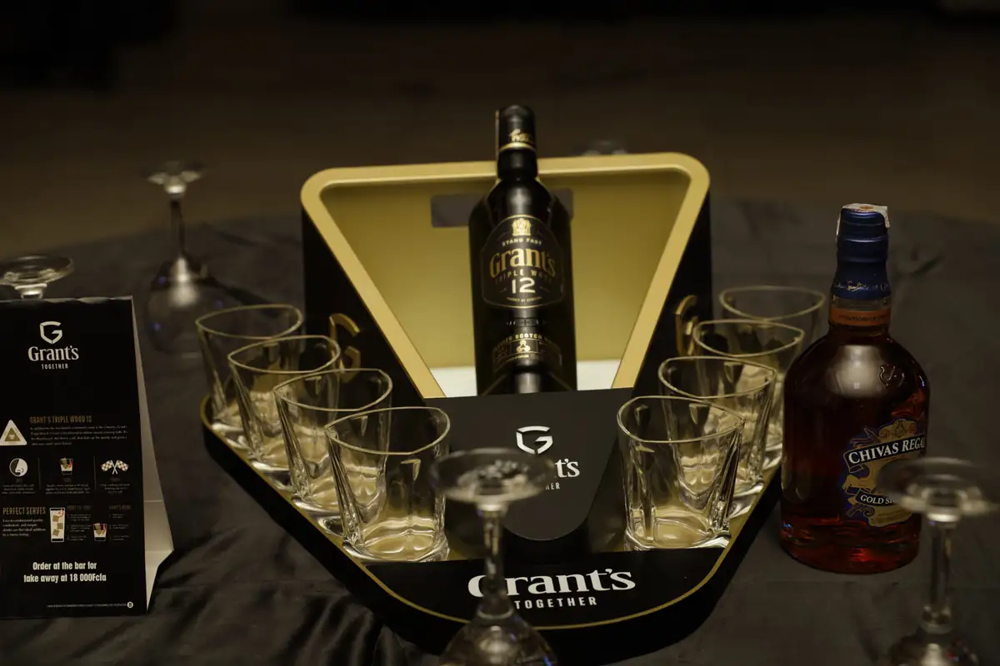
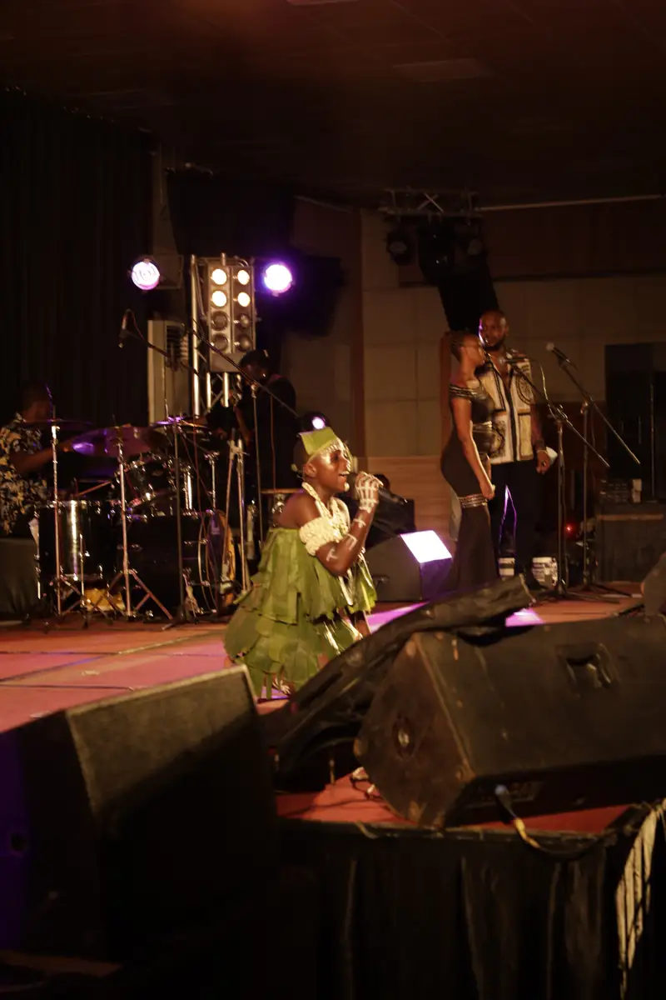
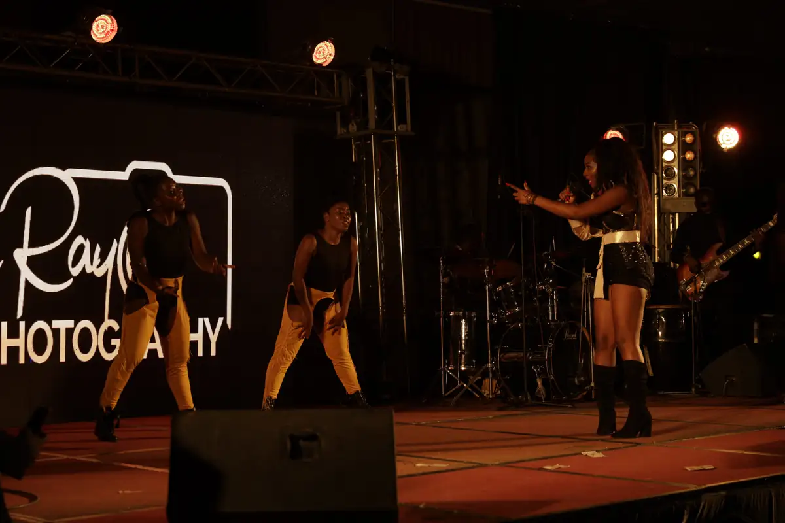
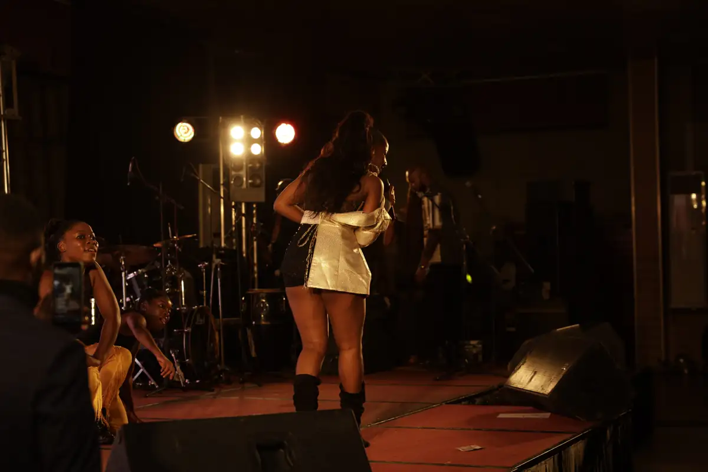
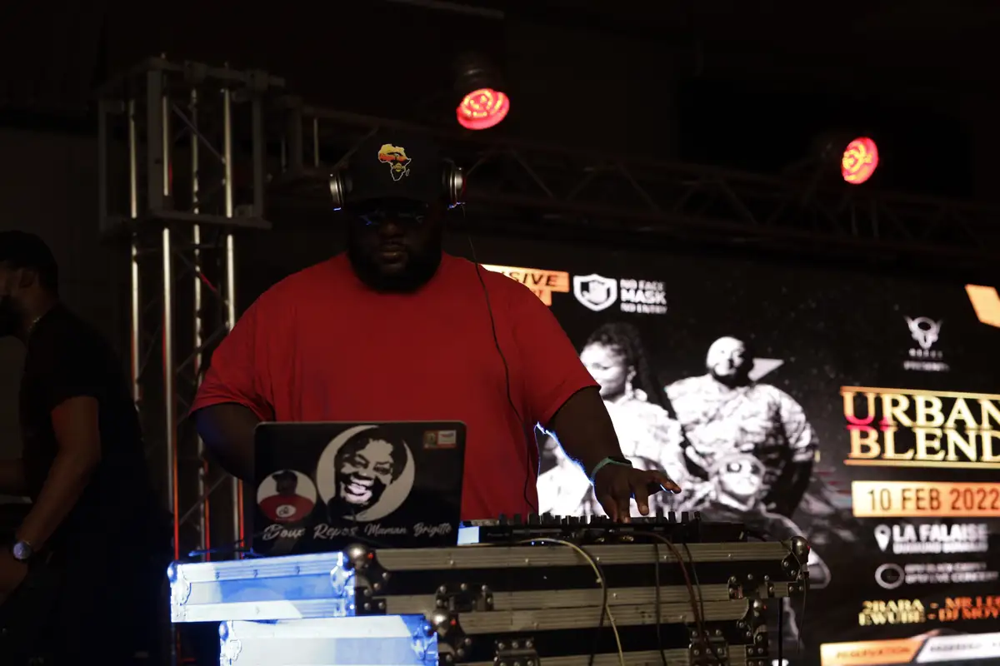
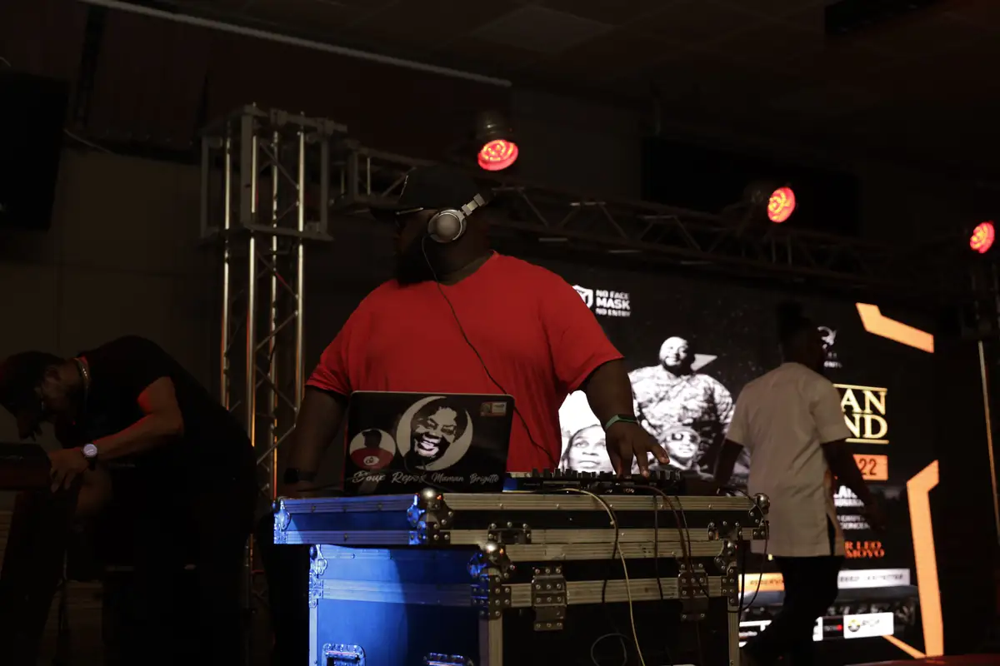

# Soirée « Urban Blend » à La Falaise

<!-- wiki:infobox -->

| Soirée « Urban Blend » à La Falaise | |
| --- | --- |
| Période | 11 février 2022 |
| Casquette | Exécution |
| Catégorie | Événement |
| Rôle | Couverture photo et vidéo |
| Folio | _pas encore sur le site_ |
| État de la fiche | À vérifier |
<!-- /wiki:infobox -->

**Soirée « Urban Blend » à La Falaise** est un événement couvert en photo et en vidéo par Alexandre « Xtincell » Djengue (11 février 2022).

## Description

- **Lieu** : salle de concert de l'hôtel La Falaise, Douala
- **Organisateur ou client** : non lu (sponsor Grant's)
- **Ce que montrent les images** : 10-11/02/2022 : concert, DJ devant l'écran de l'affiche, table Grant's, coulisses.
- **Identification** : écran « Urban Blend — 10 Feb 2022 — La Falaise » ; bouteilles et présentoir Grant's ; roll-up « Rayl Photography »
- **Fiabilité** : confirmé

## Galerie

<!-- wiki:galerie -->

<!-- /wiki:galerie -->

## Archives

- `_À identifier\P — 2022-02-10 → 11 — Soirée « Urban Blend » à La Falaise (Grant's)` (48 fichiers, disque P:)

## Sources

- Notes « Événements couverts » établies lors du rangement des disques (28/10/2026), à partir des images, des dates de prise de vue et des livrables

<!-- wiki:liens-entrants -->
<!-- /wiki:liens-entrants -->
