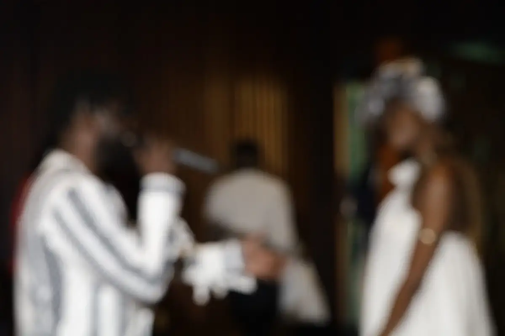
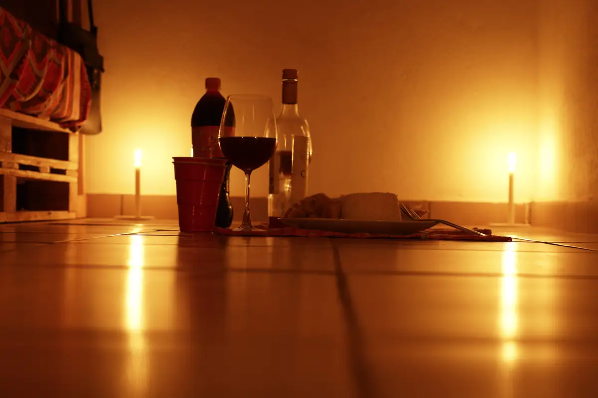
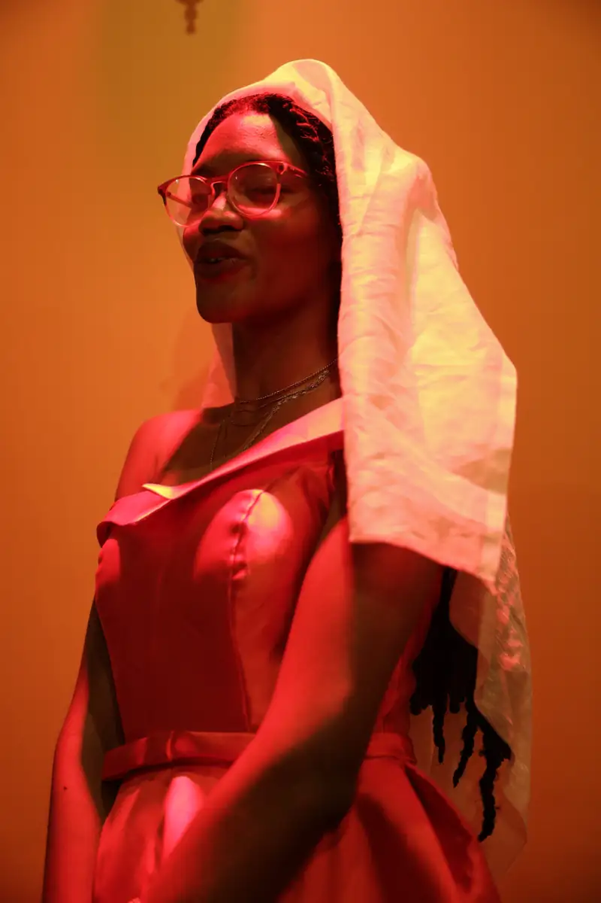
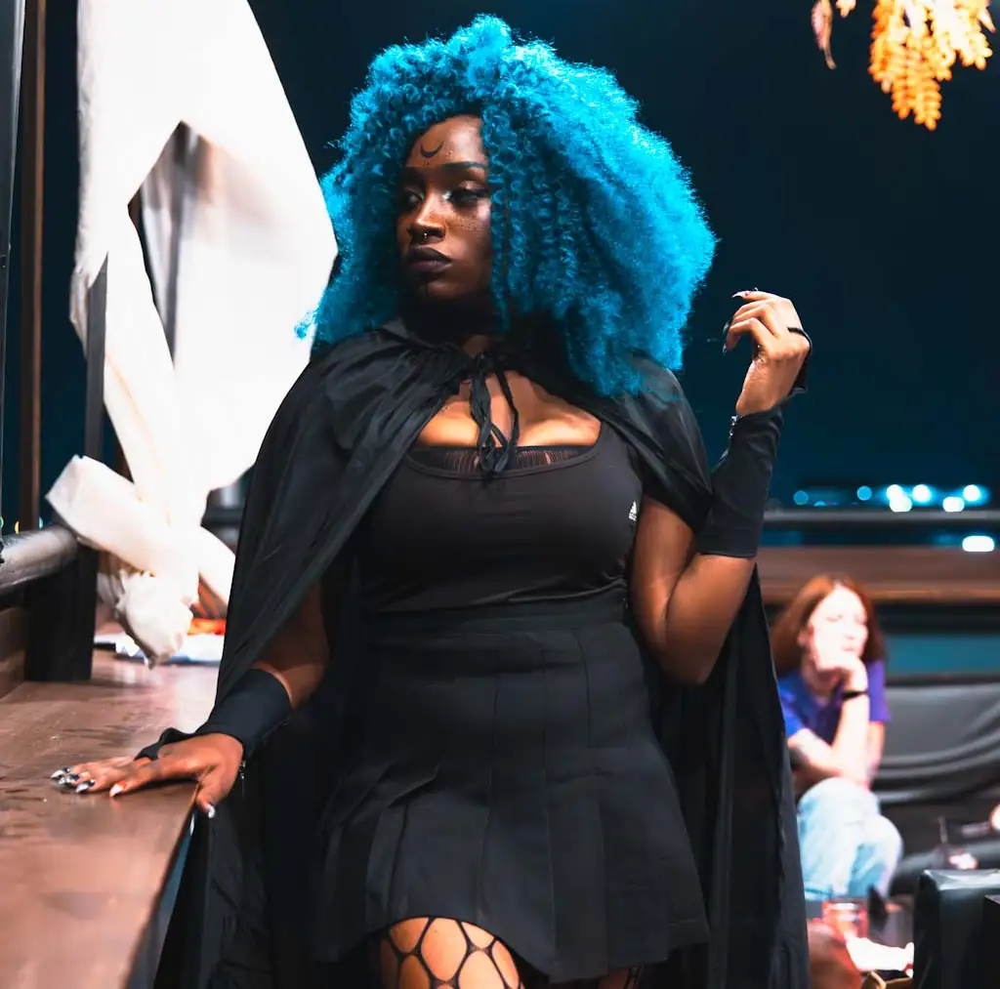
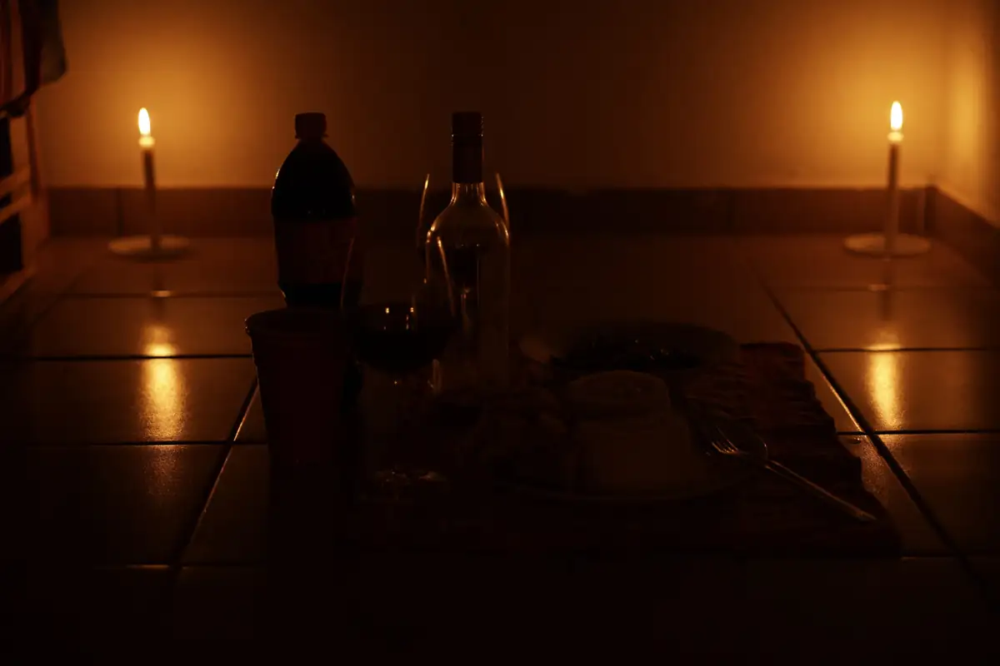
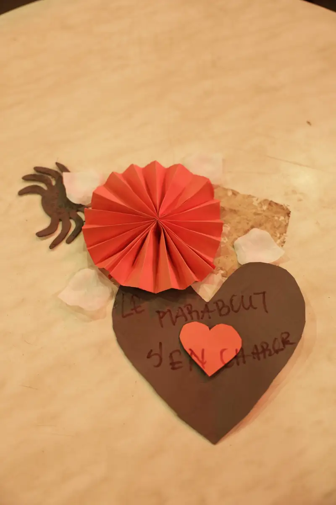

# Saint-Valentin 2022 : soirée au Rooftop Yaoundé (13/02) et concert de Locko (14/02)

<!-- wiki:infobox -->

| Saint-Valentin 2022 : soirée au Rooftop Yaoundé (13/02) et concert de Locko (14/02) | |
| --- | --- |
| Client | [LOCKO](../organisations/locko.md) |
| Via | [UPgraders](../organisations/upgraders.md) |
| Période | 12-14 février 2022 |
| Casquette | Exécution |
| Catégorie | Événement |
| Rôle | Couverture photo et vidéo |
| Fait partie de | [Universal Music Africa — image d’artistes](uma-artistes.md) |
| Folio | _pas encore sur le site_ |
| État de la fiche | Standard |
<!-- /wiki:infobox -->

**Saint-Valentin 2022 : soirée au Rooftop Yaoundé (13/02) et concert de Locko (14/02)** est un événement couvert en photo et en vidéo par Alexandre « Xtincell » Djengue (12-14 février 2022).

## Description

- **Lieu** : The Rooftop Yaoundé, puis restaurant-lounge aux lumières rouges
- **Organisateur ou client** : The Rooftop Yaoundé (13/02) ; Locko (14/02)
- **Ce que montrent les images** : 13/02 : maquillage, invités en tenues de soirée, rooftop de nuit ; 14/02 : Locko en tenue blanche et noire chante entre les tables avec une chanteuse en robe drapée.
- **Identification** : enseigne « Rooftop Yaoundé » (12-13/02) ; les JPG livrés du 14/02/2022 (Locko) sont dans LOCKO\2022 sur C: — le 14/02 est rangé chez Locko
- **Fiabilité** : confirmé

## Galerie

<!-- wiki:galerie -->

<!-- /wiki:galerie -->

## Archives

- `LOCKO\2022\Concert de Saint-Valentin (14-02-2022)` (132 fichiers, disque P:)
- `_À identifier\P — 2022-02-12 → 13 — Soirée de Saint-Valentin au Rooftop Yaoundé` (265 fichiers, disque P:)

## Sources

- Notes « Événements couverts » établies lors du rangement des disques (28/10/2026), à partir des images, des dates de prise de vue et des livrables

<!-- wiki:liens-entrants -->
<!-- /wiki:liens-entrants -->
