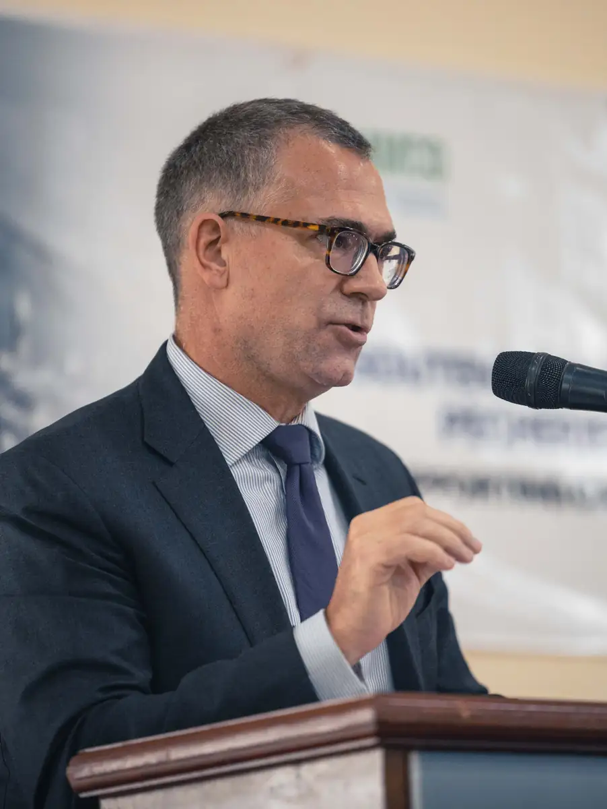
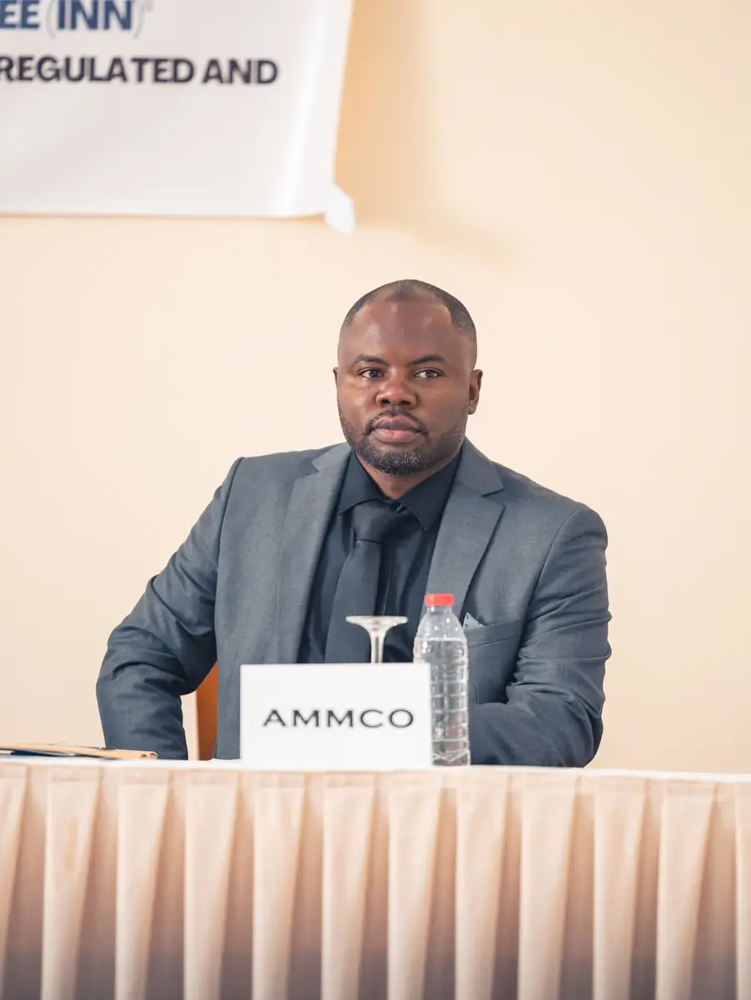
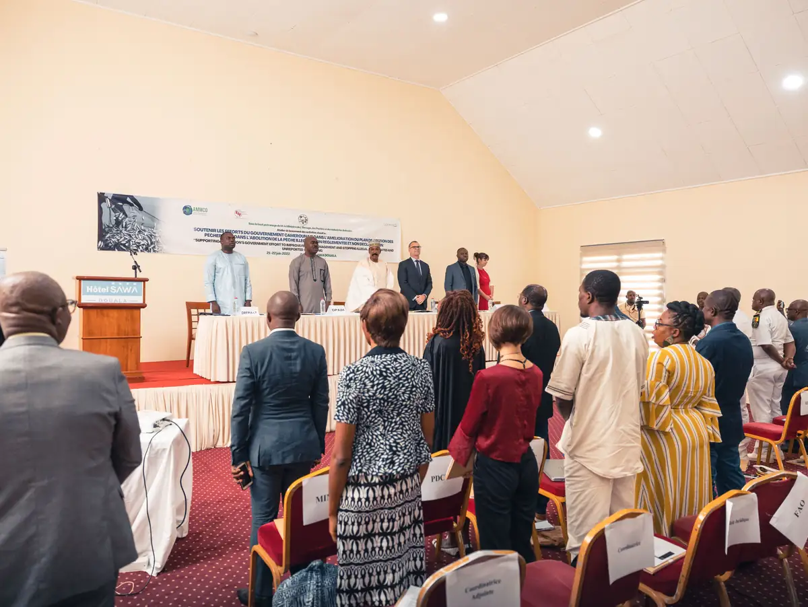
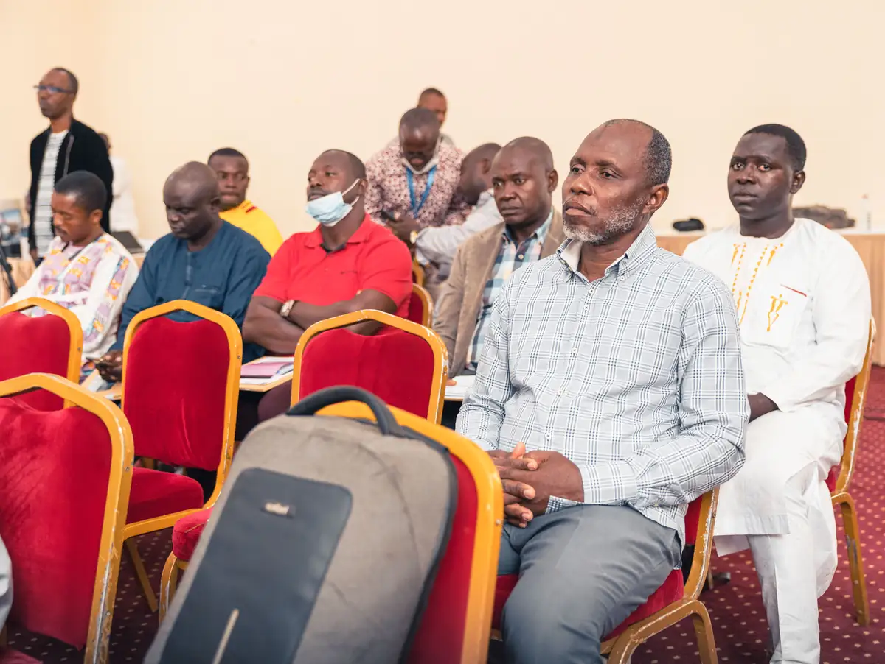
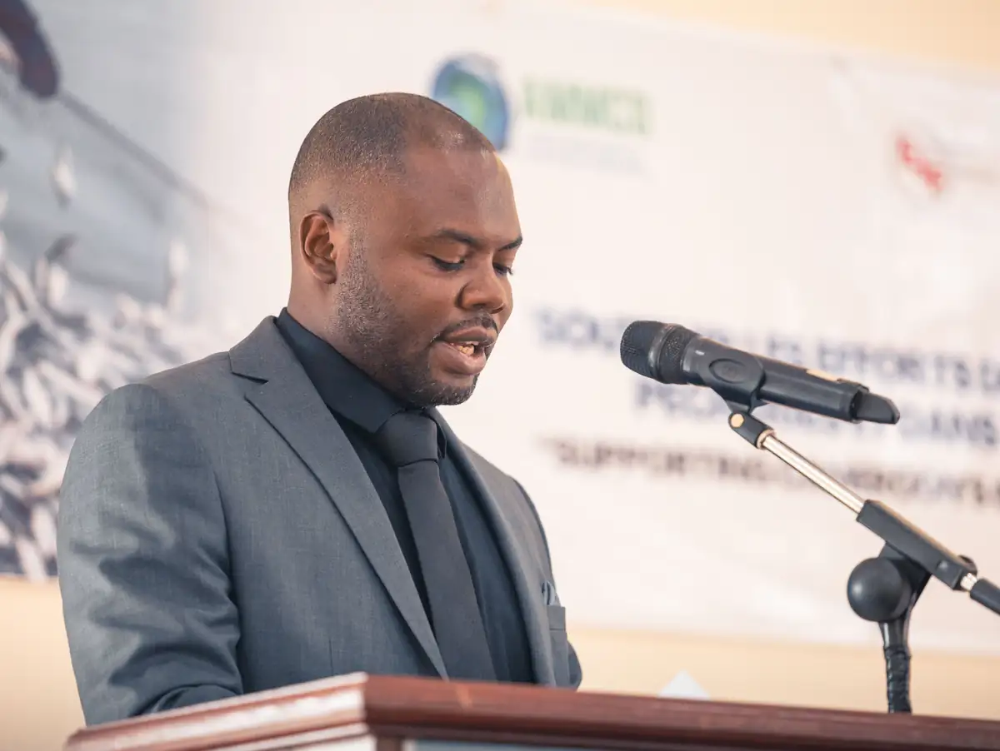
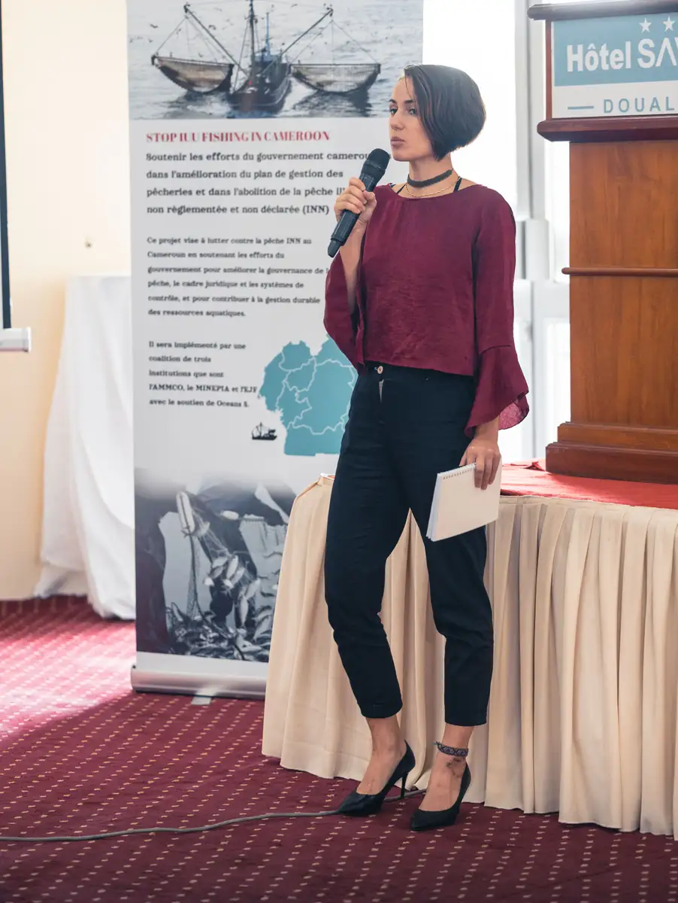

# Atelier sur la pêche illicite, non déclarée et non réglementée (INN)

<!-- wiki:infobox -->

| Atelier sur la pêche illicite, non déclarée et non réglementée (INN) | |
| --- | --- |
| Client | [AMMCO](../organisations/ammco.md) |
| Via | [UPgraders](../organisations/upgraders.md) |
| Période | 21 juin 2022 |
| Casquette | Exécution |
| Catégorie | Événement |
| Rôle | Couverture photo et vidéo |
| Fait partie de | [Street Whale](street-whale.md) |
| Folio | _pas encore sur le site_ |
| État de la fiche | Standard |
<!-- /wiki:infobox -->

**Atelier sur la pêche illicite, non déclarée et non réglementée (INN)** est un événement couvert en photo et en vidéo par Alexandre « Xtincell » Djengue (21 juin 2022).

## Description

- **Lieu** : Hôtel Sawa, Douala
- **Organisateur ou client** : AMMCO, avec le MINEPIA
- **Ce que montrent les images** : Ouverture officielle, allocutions au pupitre de l'hôtel, présentation « Stop IUU fishing in Cameroon », travaux en salle, interviews presse, déjeuner autour de la piscine.
- **Identification** : bâche « Government effort to improve fishery management and stopping illegal, unregulated, unreported (IUU) fishing — 21-22 juin 2022 — à l'Hôtel Sawa Douala » ; panneau « AMMCO Séminaire Sawa I »
- **Fiabilité** : confirmé

## Galerie

<!-- wiki:galerie -->

<!-- /wiki:galerie -->

## Archives

- `AMMCO\2022\Peche INN` (76 fichiers, disque C:)

## Sources

- Notes « Événements couverts » établies lors du rangement des disques (28/10/2026), à partir des images, des dates de prise de vue et des livrables

<!-- wiki:liens-entrants -->
<!-- /wiki:liens-entrants -->
