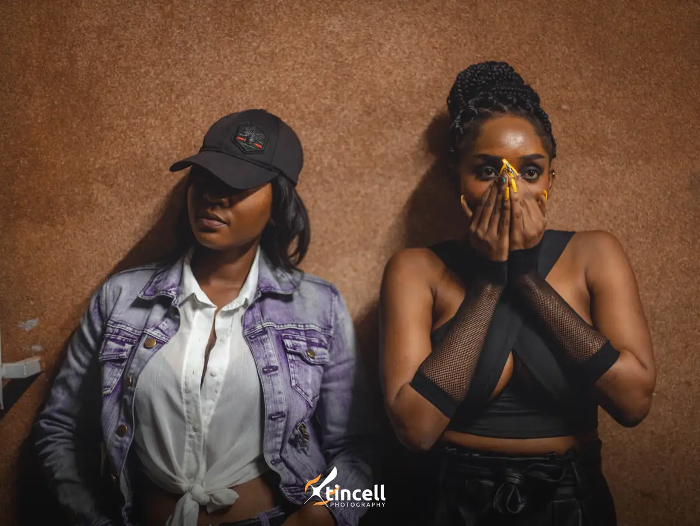
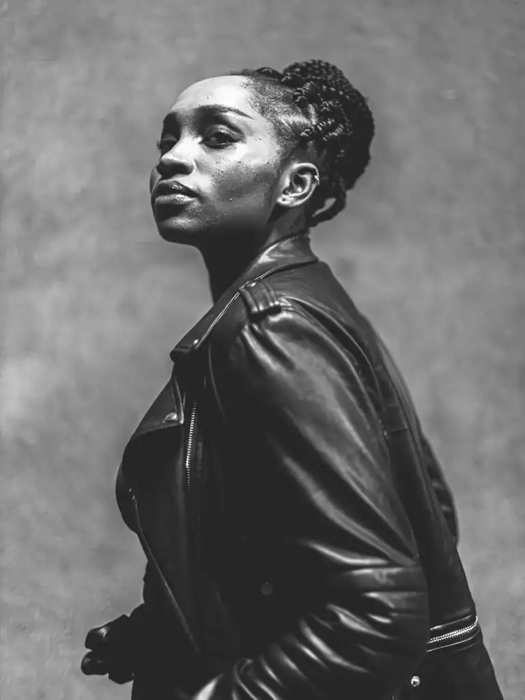
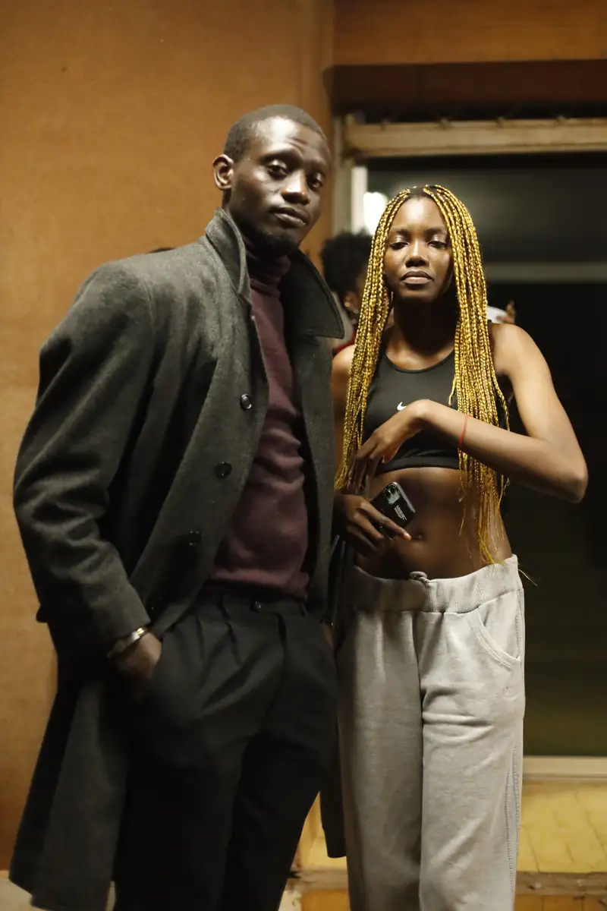
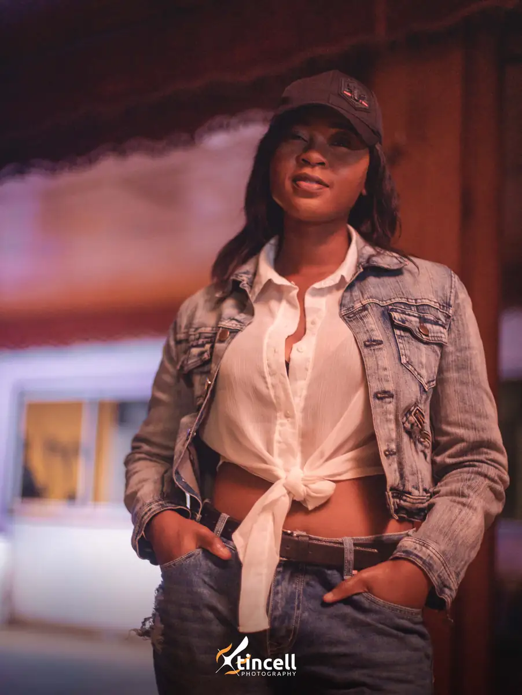
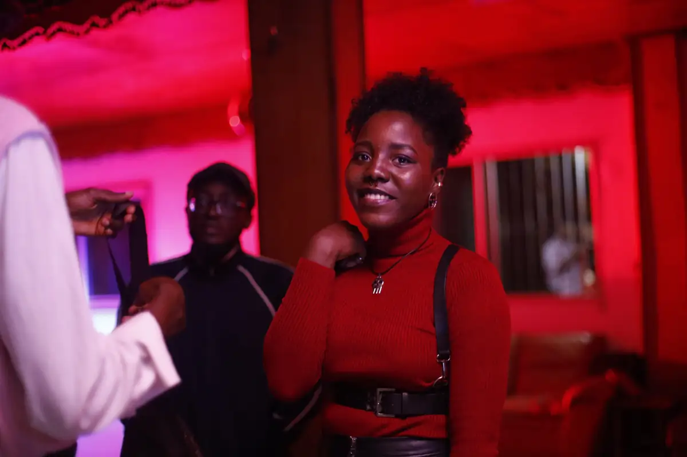
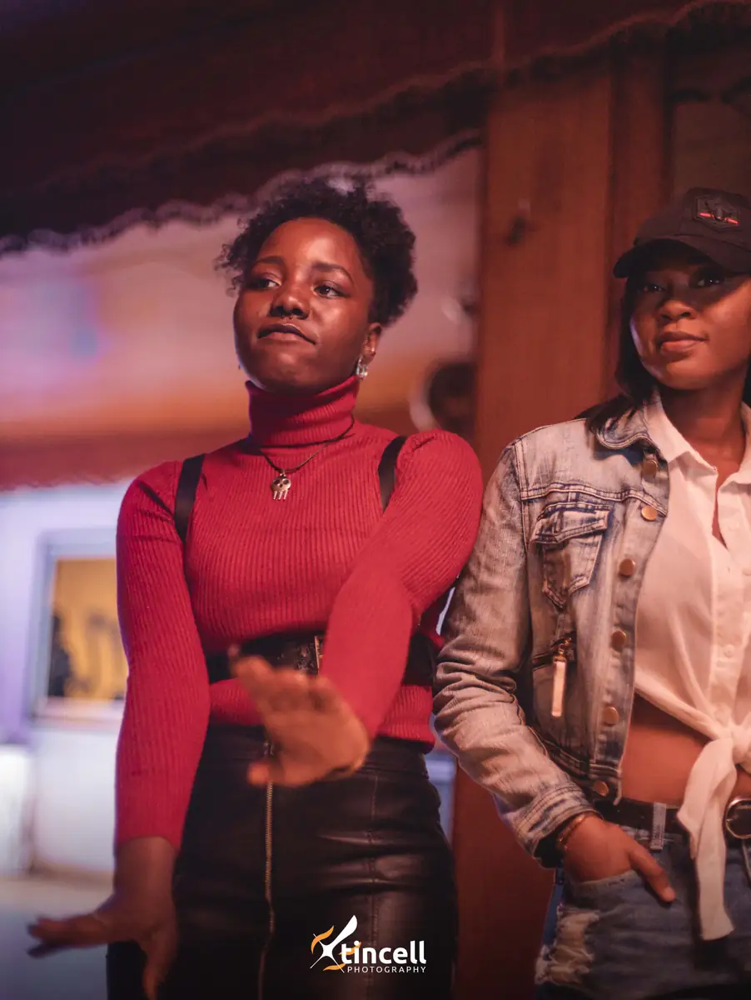

# Soirée « The Mooda Times » (hip-hop)

<!-- wiki:infobox -->

| Soirée « The Mooda Times » (hip-hop) | |
| --- | --- |
| Client | [Mooda](../organisations/mooda.md) |
| Via | [UPgraders](../organisations/upgraders.md) |
| Période | 2-3 juillet 2022 |
| Casquette | Exécution |
| Catégorie | Événement |
| Rôle | Couverture photo et vidéo |
| Fait partie de | [Mooda — travaux](mooda-travaux.md) |
| Folio | _pas encore sur le site_ |
| État de la fiche | Standard |
<!-- /wiki:infobox -->

**Soirée « The Mooda Times » (hip-hop)** est un événement couvert en photo et en vidéo par Alexandre « Xtincell » Djengue (2-3 juillet 2022).

## Description

- **Lieu** : salle à piliers en bois et cour, lumières roses
- **Organisateur ou client** : Mooda
- **Ce que montrent les images** : 02-03/07/2022 : portraits de mode posés devant un mur ocre, invités, scène avec rideau au « m. », duo en noir et blanc.
- **Identification** : dossier client « Mooda » ; affiches « The Mooda Times — Hip-hop GOATs » dans le lot P: du même week-end
- **Fiabilité** : confirmé

## Galerie

<!-- wiki:galerie -->

<!-- /wiki:galerie -->

## Archives

- `Mooda\2022\Mooda` (100 fichiers, disque C:)
- `Mooda\2022\Soirée « The Mooda Times » (02-03-07-2022), RAW` (851 fichiers, disque P:)

## Sources

- Notes « Événements couverts » établies lors du rangement des disques (28/10/2026), à partir des images, des dates de prise de vue et des livrables

<!-- wiki:liens-entrants -->
<!-- /wiki:liens-entrants -->
