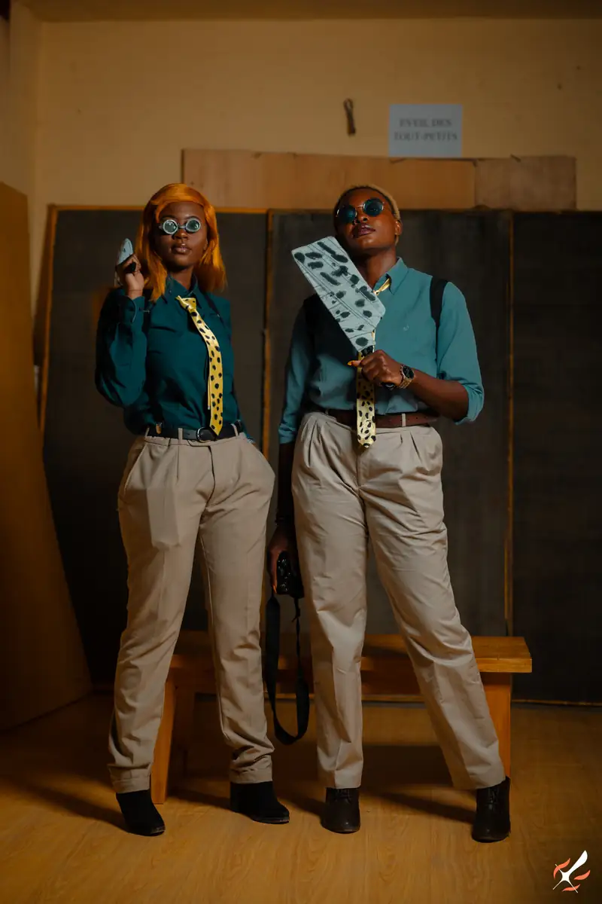
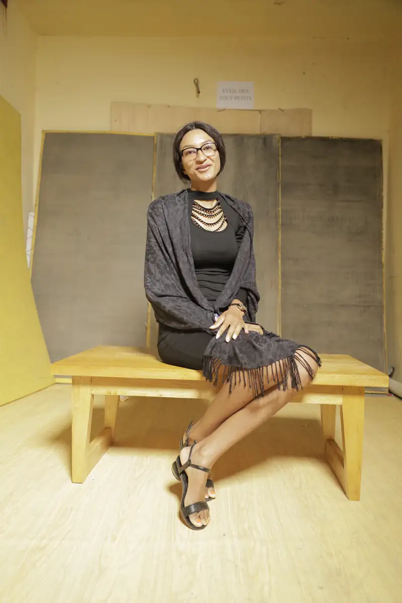
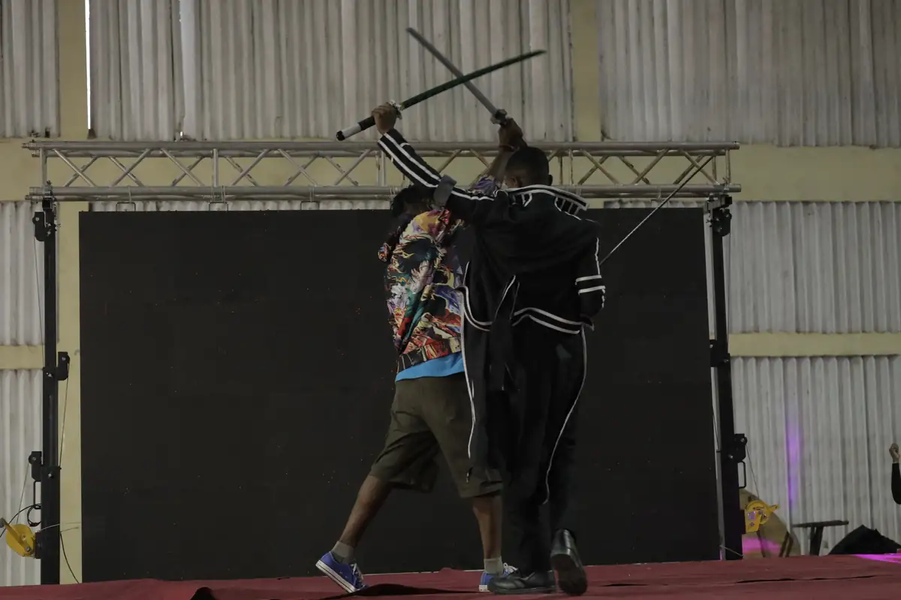
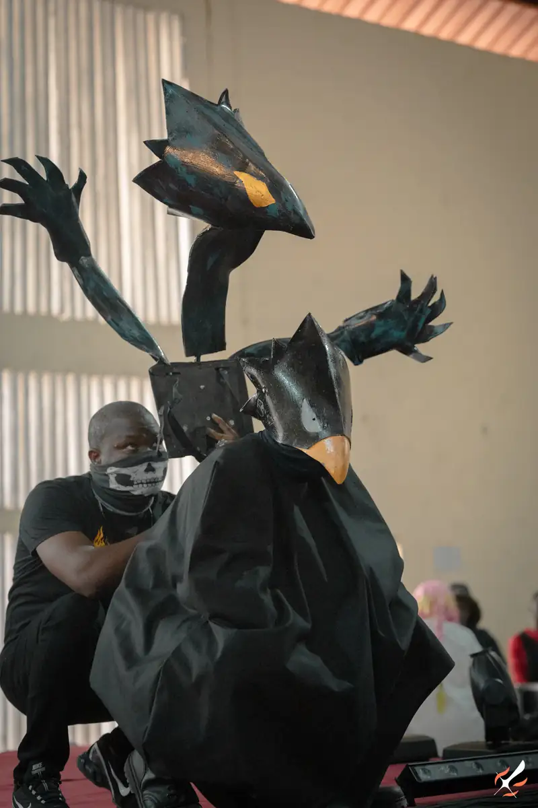
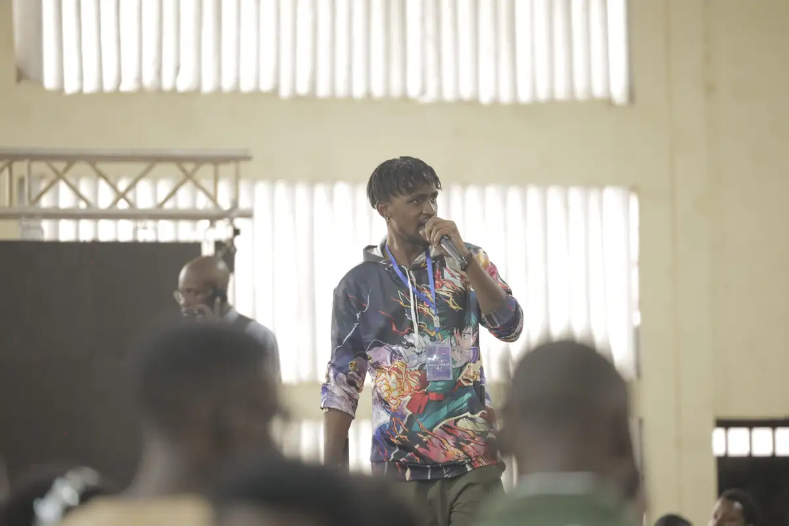
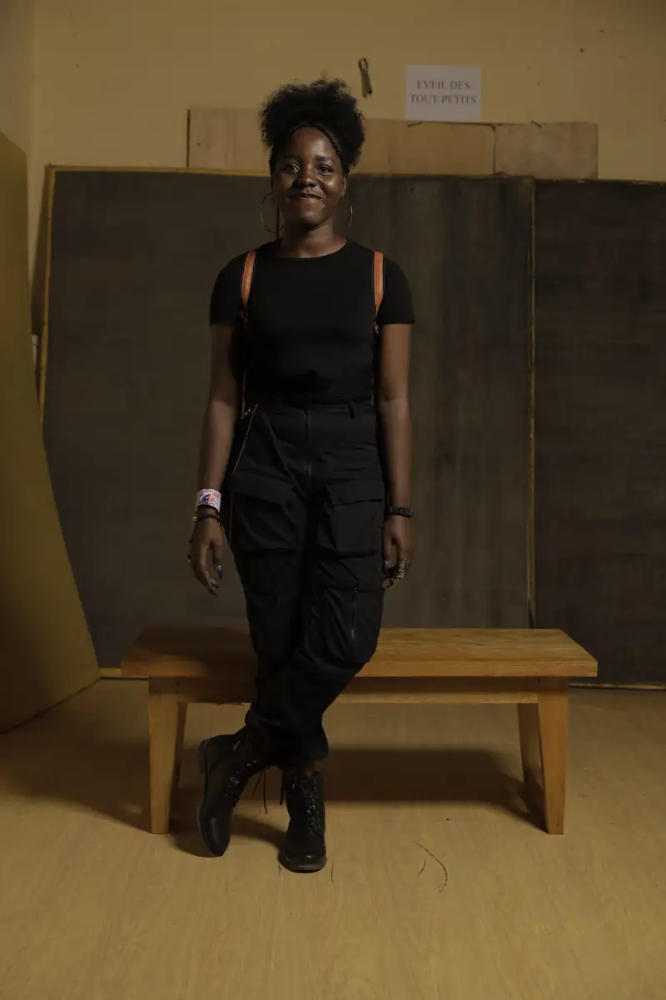

# K-mer Otaku Festival 2022

<!-- wiki:infobox -->

| K-mer Otaku Festival 2022 | |
| --- | --- |
| Client | [Kamer Otaku Festival (KOF)](../organisations/kamer-otaku-festival.md) |
| Via | [UPgraders](../organisations/upgraders.md) |
| Période | 6 août 2022 |
| Casquette | Exécution |
| Catégorie | Événement |
| Rôle | Couverture photo et vidéo |
| Fait partie de | [Kamer Otaku Festival — éditions 2022 à 2024](kof-2022-2024.md) |
| Folio | _pas encore sur le site_ |
| État de la fiche | Standard |
<!-- /wiki:infobox -->

**K-mer Otaku Festival 2022** est un événement couvert en photo et en vidéo par Alexandre « Xtincell » Djengue (6 août 2022).

## Description

- **Lieu** : Gymnase Omnisport, Yaoundé
- **Organisateur ou client** : KOF — Kamer Otaku Fest
- **Ce que montrent les images** : Shooting cosplay du 06/08/2022 sur un coin studio (banc, panneaux de bois), arche gonflable Otakutique, maquillage, projections sur grand écran.
  - 06/08/2022 de 12 h 30 à 20 h : RAW de la journée du festival (même journée que le n° 19).
- **Identification** : affiche « K-mer Otaku Festival — Gymnase Omnisport, Yaoundé — 6 août » (dossier KOF 2023) ; date des fichiers 06082022
- **Fiabilité** : confirmé

## Galerie

<!-- wiki:galerie -->

<!-- /wiki:galerie -->

## Archives

- `KOF - Kamer Otaku Fest\2022\Shooting KOF2022` (340 fichiers, disque C:)
- `KOF - Kamer Otaku Fest\2022\Photos (6 août 2022)` (1 889 fichiers, disque P:)

## Sources

- Notes « Événements couverts » établies lors du rangement des disques (28/10/2026), à partir des images, des dates de prise de vue et des livrables

<!-- wiki:liens-entrants -->
<!-- /wiki:liens-entrants -->
