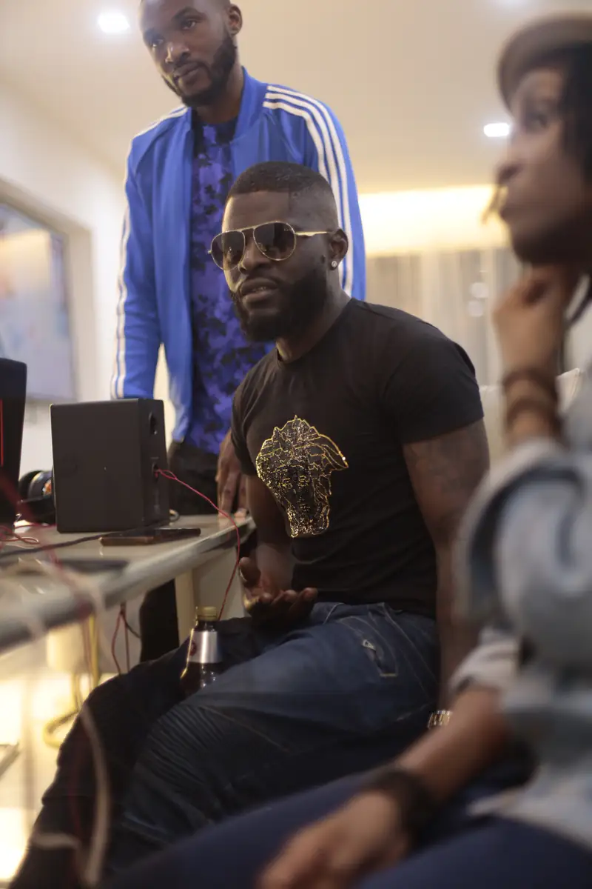
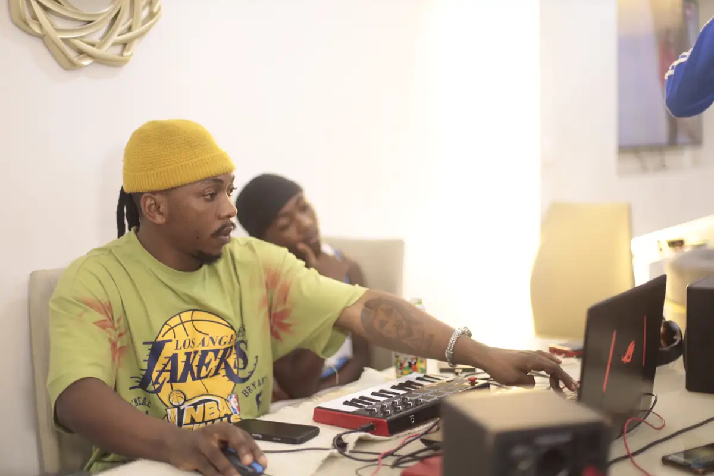
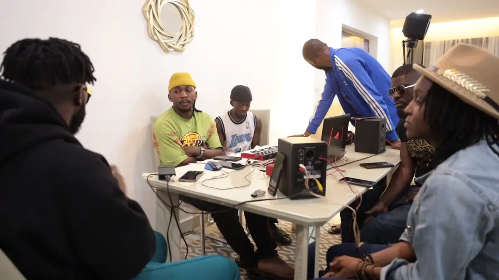
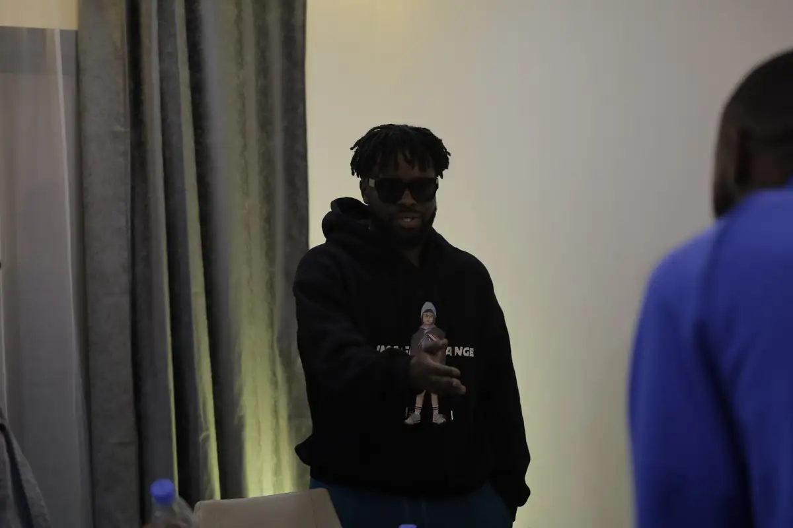
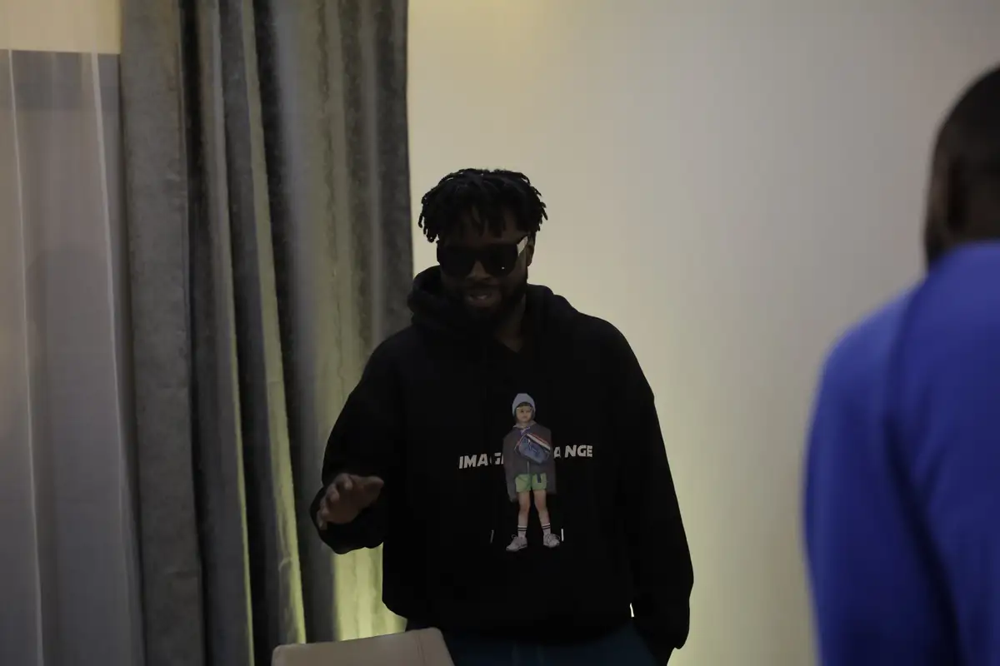
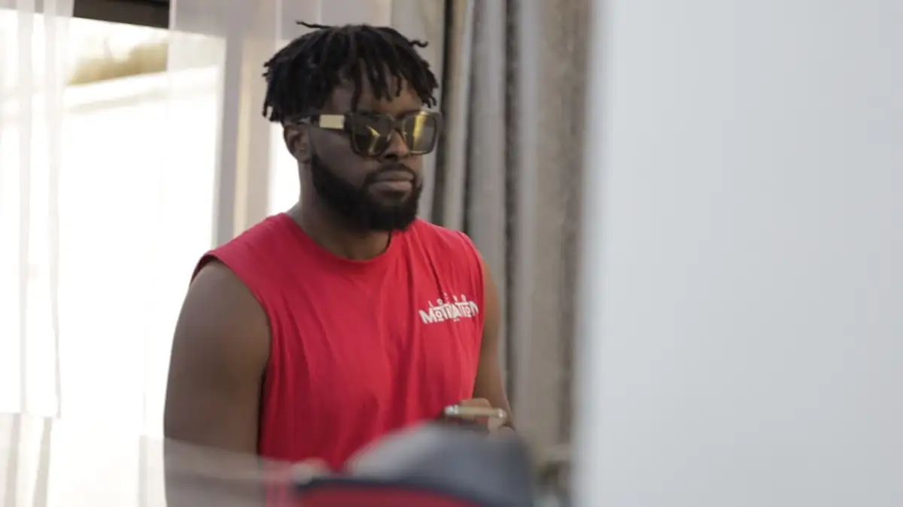

# Locko — session en studio d'appartement (backstage, août 2022)

<!-- wiki:infobox -->

| Locko — session en studio d'appartement (backstage, août 2022) | |
| --- | --- |
| Client | [LOCKO](../organisations/locko.md) |
| Via | [UPgraders](../organisations/upgraders.md) |
| Période | 24-25 août 2022 |
| Casquette | Exécution |
| Catégorie | Événement |
| Rôle | Couverture photo et vidéo |
| Fait partie de | [Universal Music Africa — image d’artistes](uma-artistes.md) |
| Folio | _pas encore sur le site_ |
| État de la fiche | Standard |
<!-- /wiki:infobox -->

**Locko — session en studio d'appartement (backstage, août 2022)** est un événement couvert en photo et en vidéo par Alexandre « Xtincell » Djengue (24-25 août 2022).

## Description

- **Lieu** : appartement aménagé en studio d'enregistrement
- **Organisateur ou client** : Locko
- **Ce que montrent les images** : 24-25/08/2022 : écoute et production sur ordinateur, discussions, portraits de Locko.
- **Identification** : dossier client Locko
- **Fiabilité** : confirmé

## Galerie

<!-- wiki:galerie -->

<!-- /wiki:galerie -->

## Archives

- `LOCKO\2022\Backstage (août 2022)` (223 fichiers, disque P:)

## Sources

- Notes « Événements couverts » établies lors du rangement des disques (28/10/2026), à partir des images, des dates de prise de vue et des livrables

<!-- wiki:liens-entrants -->
<!-- /wiki:liens-entrants -->
