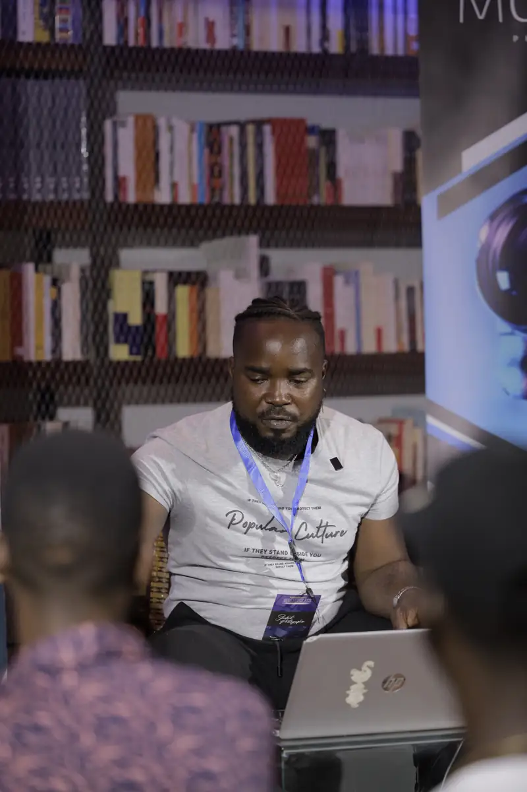
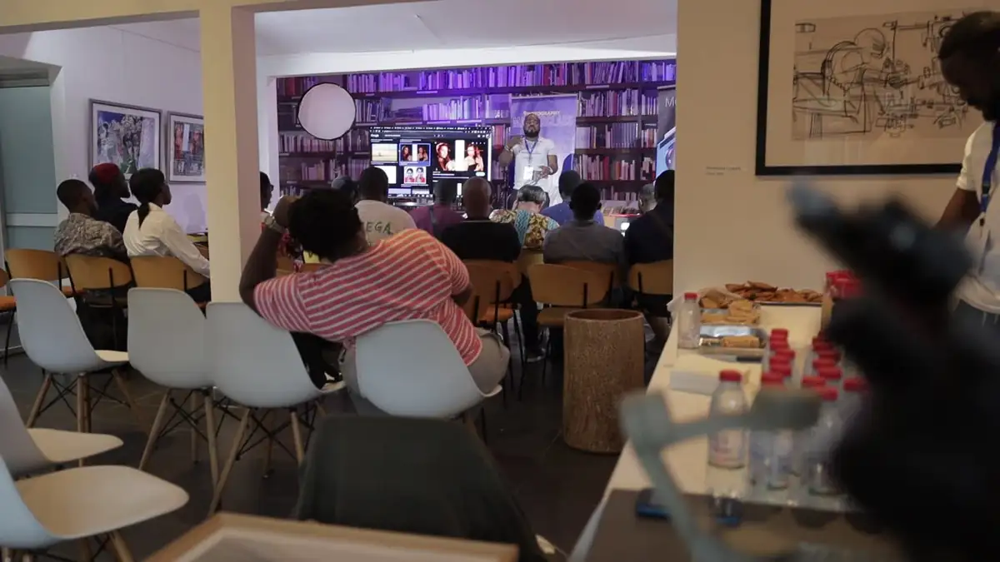
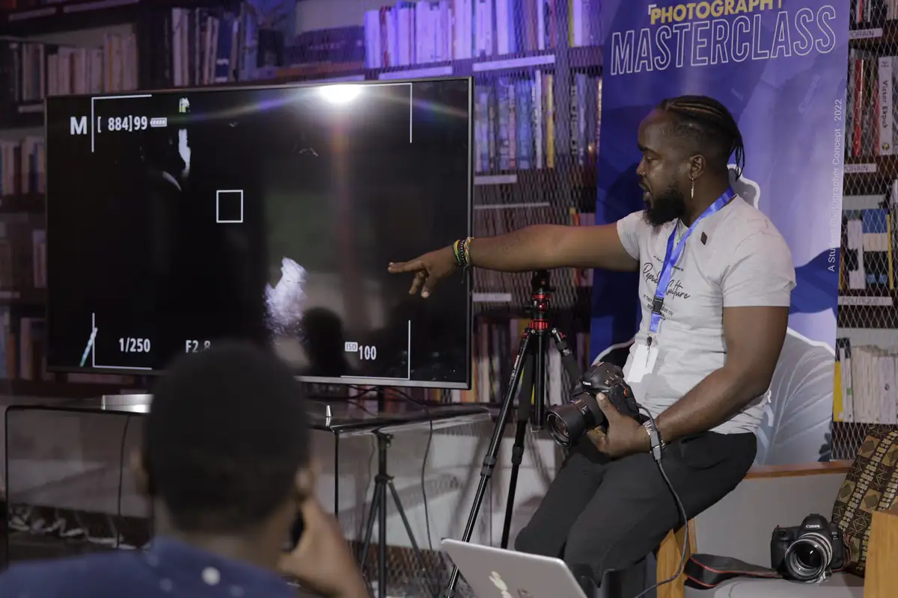
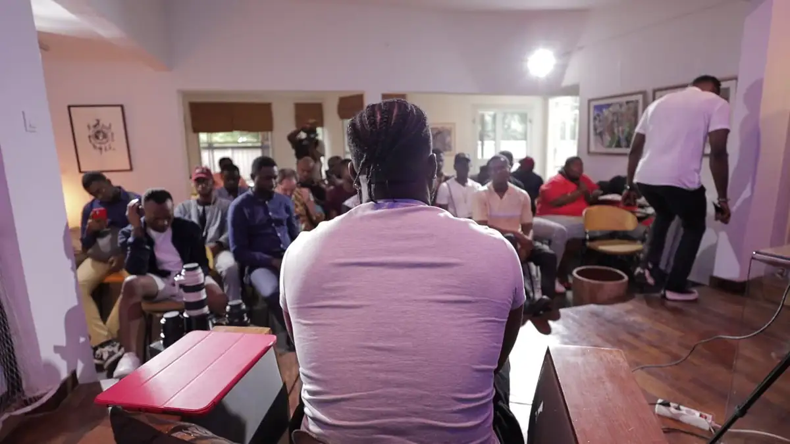

# « Photography Masterclass » de Stéphane Nounamo (I)

<!-- wiki:infobox -->

| « Photography Masterclass » de Stéphane Nounamo (I) | |
| --- | --- |
| Client | [Student Photographer (Stéphane Nounamo)](../organisations/student-photographer-stephane-nounamo.md) |
| Via | [UPgraders](../organisations/upgraders.md) |
| Période | 27 août 2022 |
| Casquette | Exécution |
| Catégorie | Événement |
| Rôle | Couverture photo et vidéo |
| Fait partie de | [Student Photographer (Stéphane Nounamo) — travaux](student-photographer-stephane-nounamo-travaux.md) |
| Folio | _pas encore sur le site_ |
| État de la fiche | Standard |
<!-- /wiki:infobox -->

**« Photography Masterclass » de Stéphane Nounamo (I)** est un événement couvert en photo et en vidéo par Alexandre « Xtincell » Djengue (27 août 2022).

## Description

- **Lieu** : bibliothèque-salon (murs de livres), Douala
- **Organisateur ou client** : Student Photographer (Stéphane Nounamo), avec Motion19
- **Ce que montrent les images** : 27/08/2022 : démonstrations au boîtier, projection des images en direct, échanges avec les participants.
- **Identification** : roll-ups « Photography Masterclass — A Student Photographer Concept 2022 » et « Motion19 »
- **Fiabilité** : confirmé

## Galerie

<!-- wiki:galerie -->

<!-- /wiki:galerie -->

## Archives

- `Student Photographer (Stéphane Nounamo)\2022\Masterclass I` (239 fichiers, disque P:)

## Sources

- Notes « Événements couverts » établies lors du rangement des disques (28/10/2026), à partir des images, des dates de prise de vue et des livrables

<!-- wiki:liens-entrants -->
<!-- /wiki:liens-entrants -->
