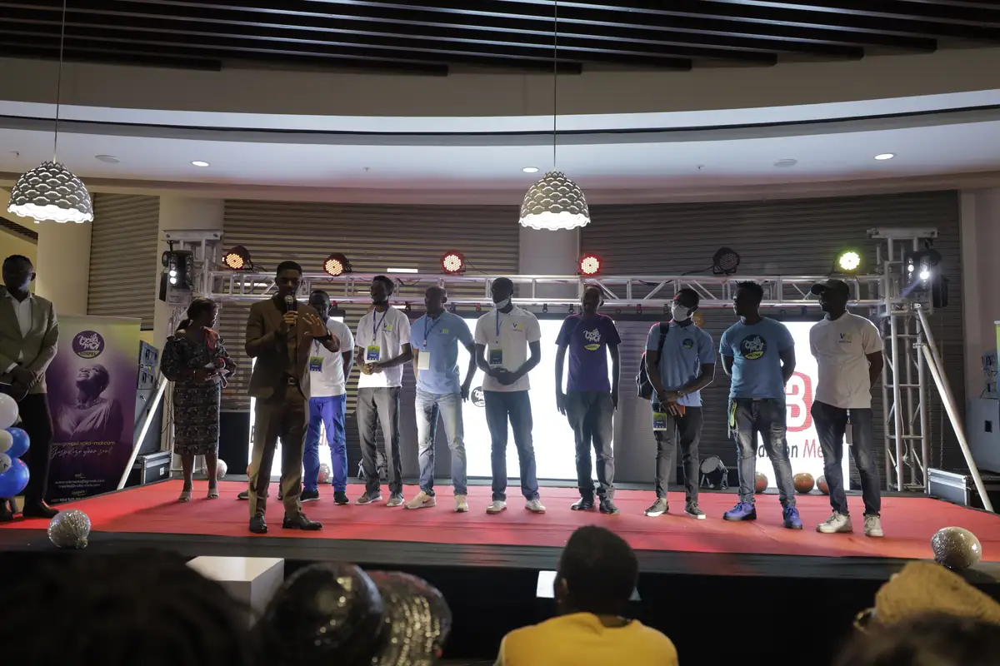
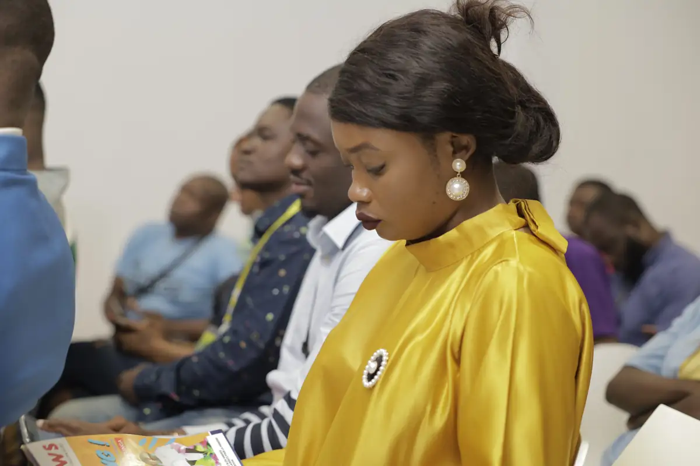
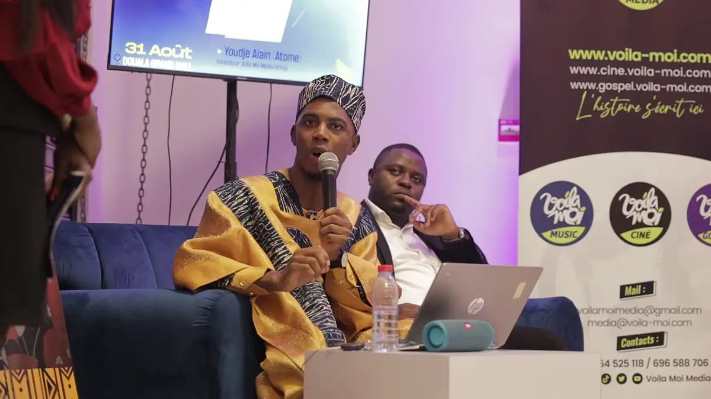
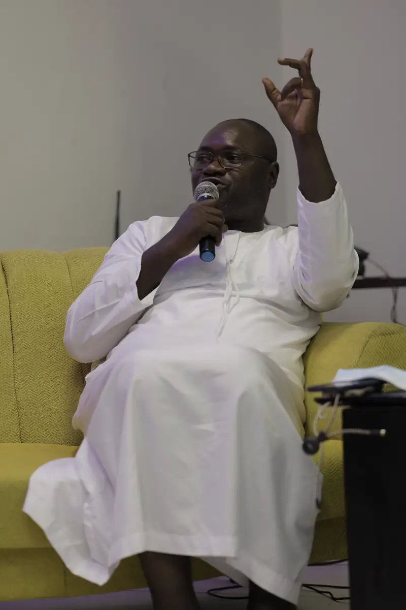
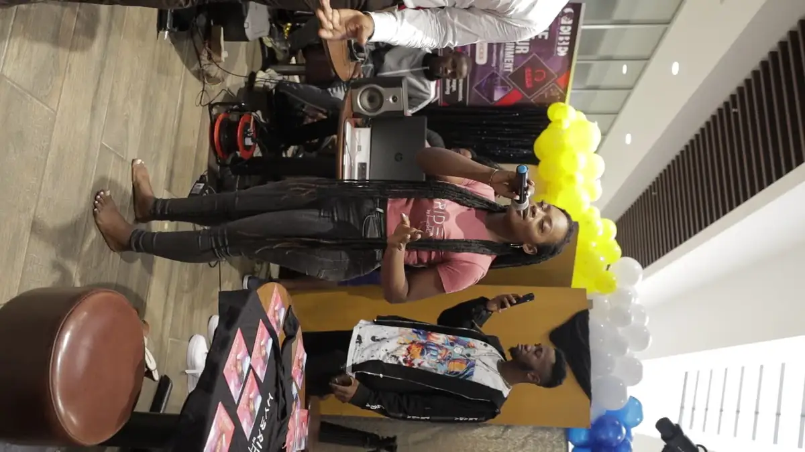
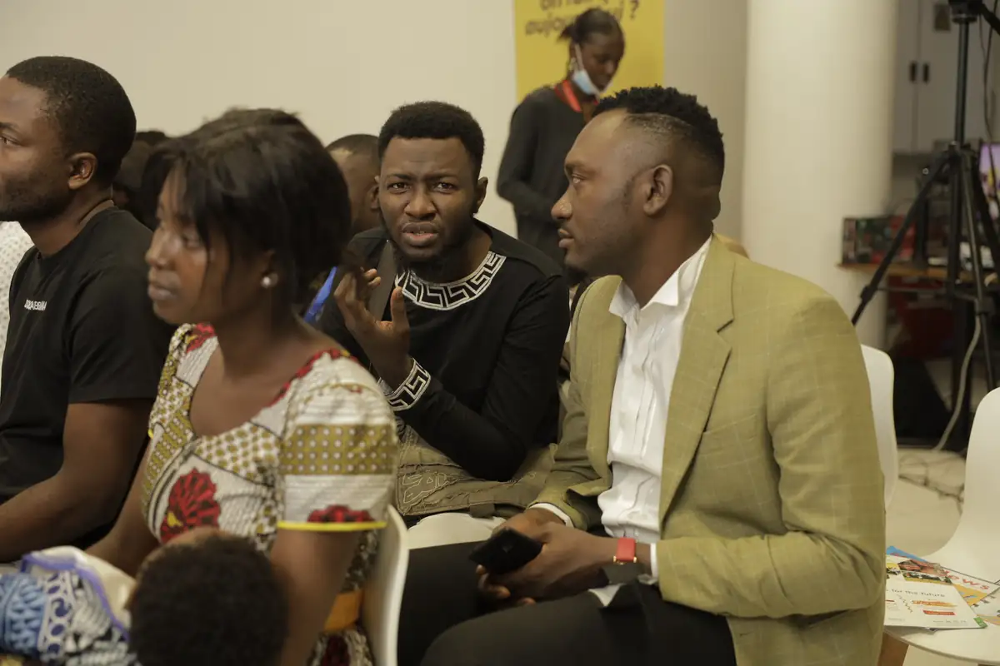

# Journée mondiale du blog — talk et soirée

<!-- wiki:infobox -->

| Journée mondiale du blog — talk et soirée | |
| --- | --- |
| Client | [Voilà Moi](../organisations/voila-moi.md) |
| Via | [UPgraders](../organisations/upgraders.md) |
| Période | 31 août 2022 |
| Casquette | Exécution |
| Catégorie | Événement |
| Rôle | Couverture photo et vidéo |
| Fait partie de | [Voilà Moi — travaux](voila-moi-travaux.md) |
| Folio | _pas encore sur le site_ |
| État de la fiche | Standard |
<!-- /wiki:infobox -->

**Journée mondiale du blog — talk et soirée** est un événement couvert en photo et en vidéo par Alexandre « Xtincell » Djengue (31 août 2022).

## Description

- **Lieu** : Douala Grand Mall
- **Organisateur ou client** : Voilà Moi (voilamoi-consulting.com)
- **Ce que montrent les images** : Talk sur fauteuils jaunes devant les roll-ups Voilà Moi et MTN, régie, puis soirée de remise de prix (Grant's) devant un photocall de sponsors.
- **Identification** : écran « Journée mondiale du blog — 31 août » ; roll-ups Voilà Moi, MTN ; photocall Grant's, MTN, Douala Grand Mall ; le dossier Atome (exports retouchés, 381 JPG récupérés de found.000) porte les mêmes numéros de fichiers (_MG_0725-1743) : même prise de vue, laissée chez les deux
- **Fiabilité** : confirmé

## Galerie

<!-- wiki:galerie -->

<!-- /wiki:galerie -->

## Archives

- `Voilà Moi\2022\Journée mondiale du blog (31-08-2022, Douala Grand Mall)` (305 fichiers, disque P:)
- `Atome\2022\Journée mondiale du blog (31-08-2022, Douala Grand Mall)` (381 fichiers, disque P:)

## Sources

- Notes « Événements couverts » établies lors du rangement des disques (28/10/2026), à partir des images, des dates de prise de vue et des livrables

<!-- wiki:liens-entrants -->
<!-- /wiki:liens-entrants -->
