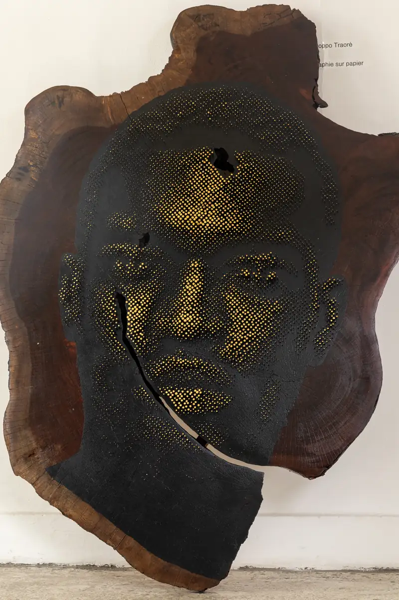
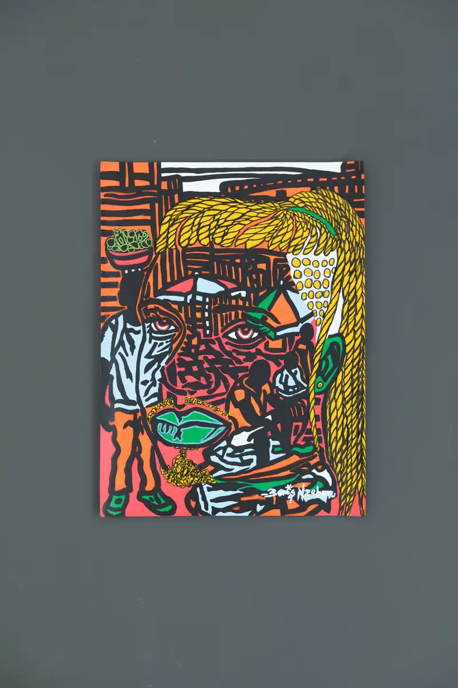
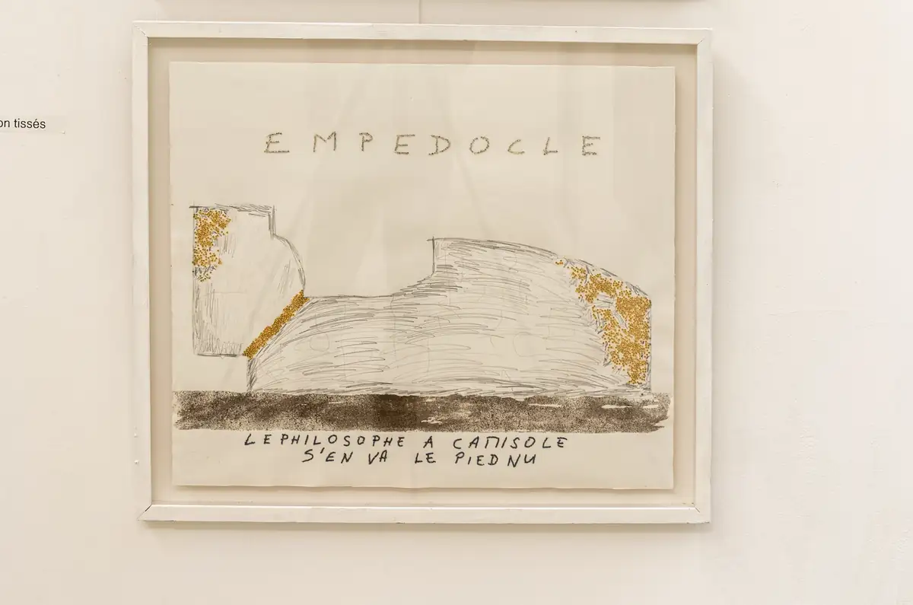
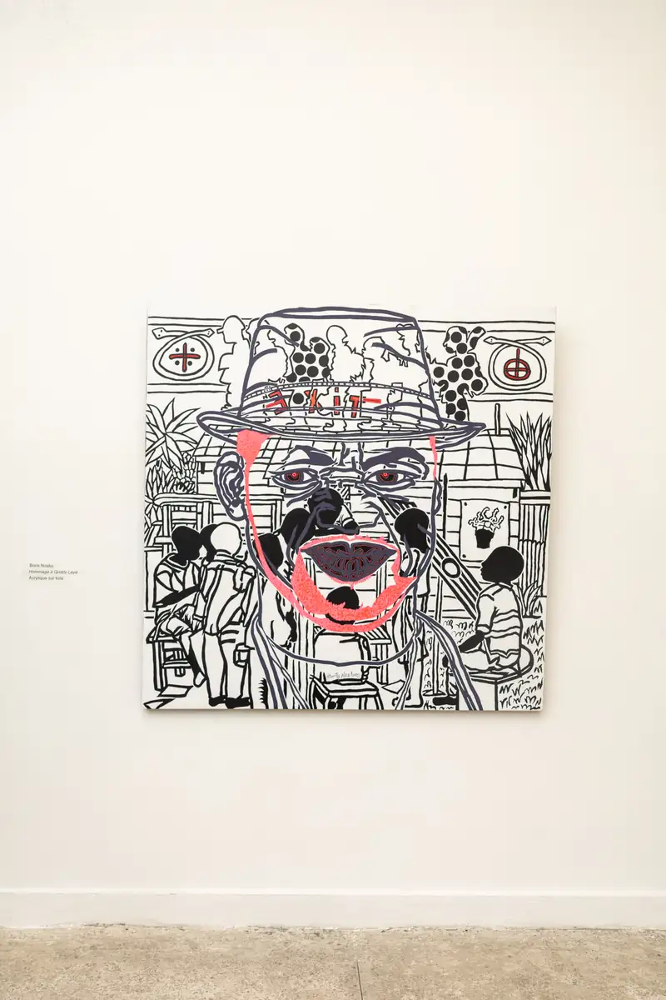
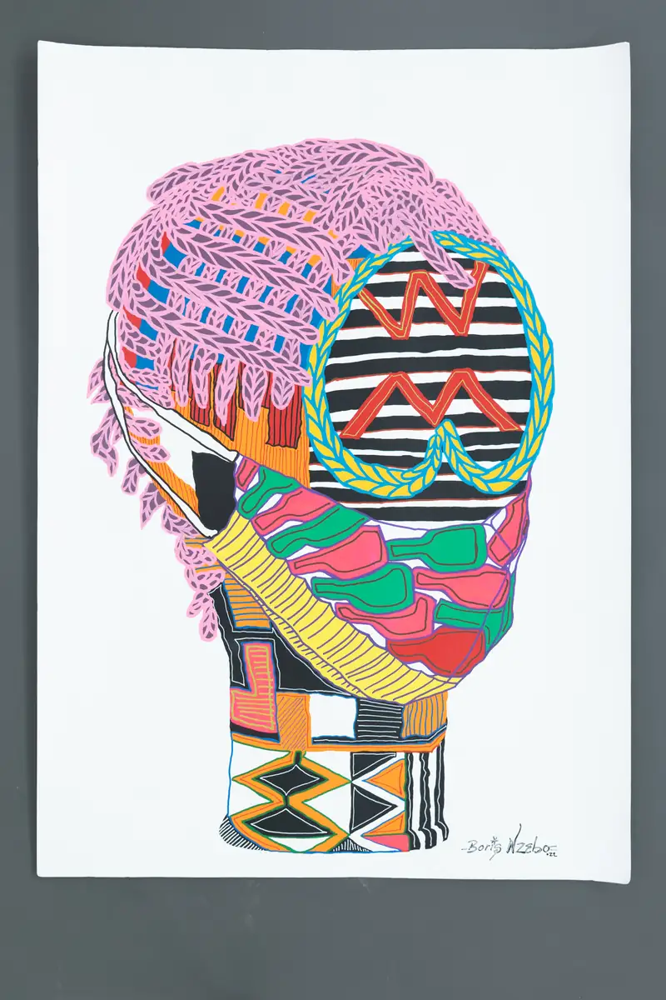
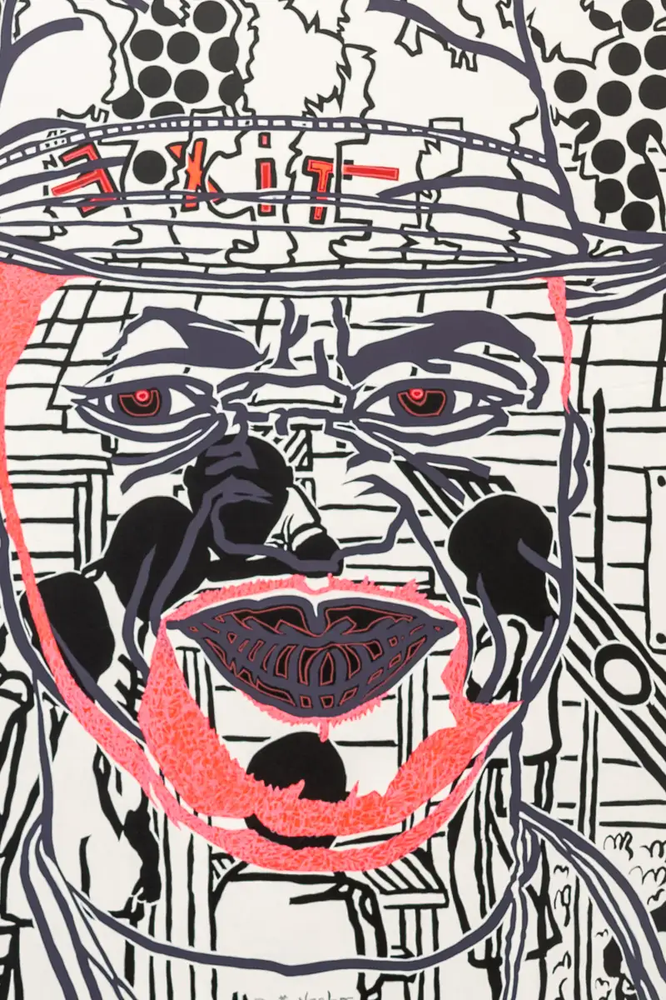

# Galerie MAM — photographies d'œuvres d'une exposition

<!-- wiki:infobox -->

| Galerie MAM — photographies d'œuvres d'une exposition | |
| --- | --- |
| Client | [Galerie MAM](../organisations/galerie-mam.md) |
| Via | [UPgraders](../organisations/upgraders.md) |
| Période | 29 septembre → 7 octobre 2022 |
| Casquette | Exécution |
| Catégorie | Événement |
| Rôle | Couverture photo et vidéo |
| Fait partie de | [Galerie MAM — travaux](galerie-mam-travaux.md) |
| Folio | _pas encore sur le site_ |
| État de la fiche | Standard |
<!-- /wiki:infobox -->

**Galerie MAM — photographies d'œuvres d'une exposition** est un événement couvert en photo et en vidéo par Alexandre « Xtincell » Djengue (29 septembre → 7 octobre 2022).

## Description

- **Lieu** : Galerie MAM, Douala
- **Organisateur ou client** : Galerie MAM
- **Ce que montrent les images** : Reproductions d'œuvres sur fond gris (07/10/2022) et vues d'accrochage dans la galerie (29/09/2022) : dessins, sculptures en bronze, panneaux percés, toiles abstraites.
- **Identification** : dossier client « Galerie MAM » ; cartels visibles ; noms de fichiers « Product… »
- **Fiabilité** : confirmé

## Galerie

<!-- wiki:galerie -->

<!-- /wiki:galerie -->

## Archives

- `Galerie MAM\2022\Galerie MAM` (60 fichiers, disque C:)

## Sources

- Notes « Événements couverts » établies lors du rangement des disques (28/10/2026), à partir des images, des dates de prise de vue et des livrables

<!-- wiki:liens-entrants -->
<!-- /wiki:liens-entrants -->
