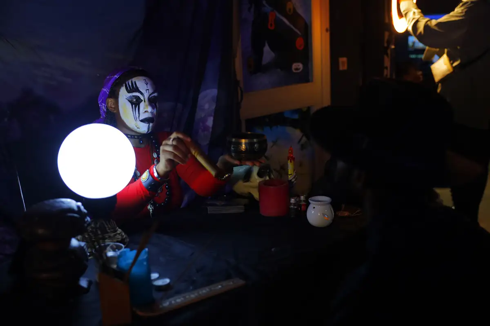
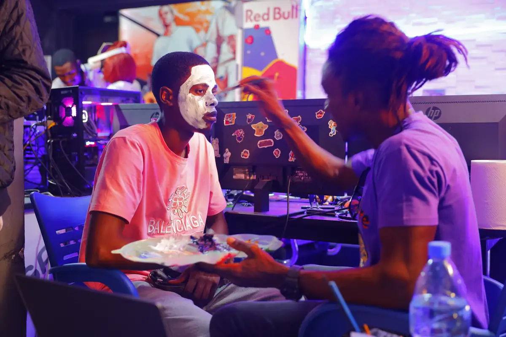
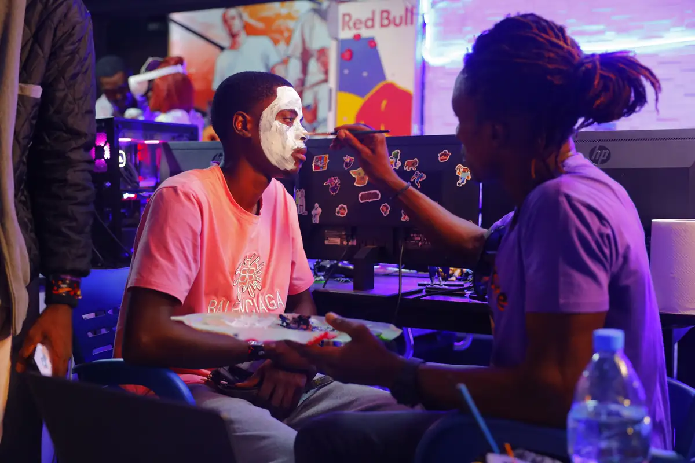
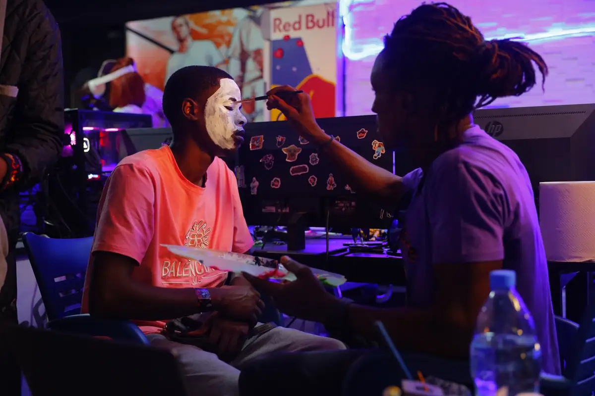
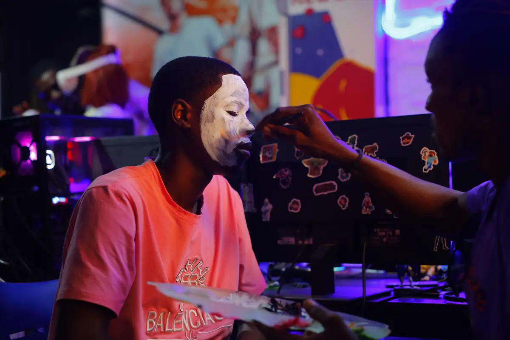
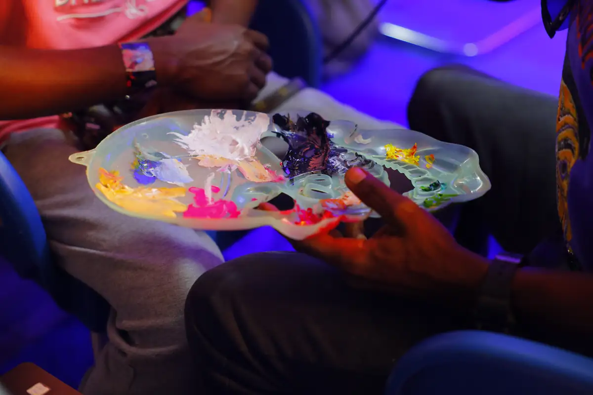

# Soirée d'Halloween au gaming center « Insomnia » (Red Bull)

<!-- wiki:infobox -->

| Soirée d'Halloween au gaming center « Insomnia » (Red Bull) | |
| --- | --- |
| Période | 30 octobre 2022 |
| Casquette | Exécution |
| Catégorie | Événement |
| Rôle | Couverture photo et vidéo |
| Folio | _pas encore sur le site_ |
| État de la fiche | À vérifier |
<!-- /wiki:infobox -->

**Soirée d'Halloween au gaming center « Insomnia » (Red Bull)** est un événement couvert en photo et en vidéo par Alexandre « Xtincell » Djengue (30 octobre 2022).

## Description

- **Lieu** : gaming center Insomnia
- **Organisateur ou client** : gaming center Insomnia (sponsor Red Bull)
- **Ce que montrent les images** : 30/10/2022 : maquillage d'Halloween, tournoi de jeux vidéo ; renommé dans _À identifier.
- **Identification** : enseigne « Insomnia », affiche de tournoi IGZ, Red Bull
- **Fiabilité** : lieu confirmé

## Galerie

<!-- wiki:galerie -->

<!-- /wiki:galerie -->

## Archives

- `_À identifier\P — 2022-10-30 — Soirée Halloween au gaming center « Insomnia » (Red Bull)` (81 fichiers, disque P:)

## Sources

- Notes « Événements couverts » établies lors du rangement des disques (28/10/2026), à partir des images, des dates de prise de vue et des livrables

<!-- wiki:liens-entrants -->
<!-- /wiki:liens-entrants -->
