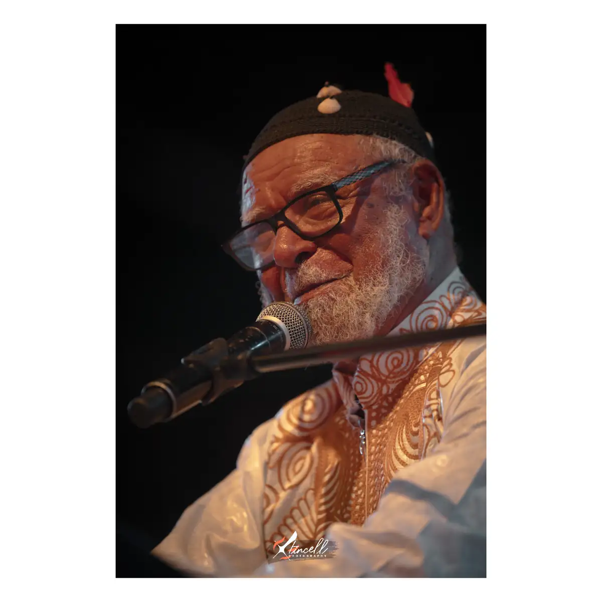
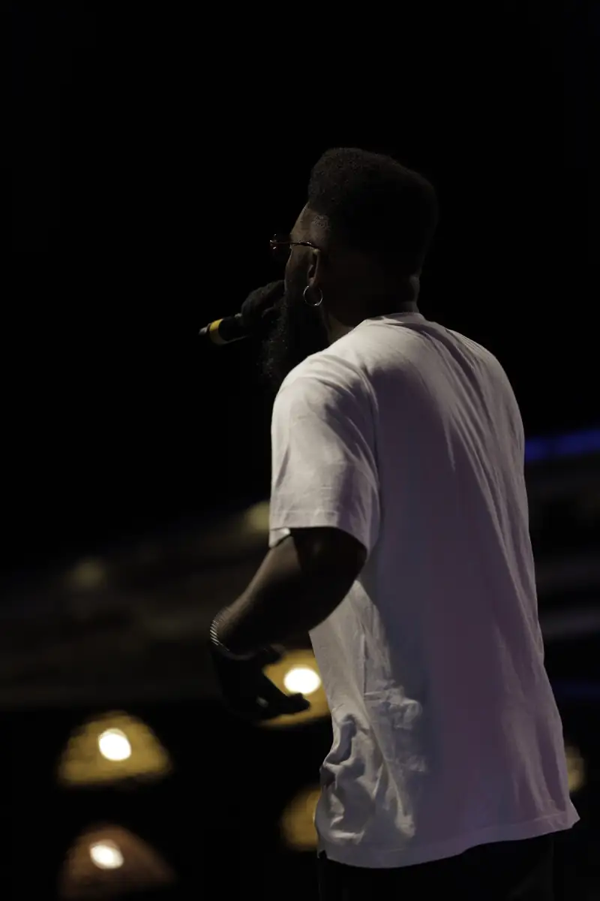
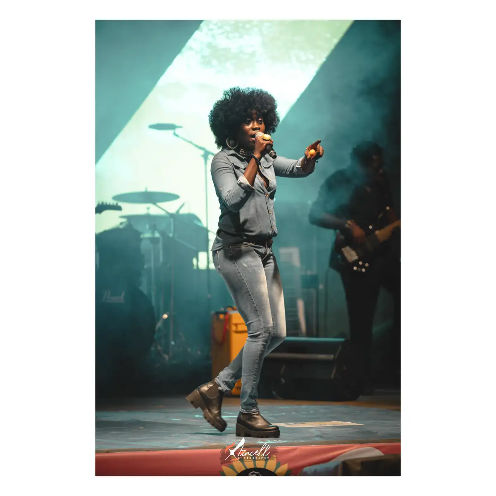
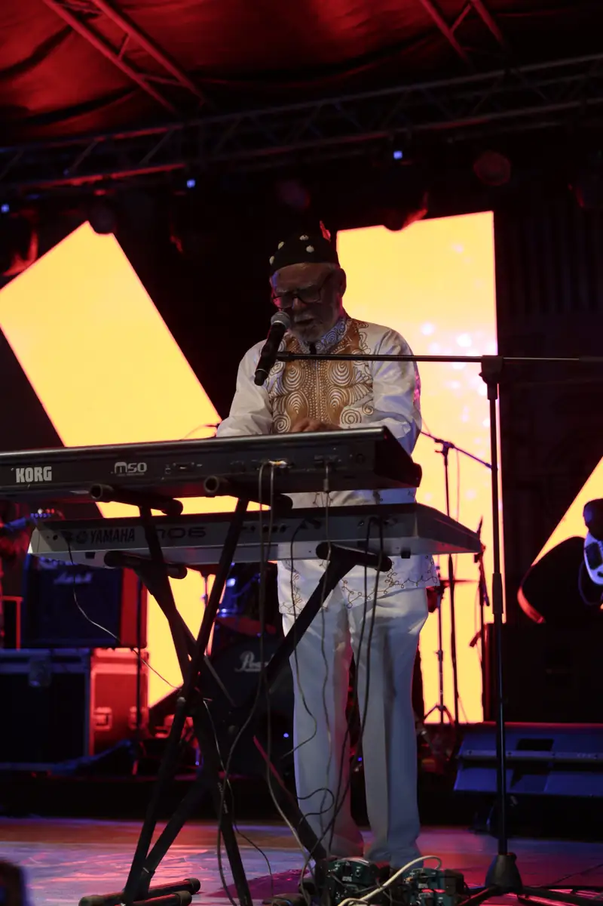

# DOMAF 2022 — concerts

<!-- wiki:infobox -->

| DOMAF 2022 — concerts | |
| --- | --- |
| Client | [DOMAF — Conseil Camerounais de la Musique](../organisations/domaf-conseil-camerounais-de-la-musique.md) |
| Via | [UPgraders](../organisations/upgraders.md) |
| Période | 13-14 novembre 2022 |
| Casquette | Exécution |
| Catégorie | Événement |
| Rôle | Couverture photo et vidéo |
| Fait partie de | [DOMAF — Conseil Camerounais de la Musique — travaux](domaf-conseil-camerounais-de-la-musique-travaux.md) |
| Folio | _pas encore sur le site_ |
| État de la fiche | Standard |
<!-- /wiki:infobox -->

**DOMAF 2022 — concerts** est un événement couvert en photo et en vidéo par Alexandre « Xtincell » Djengue (13-14 novembre 2022).

## Description

- **Lieu** : scène du festival DOMAF
- **Organisateur ou client** : DOMAF
- **Ce que montrent les images** : Dix JPG retouchés et signés Xtincell : artistes en scène et portraits backstage.
  - 13/11/2022 de 21 h à minuit : têtes d'affiche et jeunes talents, coulisses, public.
  - Version JPG de la soirée du 13/11/2022, mêmes numéros de fichiers que les RAW.
- **Identification** : noms de fichiers « ATango », « Anofel », « Dashor », « Fendoung » ; dossier client DOMAF 2022 (festival des 13-14/11/2022)
- **Fiabilité** : confirmé / confirmé (doublon JPG des RAW)

## Galerie

<!-- wiki:galerie -->

<!-- /wiki:galerie -->

## Archives

- `DOMAF — Conseil Camerounais de la Musique\2022\Domaf` (10 fichiers, disque C:)
- `DOMAF — Conseil Camerounais de la Musique\2022\Concert (13-14-11-2022) (déduit)` (1 124 fichiers, disque P:)
- `DOMAF — Conseil Camerounais de la Musique\2022\Photos (novembre 2022)` (1 124 fichiers, disque P:)

## Sources

- Notes « Événements couverts » établies lors du rangement des disques (28/10/2026), à partir des images, des dates de prise de vue et des livrables

<!-- wiki:liens-entrants -->
<!-- /wiki:liens-entrants -->
