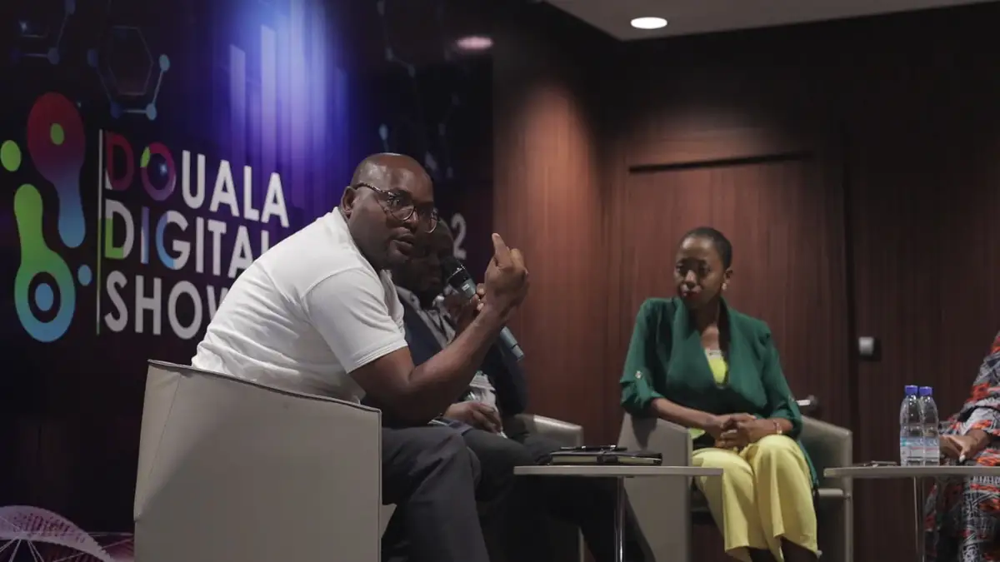
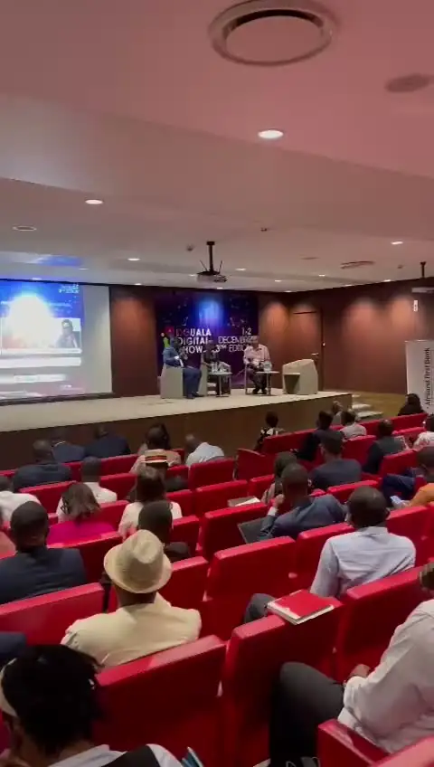
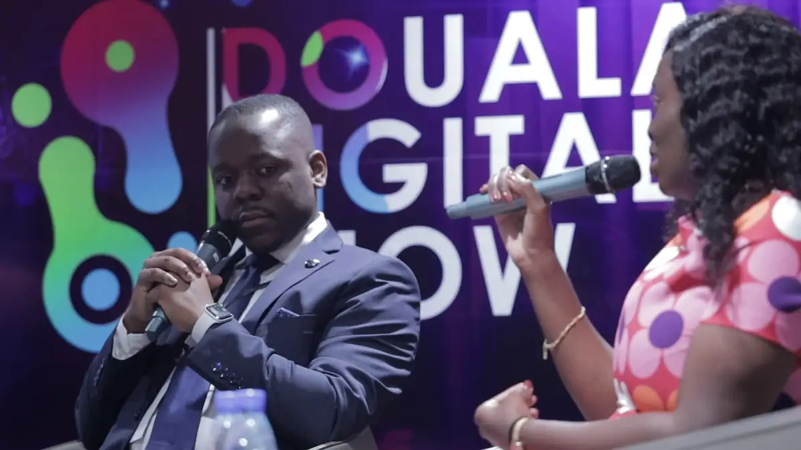
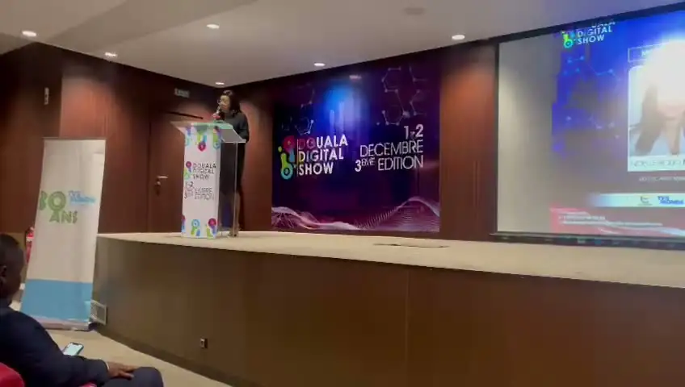
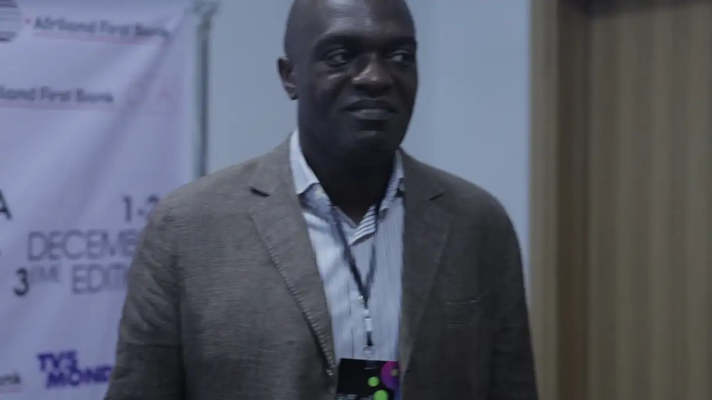
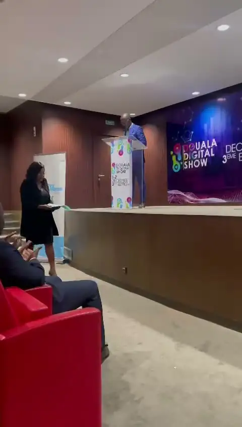

# Douala Digital Show — 3e édition (1er et 2 décembre 2022)

<!-- wiki:infobox -->

| Douala Digital Show — 3e édition (1er et 2 décembre 2022) | |
| --- | --- |
| Client | [OmenKart](../organisations/omenkart.md) |
| Via | [UPgraders](../organisations/upgraders.md) |
| Période | 1 décembre 2022 |
| Casquette | Exécution |
| Catégorie | Événement |
| Rôle | Couverture photo et vidéo |
| Folio | _pas encore sur le site_ |
| État de la fiche | Standard |
<!-- /wiki:infobox -->

**Douala Digital Show — 3e édition (1er et 2 décembre 2022)** est un événement couvert en photo et en vidéo par Alexandre « Xtincell » Djengue (1 décembre 2022).

## Description

- **Lieu** : auditorium aux fauteuils rouges, Douala
- **Organisateur ou client** : Douala Digital Show, avec Omenkart (OA) en communication ; partenaires Afriland First Bank, TV5 Monde, Ejara
- **Ce que montrent les images** : Vidéos des 01/12/2022 et suivants : keynotes, panels sur fauteuils, interviews devant le photocall, public.
- **Identification** : écran « Douala Digital Show — 1-2 décembre — 3e édition » ; photocall OA, Afriland First Bank, TV5 Monde ; roll-up Ejara
- **Fiabilité** : confirmé

## Galerie

<!-- wiki:galerie -->

<!-- /wiki:galerie -->

## Archives

- `Omenkart\2023\DDS` (89 fichiers, disque P:)

## Sources

- Notes « Événements couverts » établies lors du rangement des disques (28/10/2026), à partir des images, des dates de prise de vue et des livrables

<!-- wiki:liens-entrants -->
<!-- /wiki:liens-entrants -->
