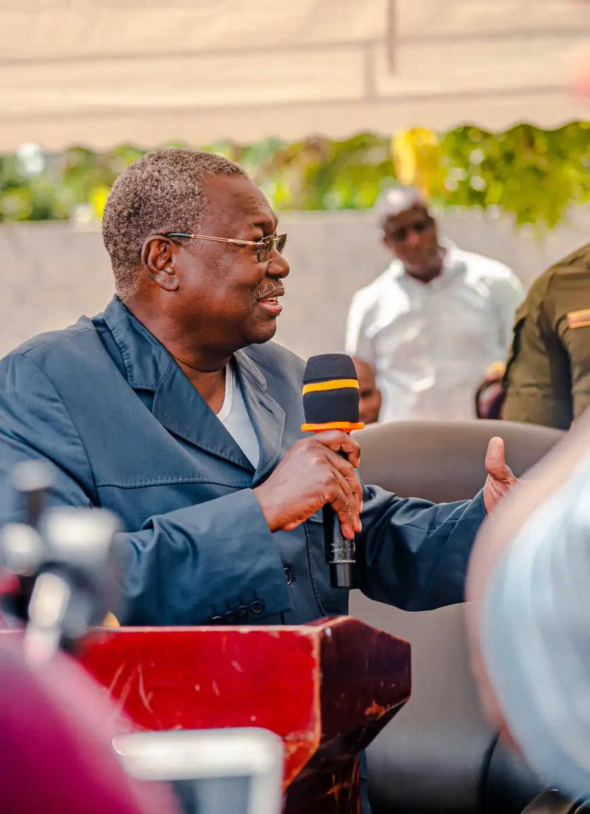
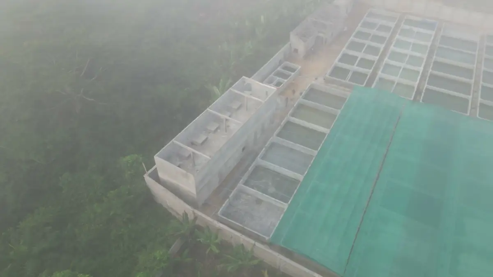
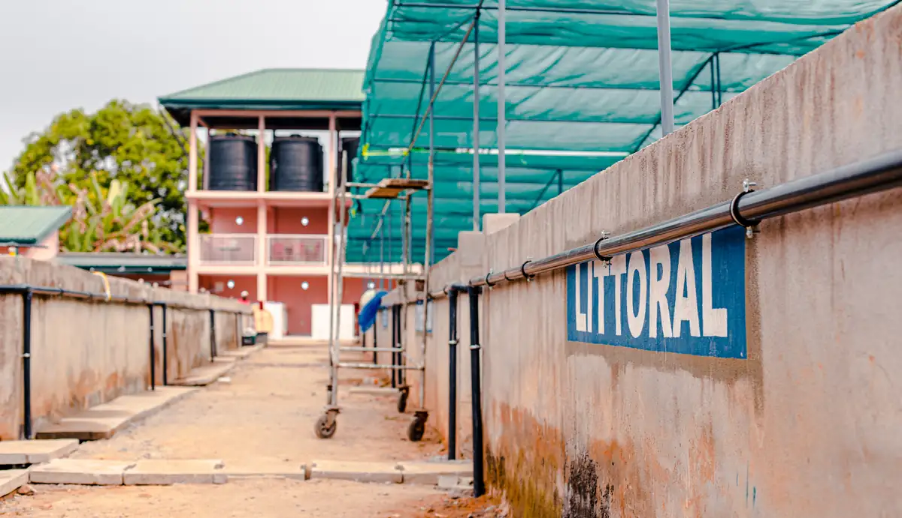
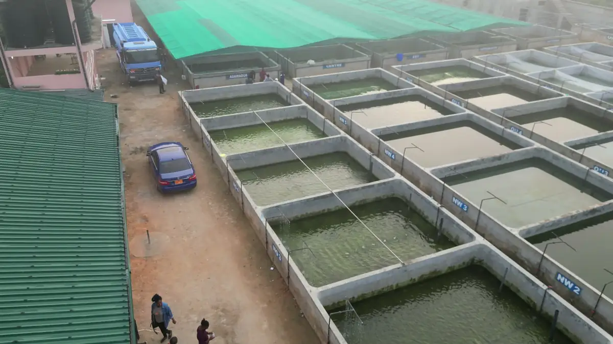
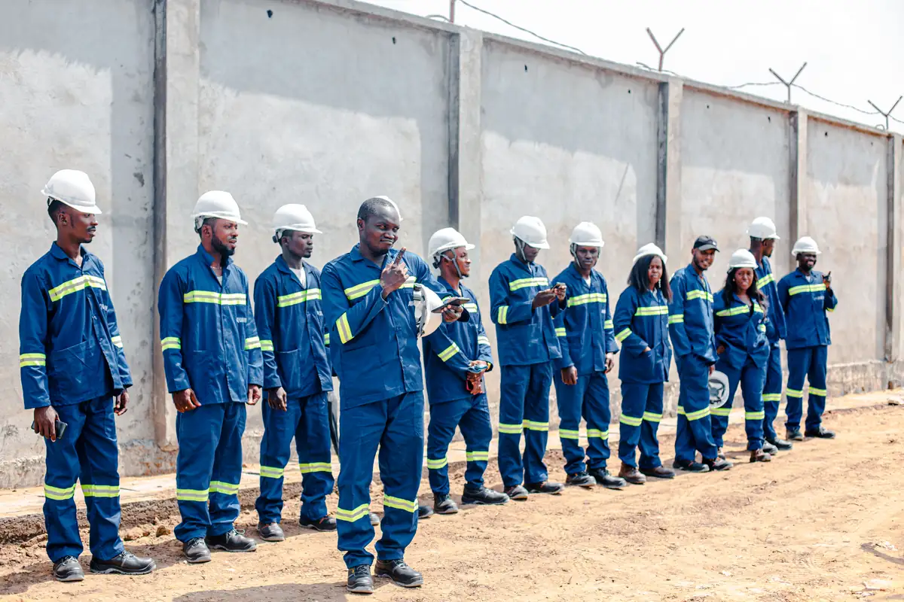
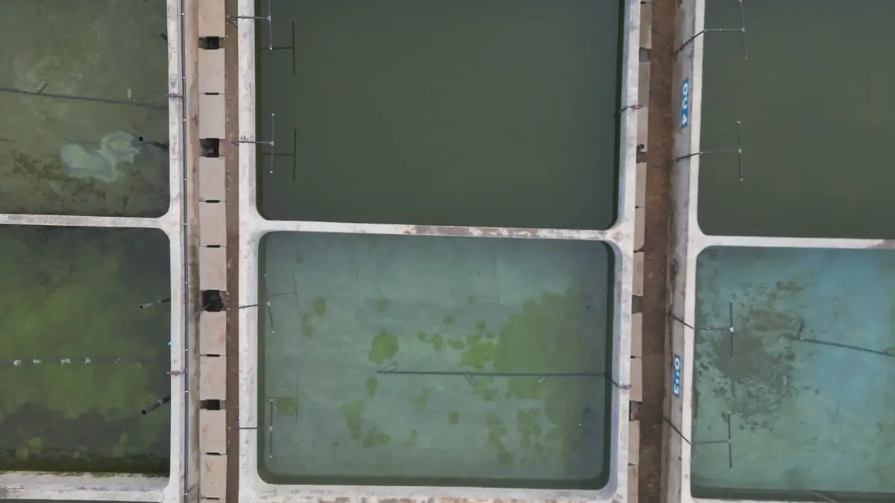

# Inauguration de la ferme aquacole Aquarin

<!-- wiki:infobox -->

| Inauguration de la ferme aquacole Aquarin | |
| --- | --- |
| Client | [Aquarin](../organisations/aquarin.md) |
| Via | [UPgraders](../organisations/upgraders.md) |
| Période | 27 décembre 2022 |
| Casquette | Exécution |
| Catégorie | Événement |
| Rôle | Couverture photo et vidéo |
| Fait partie de | [Aquarin — travaux](aquarin-travaux.md) |
| Folio | _pas encore sur le site_ |
| État de la fiche | Standard |
<!-- /wiki:infobox -->

**Inauguration de la ferme aquacole Aquarin** est un événement couvert en photo et en vidéo par Alexandre « Xtincell » Djengue (27 décembre 2022).

## Description

- **Lieu** : site aquacole Aquarin (bassins, usine d'aliments)
- **Organisateur ou client** : Aquarin
- **Ce que montrent les images** : Arrivée des officiels, visite des bassins et de l'extrudeuse d'aliments pour poissons, remise de gilets Aquarin, discours sous tente, photo de groupe avec le personnel.
  - Survol des bassins numérotés (NW, Nord-Ouest), des serres d'ombrage vertes et du site dans le brouillard.
- **Identification** : gilets et combinaisons « Aquarin » ; noms de fichiers 27122022-… (27/12/2022)
- **Fiabilité** : confirmé / déduit

## Galerie

<!-- wiki:galerie -->

<!-- /wiki:galerie -->

## Archives

- `Aquarin\2022\Aquarin` (163 fichiers, disque C:)
- `Aquarin\2023\Drone — visite du ministre (site aquacole)` (14 fichiers, disque C:)

## Sources

- Notes « Événements couverts » établies lors du rangement des disques (28/10/2026), à partir des images, des dates de prise de vue et des livrables

<!-- wiki:liens-entrants -->
<!-- /wiki:liens-entrants -->
