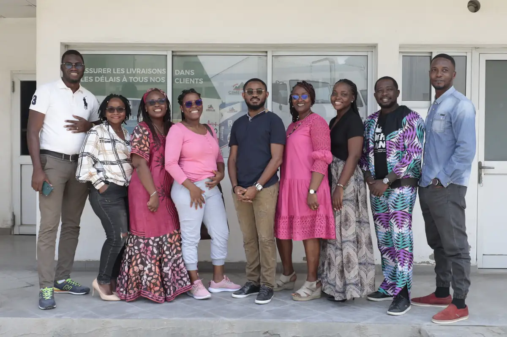
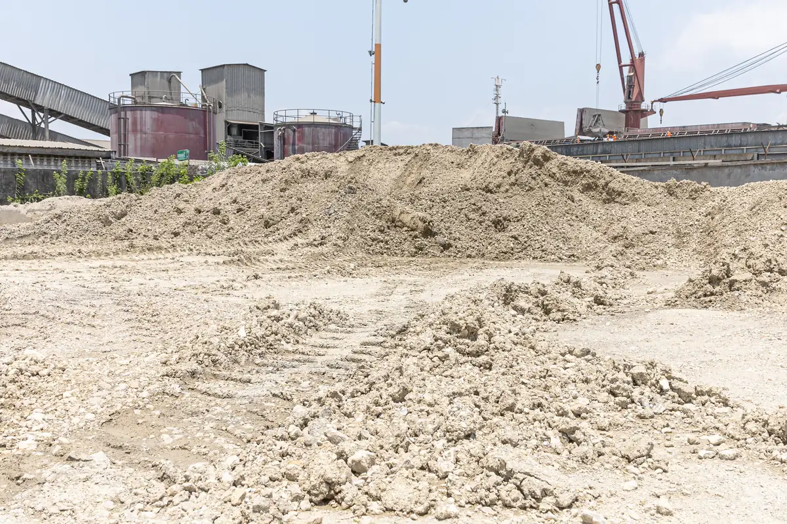

# Cimencam — reportage photo d'entreprise (usine de Bonabéri)

<!-- wiki:infobox -->

| Cimencam — reportage photo d'entreprise (usine de Bonabéri) | |
| --- | --- |
| Client | [Cimencam](../organisations/cimencam.md) |
| Via | [UPgraders](../organisations/upgraders.md) |
| Période | 27 février → 17 mars 2023 |
| Casquette | Exécution |
| Catégorie | Événement |
| Rôle | Couverture photo et vidéo |
| Fait partie de | [Cimencam — vidéo corporate](cimencam-video-corporate.md) |
| Folio | _pas encore sur le site_ |
| État de la fiche | Standard |
<!-- /wiki:infobox -->

**Cimencam — reportage photo d'entreprise (usine de Bonabéri)** est un événement couvert en photo et en vidéo par Alexandre « Xtincell » Djengue (27 février → 17 mars 2023).

## Description

- **Lieu** : cimenterie Cimencam, Douala
- **Organisateur ou client** : Omenkart pour Cimencam
- **Ce que montrent les images** : 27/02 et 17/03/2023 : portraits de direction au bureau, portraits d'employés en EPI, vues de l'usine (silo, sacs de ciment, ensacheuse), photos d'équipe.
  - Version livrée du reportage du n° 123 : portraits, silos, ensacheuse, usine de mortier, affiches de la politique santé-sécurité.
- **Identification** : logos Cimencam sur les silos et les combinaisons
- **Fiabilité** : confirmé

## Galerie

<!-- wiki:galerie -->

<!-- /wiki:galerie -->

## Archives

- `Omenkart\2023\Cimencam` (871 fichiers, disque P:)
- `Omenkart\2023\Omenkart Cimencam` (56 fichiers, disque P:)

## Sources

- Notes « Événements couverts » établies lors du rangement des disques (28/10/2026), à partir des images, des dates de prise de vue et des livrables

<!-- wiki:liens-entrants -->
<!-- /wiki:liens-entrants -->
