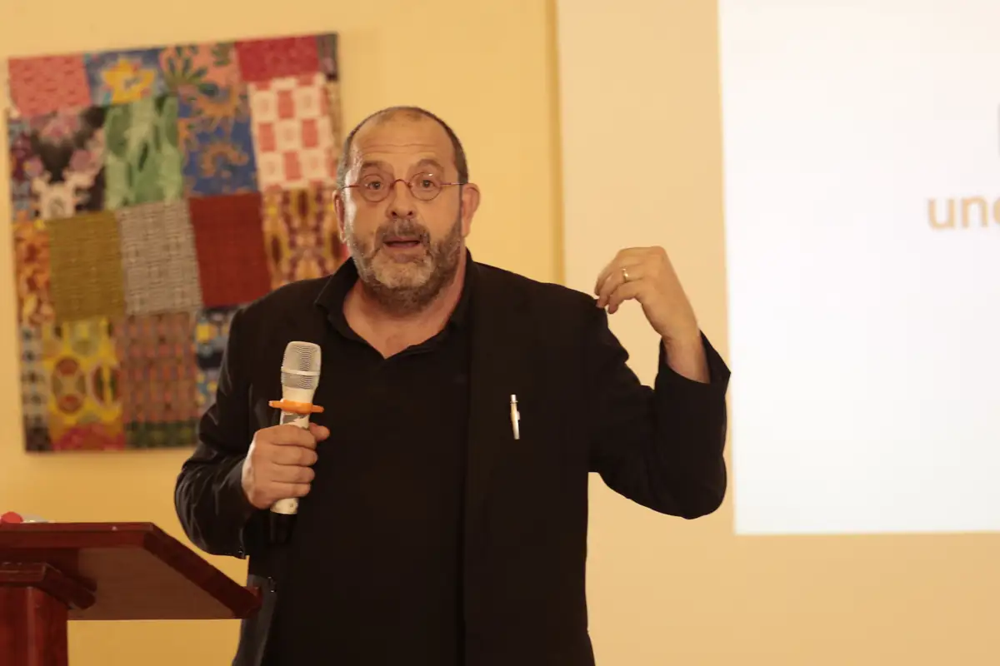
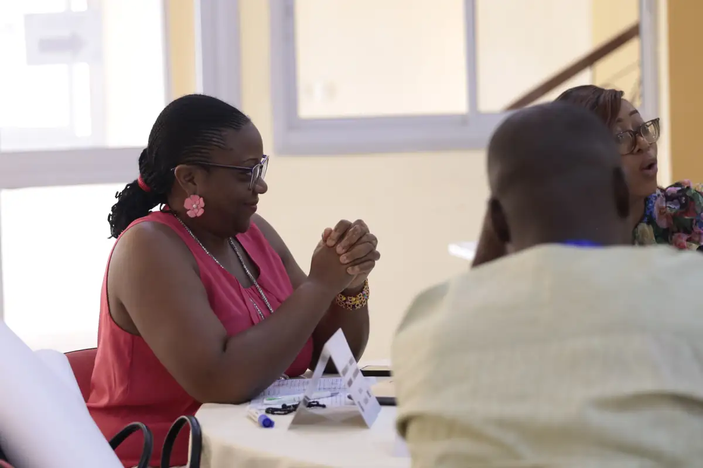
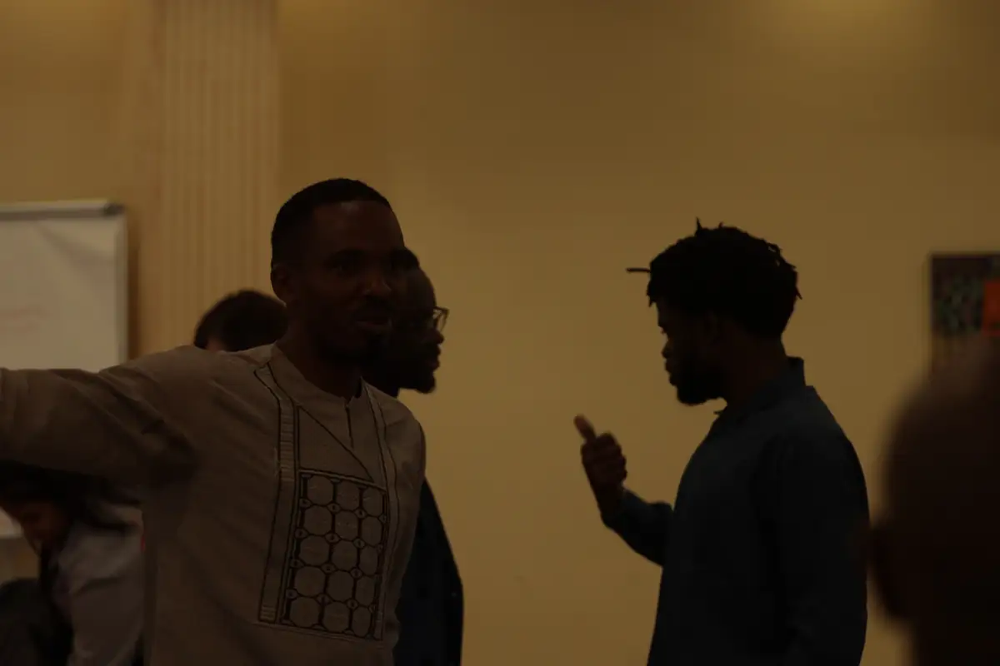
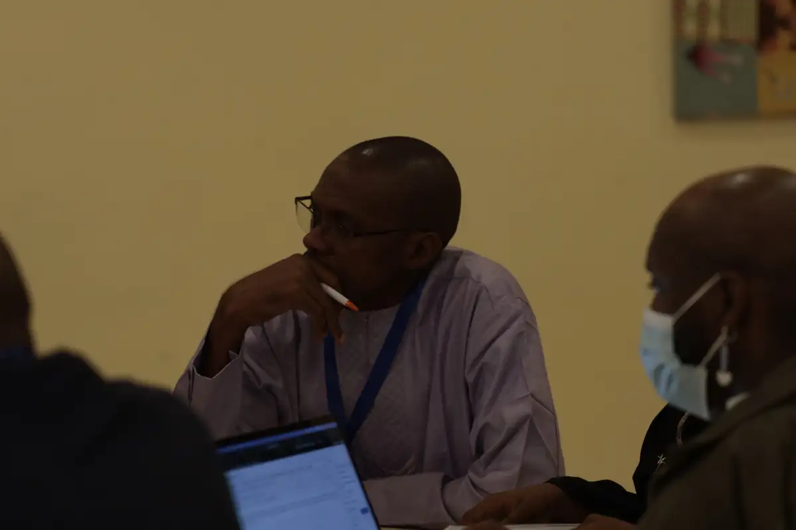
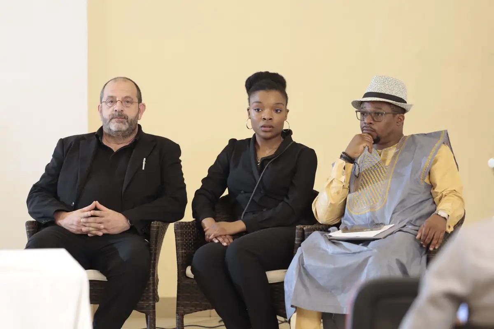
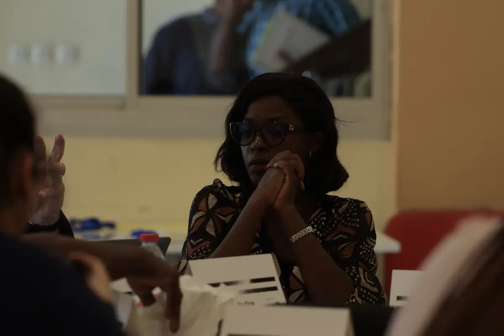

# Talk Paix (CFI) — atelier des médias (22-23 mars 2023)

<!-- wiki:infobox -->

| Talk Paix (CFI) — atelier des médias (22-23 mars 2023) | |
| --- | --- |
| Client | [Talk Paix (CFI)](../organisations/talk-paix-cfi.md) |
| Via | [UPgraders](../organisations/upgraders.md) |
| Période | 22-23 mars 2023 |
| Casquette | Exécution |
| Catégorie | Événement |
| Rôle | Couverture photo et vidéo |
| Fait partie de | [Talk Paix (CFI) — travaux](talk-paix-cfi-travaux.md) |
| Folio | _pas encore sur le site_ |
| État de la fiche | Standard |
<!-- /wiki:infobox -->

**Talk Paix (CFI) — atelier des médias (22-23 mars 2023)** est un événement couvert en photo et en vidéo par Alexandre « Xtincell » Djengue (22-23 mars 2023).

## Description

- **Lieu** : salle d'hôtel aux tentures wax, Yaoundé probable
- **Organisateur ou client** : CFI — Talk Paix / Talk Peace
- **Ce que montrent les images** : Panel d'ouverture, interventions au pupitre, débats, travaux de groupe sur paperboard, roll-up « Talk Paix — 10 médias, 24 mois ».
- **Identification** : roll-ups « Talk Paix — Talk Peace » ; porte-noms
- **Fiabilité** : confirmé

## Galerie

<!-- wiki:galerie -->

<!-- /wiki:galerie -->

## Archives

- `Talk Paix (CFI)\2023\Talk Paix (22-23-03-2023)` (1 036 fichiers, disque P:)

## Sources

- Notes « Événements couverts » établies lors du rangement des disques (28/10/2026), à partir des images, des dates de prise de vue et des livrables

<!-- wiki:liens-entrants -->
<!-- /wiki:liens-entrants -->
