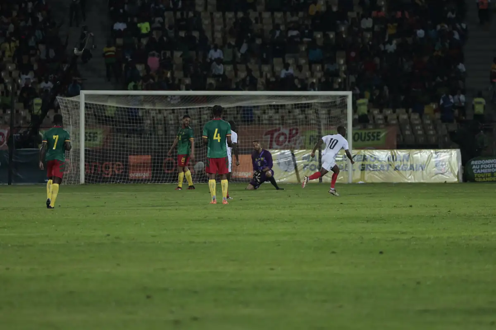
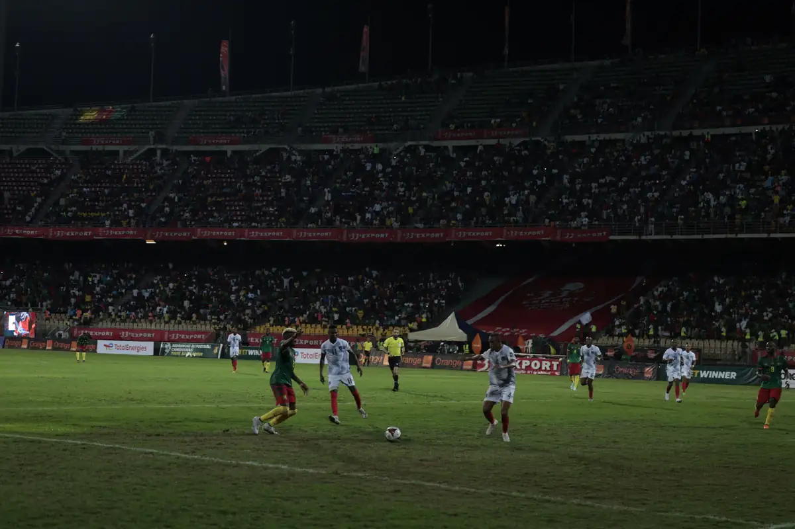
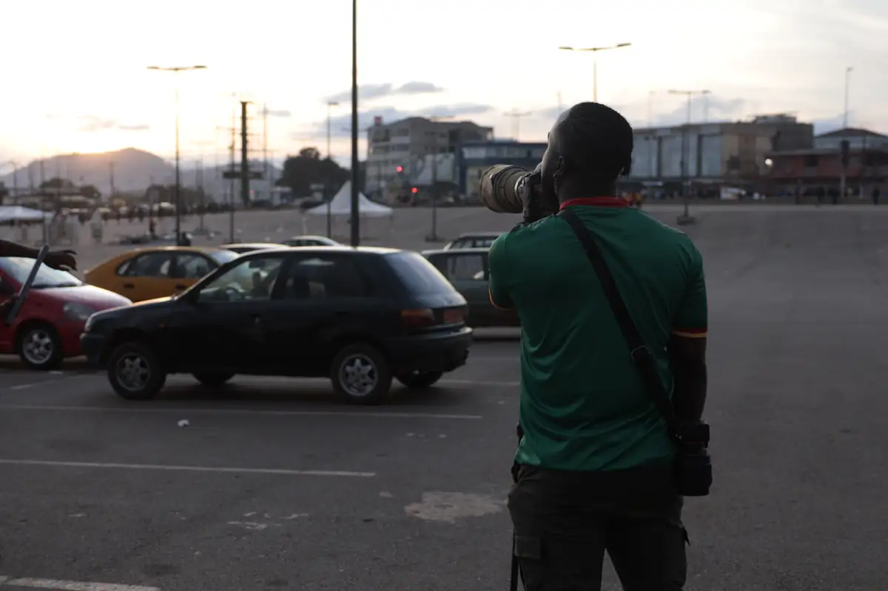
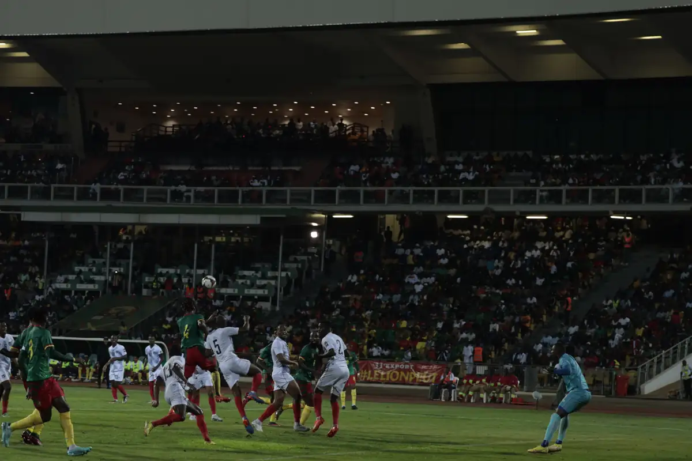
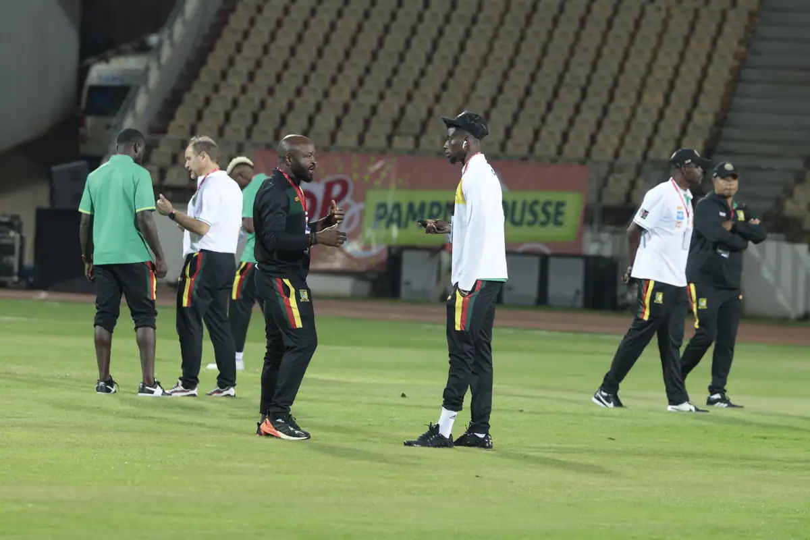
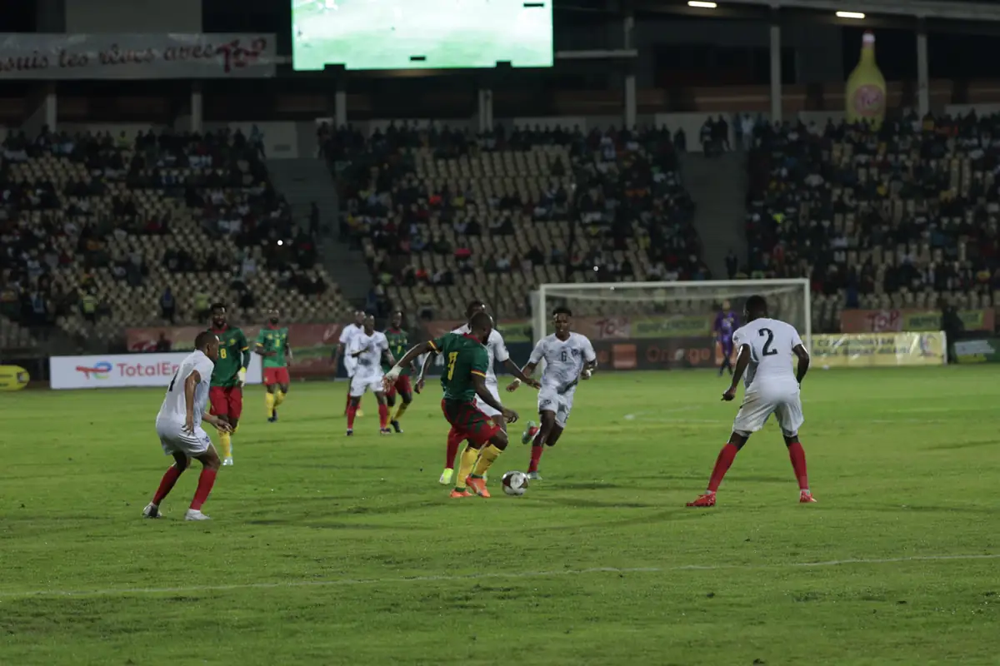

# Match Cameroun–Namibie (éliminatoires CAN 2023)

<!-- wiki:infobox -->

| Match Cameroun–Namibie (éliminatoires CAN 2023) | |
| --- | --- |
| Client | [LION DEN](../organisations/lion-den.md) |
| Via | [UPgraders](../organisations/upgraders.md) |
| Période | 24 mars 2023 |
| Casquette | Exécution |
| Catégorie | Événement |
| Rôle | Couverture photo et vidéo |
| Fait partie de | [LION DEN — travaux](lion-den-travaux.md) |
| Folio | _pas encore sur le site_ |
| État de la fiche | Standard |
<!-- /wiki:infobox -->

**Match Cameroun–Namibie (éliminatoires CAN 2023)** est un événement couvert en photo et en vidéo par Alexandre « Xtincell » Djengue (24 mars 2023).

## Description

- **Lieu** : stade Ahmadou Ahidjo (Mfandena), Yaoundé
- **Organisateur ou client** : Lion Den
- **Ce que montrent les images** : 24/03/2023 : installation, supporters en tribune, entrée des équipes, match de nuit (panneaux Orange, Top, 33 Export, Betwinner, Tradex), fumigènes.
- **Identification** : panneaux du stade ; logo CAN ; date du match qualificatif
- **Fiabilité** : confirmé

## Galerie

<!-- wiki:galerie -->

<!-- /wiki:galerie -->

## Archives

- `LION DEN\2023\Match Cameroun – Namibie (24-03-2023)` (3 759 fichiers, disque P:)

## Sources

- Notes « Événements couverts » établies lors du rangement des disques (28/10/2026), à partir des images, des dates de prise de vue et des livrables

<!-- wiki:liens-entrants -->
<!-- /wiki:liens-entrants -->
