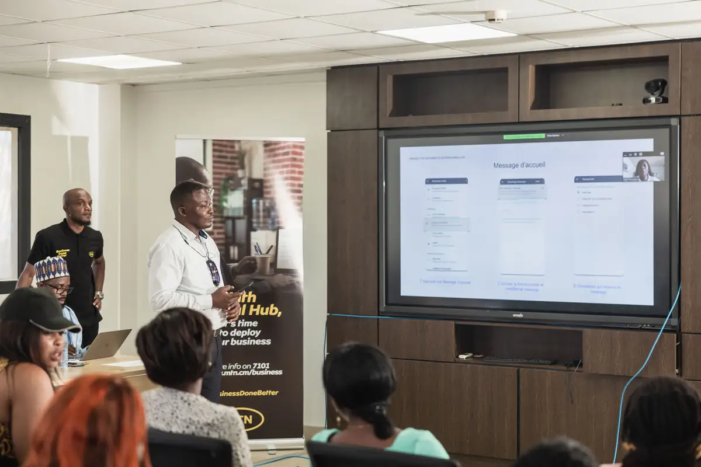
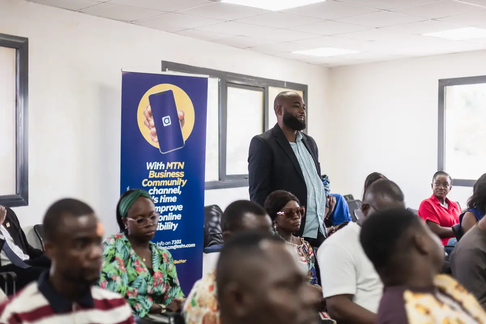

# MTN Business Academy — formation au marketing digital et remise de certificats

<!-- wiki:infobox -->

| MTN Business Academy — formation au marketing digital et remise de certificats | |
| --- | --- |
| Client | [MTN Cameroon](../organisations/mtn-cameroon.md) |
| Via | [UPgraders](../organisations/upgraders.md) |
| Période | 11-12 mai 2023 |
| Casquette | Exécution |
| Catégorie | Événement |
| Rôle | Couverture photo et vidéo |
| Fait partie de | [MTN Cameroon — travaux](mtn-cameroon-travaux.md) |
| Folio | _pas encore sur le site_ |
| État de la fiche | Standard |
<!-- /wiki:infobox -->

**MTN Business Academy — formation au marketing digital et remise de certificats** est un événement couvert en photo et en vidéo par Alexandre « Xtincell » Djengue (11-12 mai 2023).

## Description

- **Lieu** : salle de formation de MTN (Digital Hub), Douala
- **Organisateur ou client** : MTN Cameroon (MTN Business Academy, programme « Grow your business »)
- **Ce que montrent les images** : 11-12/05/2023 : formation en salle, interventions, remise des certificats devant le roll-up « Grow your business ! », interview sur le photocall MTN Business Academy.
- **Identification** : roll-ups « MTN — Grow your business ! Receive free training in Digital Marketing » et photocall « MTN Business Academy #LeBusinessEnMieux »
- **Fiabilité** : confirmé

## Galerie

<!-- wiki:galerie -->

<!-- /wiki:galerie -->

## Archives

- `MTN Cameroon\2023\2023-05-26` (253 fichiers, disque P:)

## Sources

- Notes « Événements couverts » établies lors du rangement des disques (28/10/2026), à partir des images, des dates de prise de vue et des livrables

<!-- wiki:liens-entrants -->
<!-- /wiki:liens-entrants -->
