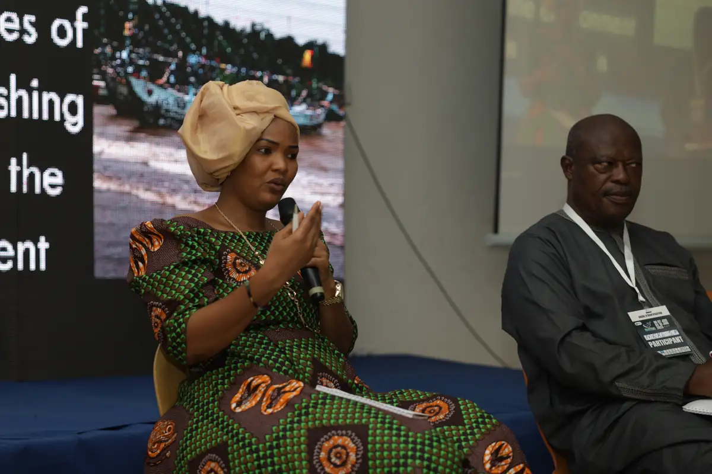
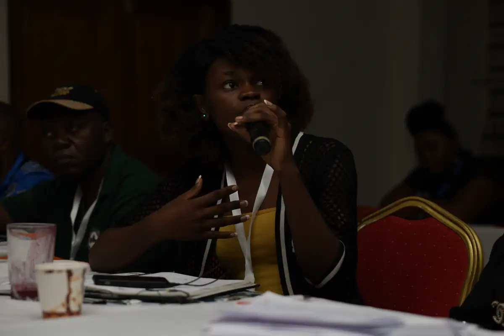
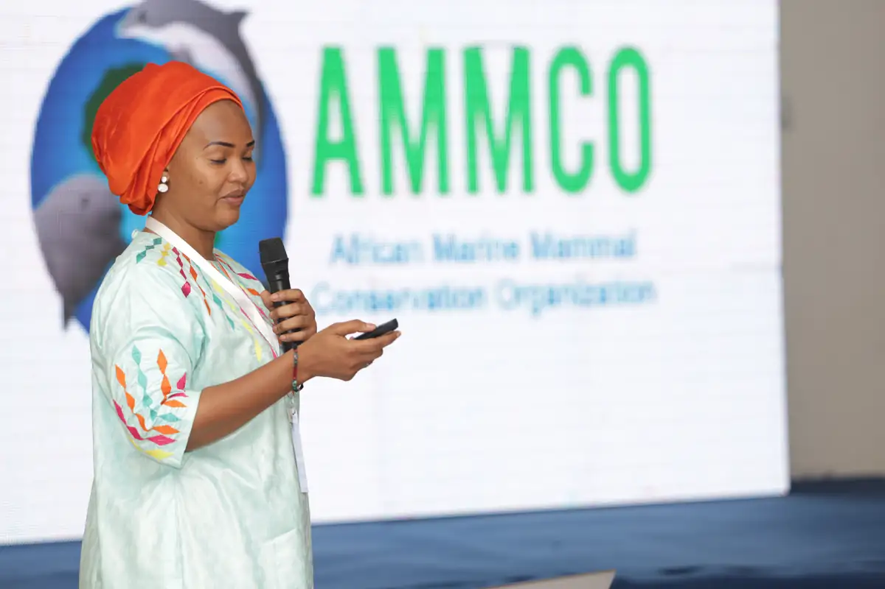
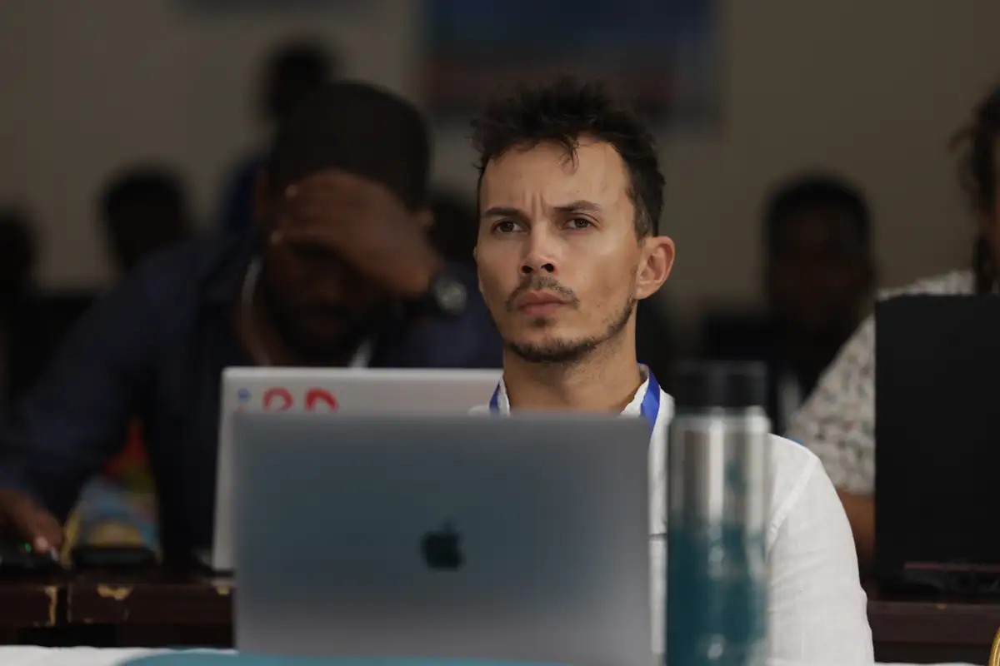

# Festival Street Whale 2023

<!-- wiki:infobox -->

| Festival Street Whale 2023 | |
| --- | --- |
| Client | [AMMCO](../organisations/ammco.md) |
| Via | [UPgraders](../organisations/upgraders.md) |
| Période | 7-10 juin 2023 |
| Casquette | Exécution |
| Catégorie | Événement |
| Rôle | Couverture photo et vidéo |
| Fait partie de | [Street Whale](street-whale.md) |
| Folio | _pas encore sur le site_ |
| État de la fiche | Standard |
<!-- /wiki:infobox -->

**Festival Street Whale 2023** est un événement couvert en photo et en vidéo par Alexandre « Xtincell » Djengue (7-10 juin 2023).

## Description

- **Lieu** : Kribi, village de pêcheurs et salle de conférence (bord de mer)
- **Organisateur ou client** : AMMCO / Street Whale
- **Ce que montrent les images** : 07-10/06/2023 : photo officielle devant la scène « Bienvenue au Street Whale 2023 », panels scientifiques (pêche INN), danses, cadre photo « Street Whale 2023 », vue de drone sur la plage.
- **Identification** : scène « Bienvenue au Street Whale 2023 » ; cadre photo « Street Whale 2023 — Join the wave to save the whales » ; logo AMMCO projeté
- **Fiabilité** : confirmé

## Galerie

<!-- wiki:galerie -->

<!-- /wiki:galerie -->

## Archives

- `StreetWhale\2023\2023 SW` (545 fichiers, disque C:)

## Sources

- Notes « Événements couverts » établies lors du rangement des disques (28/10/2026), à partir des images, des dates de prise de vue et des livrables

<!-- wiki:liens-entrants -->
<!-- /wiki:liens-entrants -->
