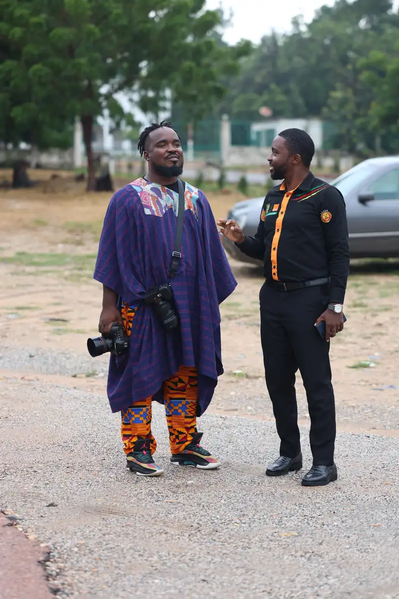
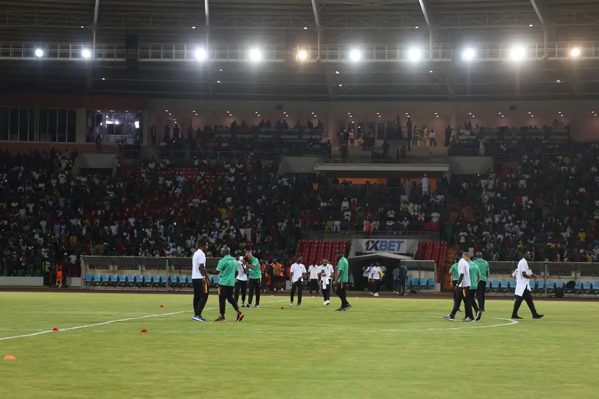
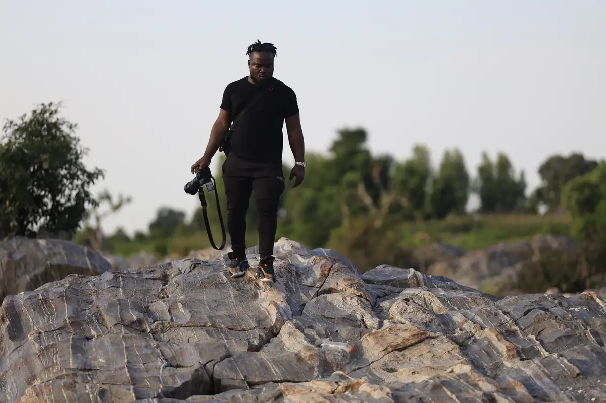
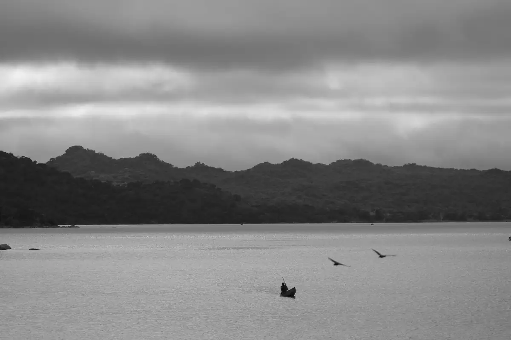
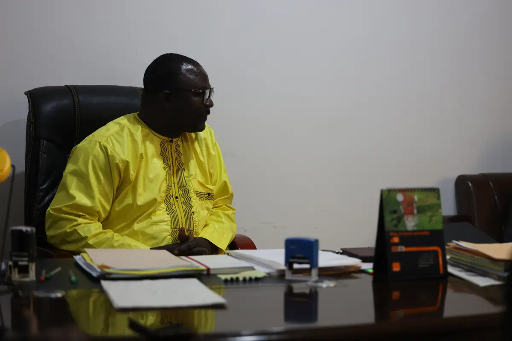
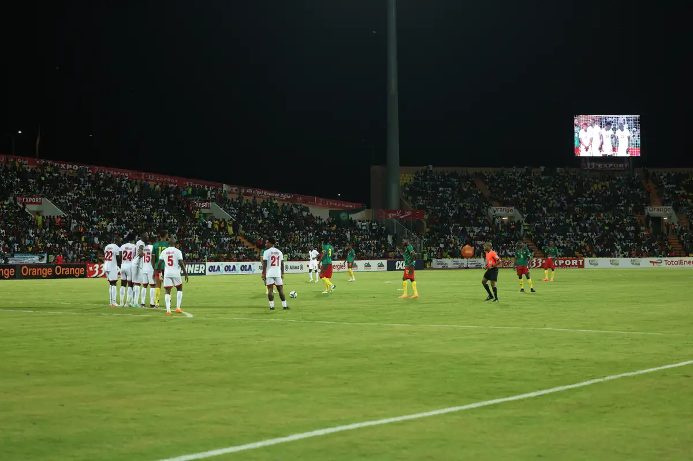

# Voyage Lion Den à Garoua — Cameroun–Burundi et visites

<!-- wiki:infobox -->

| Voyage Lion Den à Garoua — Cameroun–Burundi et visites | |
| --- | --- |
| Client | [LION DEN](../organisations/lion-den.md) |
| Via | [UPgraders](../organisations/upgraders.md) |
| Période | 11-14 septembre 2023 |
| Casquette | Exécution |
| Catégorie | Événement |
| Rôle | Couverture photo et vidéo |
| Fait partie de | [LION DEN — travaux](lion-den-travaux.md) |
| Folio | _pas encore sur le site_ |
| État de la fiche | Standard |
<!-- /wiki:infobox -->

**Voyage Lion Den à Garoua — Cameroun–Burundi et visites** est un événement couvert en photo et en vidéo par Alexandre « Xtincell » Djengue (11-14 septembre 2023).

## Description

- **Lieu** : Garoua (stade Roumdé Adjia, résidence officielle, lac de Lagdo, rochers)
- **Organisateur ou client** : Lion Den
- **Ce que montrent les images** : 11-15/09/2023 : audience officielle et remise de maillot, match Cameroun–Burundi de nuit (panneaux Orange, 1xBet, 33 Export), paysages du lac et des rochers, auberge.
- **Identification** : maillot « #Lions4Life » ; panneaux du stade ; match qualificatif CAN du 12/09/2023
- **Fiabilité** : confirmé

## Galerie

<!-- wiki:galerie -->

<!-- /wiki:galerie -->

## Archives

- `LION DEN\2023\Garoua — match Cameroun–Burundi et visites (11-15-09-2023) (déduit)` (13 715 fichiers, disque P:)

## Sources

- Notes « Événements couverts » établies lors du rangement des disques (28/10/2026), à partir des images, des dates de prise de vue et des livrables

<!-- wiki:liens-entrants -->
<!-- /wiki:liens-entrants -->
