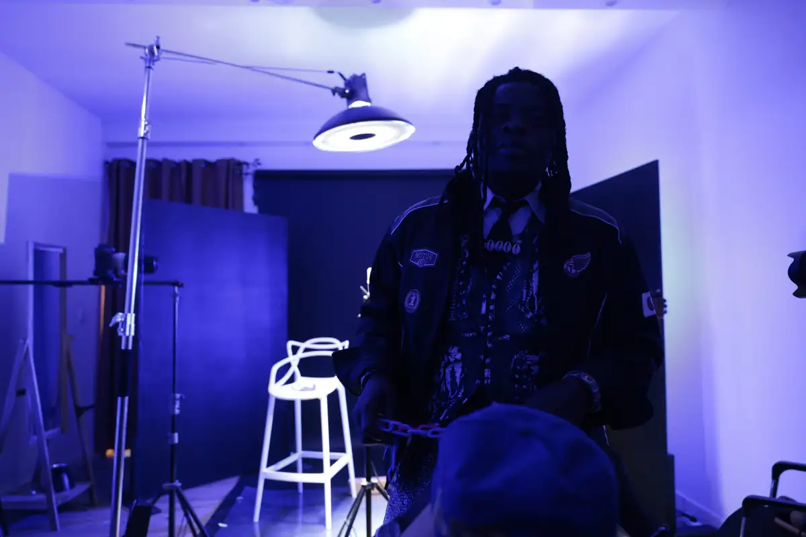
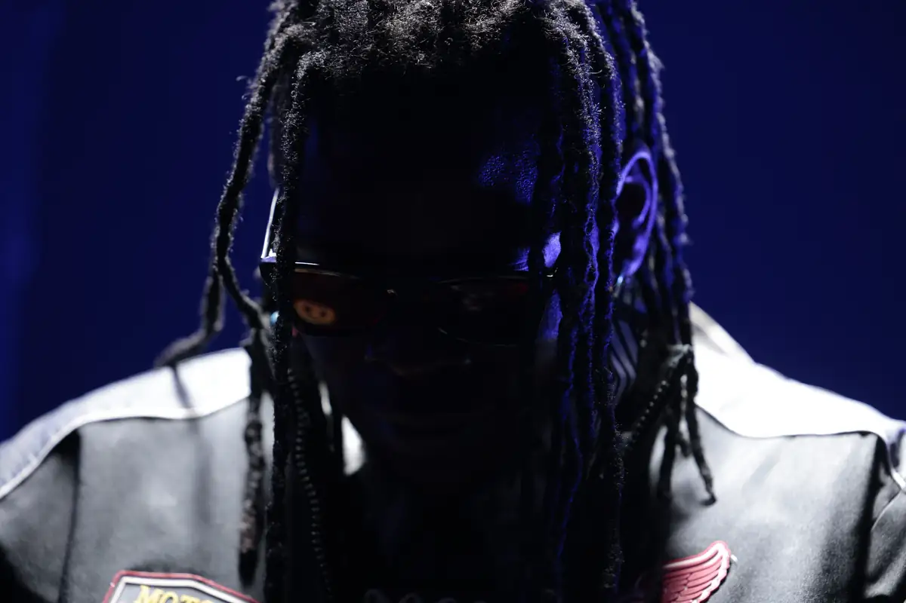
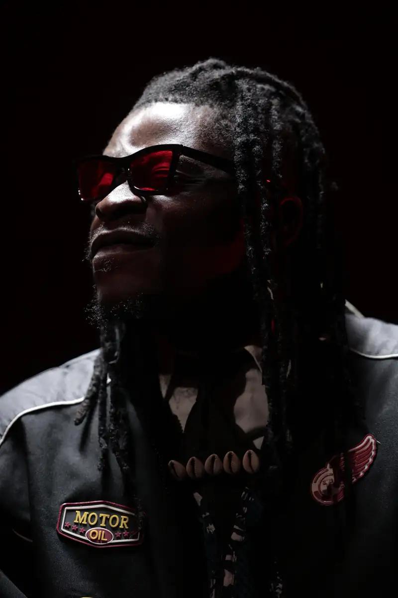
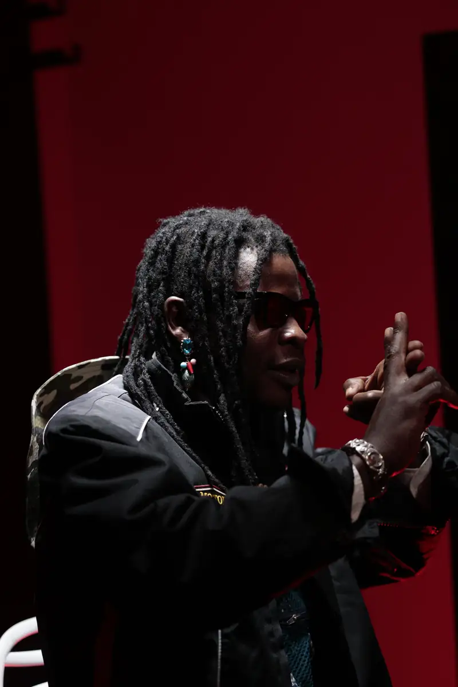
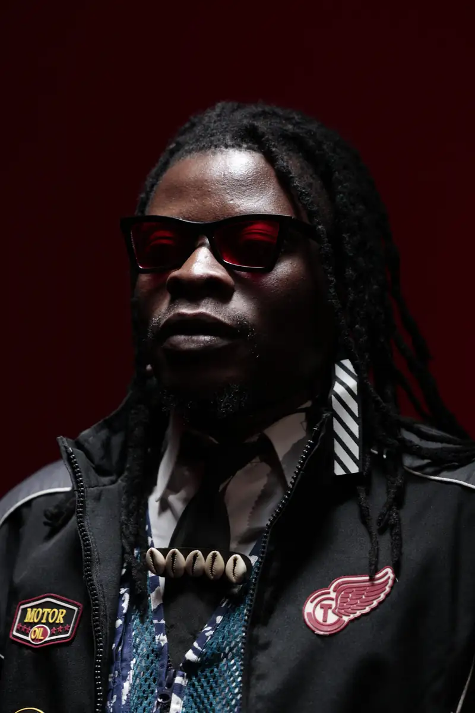

# Mounpoubeyi — séance photo en studio (« Moun 2009 »)

<!-- wiki:infobox -->

| Mounpoubeyi — séance photo en studio (« Moun 2009 ») | |
| --- | --- |
| Client | [Mounpoubeyi](../organisations/mounpoubeyi.md) |
| Via | [UPgraders](../organisations/upgraders.md) |
| Période | 19-20 septembre 2023 |
| Casquette | Exécution |
| Catégorie | Événement |
| Rôle | Couverture photo et vidéo |
| Fait partie de | [Mounpoubeyi — travaux](mounpoubeyi-travaux.md) |
| Folio | _pas encore sur le site_ |
| État de la fiche | Standard |
<!-- /wiki:infobox -->

**Mounpoubeyi — séance photo en studio (« Moun 2009 »)** est un événement couvert en photo et en vidéo par Alexandre « Xtincell » Djengue (19-20 septembre 2023).

## Description

- **Lieu** : studio d'enregistrement aux murs rouges (micro Neumann, fumée)
- **Organisateur ou client** : Mounpoubeyi
- **Ce que montrent les images** : 20/09/2023 après-midi : portraits en lumière dure, poses au micro, fumée, tenue en chaînes colorées.
- **Identification** : dossier client « Mounpoubeyi » ; nom « Moun 2009 »
- **Fiabilité** : confirmé

## Galerie

<!-- wiki:galerie -->

<!-- /wiki:galerie -->

## Archives

- `Mounpoubeyi\2023\Photos (Moun 2009)` (2 610 fichiers, disque P:)

## Sources

- Notes « Événements couverts » établies lors du rangement des disques (28/10/2026), à partir des images, des dates de prise de vue et des livrables

<!-- wiki:liens-entrants -->
<!-- /wiki:liens-entrants -->
