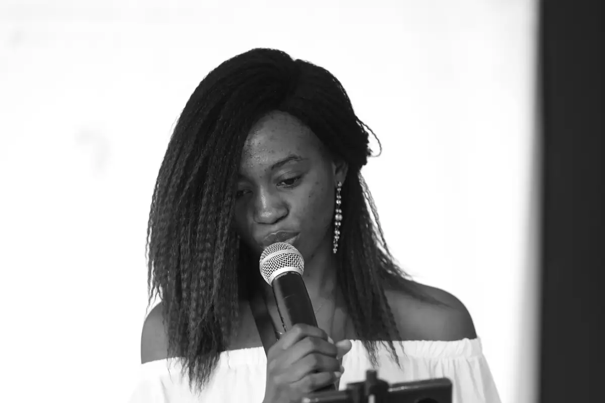
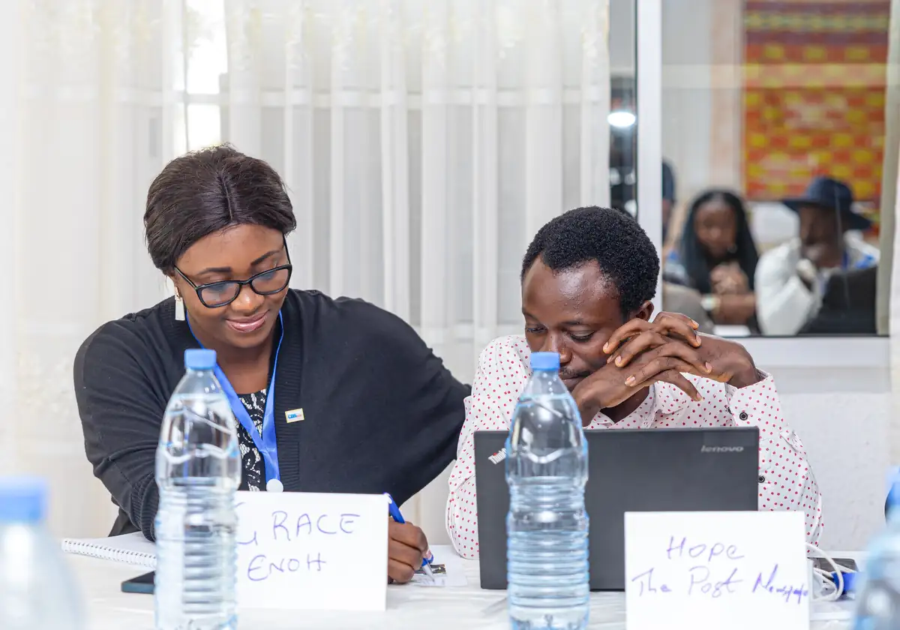
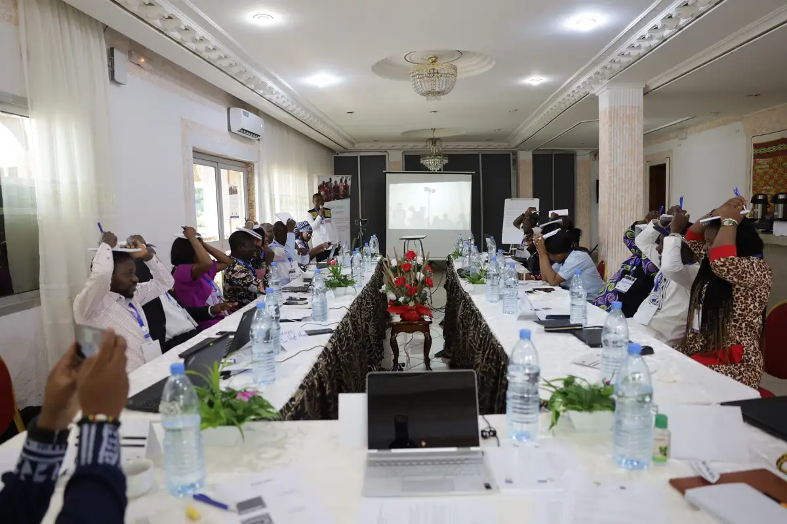
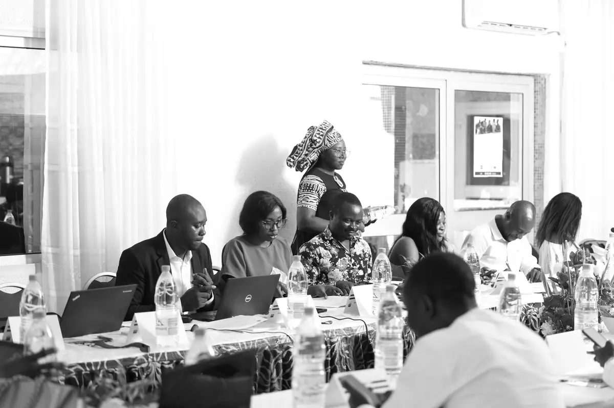
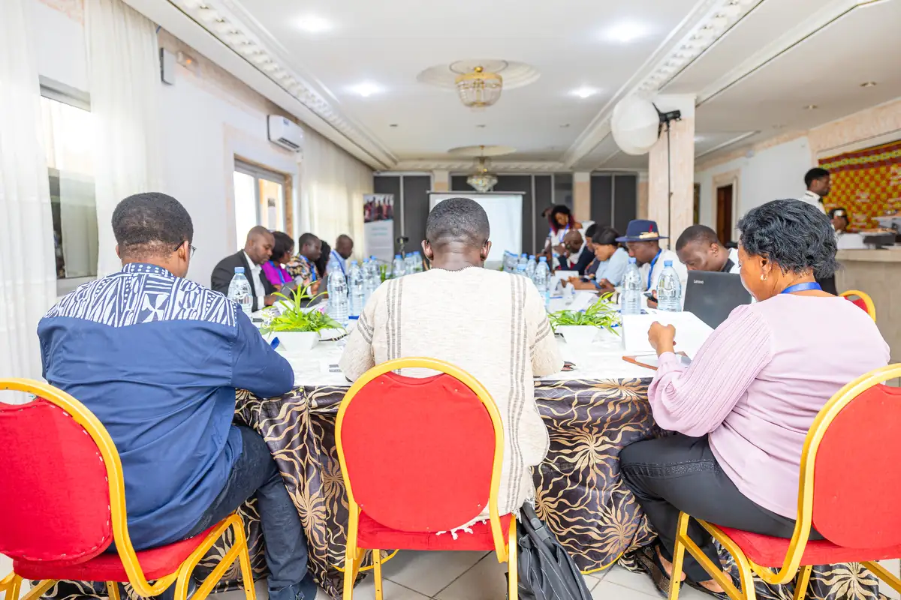

# Talk Paix (CFI) — atelier de Limbé (octobre 2023)

<!-- wiki:infobox -->

| Talk Paix (CFI) — atelier de Limbé (octobre 2023) | |
| --- | --- |
| Client | [Talk Paix (CFI)](../organisations/talk-paix-cfi.md) |
| Via | [UPgraders](../organisations/upgraders.md) |
| Période | 20 octobre 2023 |
| Casquette | Exécution |
| Catégorie | Événement |
| Rôle | Couverture photo et vidéo |
| Fait partie de | [Talk Paix (CFI) — travaux](talk-paix-cfi-travaux.md) |
| Folio | _pas encore sur le site_ |
| État de la fiche | Standard |
<!-- /wiki:infobox -->

**Talk Paix (CFI) — atelier de Limbé (octobre 2023)** est un événement couvert en photo et en vidéo par Alexandre « Xtincell » Djengue (20 octobre 2023).

## Description

- **Lieu** : salle de conférence d'hôtel, Limbé
- **Organisateur ou client** : CFI — Talk Paix / Talk Peace
- **Ce que montrent les images** : 20/10/2023 de 9 h à 14 h, livré en noir et blanc : prises de parole au micro, travaux en sous-groupes, exercices devant le roll-up Talk Paix, smartphone sur trépied.
  - 08-14/10/2023 : sélection retouchée des séances, prises de parole, photo de groupe devant le roll-up Talk Paix.
  - 20/10/2023 de 7 h à 15 h : RAW de la dernière journée (voir le n° 38).
- **Identification** : roll-up « Talk Paix — Talk Peace » ; même date que les rushes « Limbe » sur P:
- **Fiabilité** : confirmé

## Galerie

<!-- wiki:galerie -->

<!-- /wiki:galerie -->

## Archives

- `Talk Paix (CFI)\2023\Photos — atelier du 20 octobre 2023` (819 fichiers, disque C:)
- `Talk Paix (CFI)\2023\Limbe (exports)` (115 fichiers, disque P:)
- `Talk Paix (CFI)\2023\Limbe (rushes 2023-10-20)` (1 270 fichiers, disque P:)

## Sources

- Notes « Événements couverts » établies lors du rangement des disques (28/10/2026), à partir des images, des dates de prise de vue et des livrables

<!-- wiki:liens-entrants -->
<!-- /wiki:liens-entrants -->
