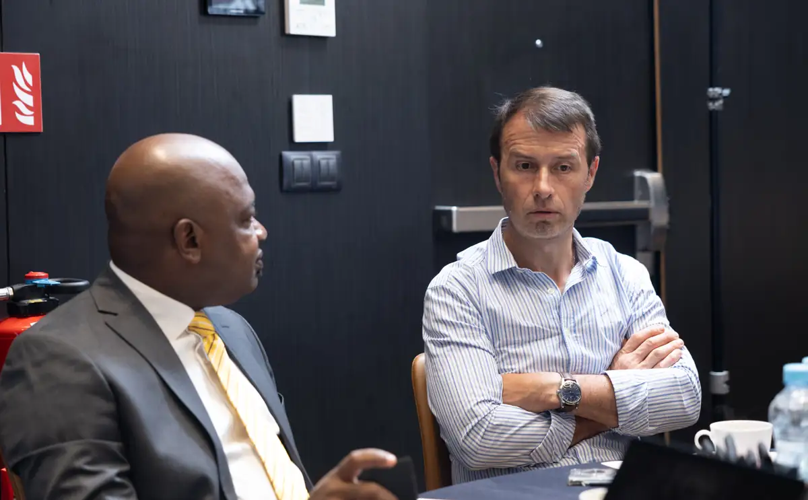
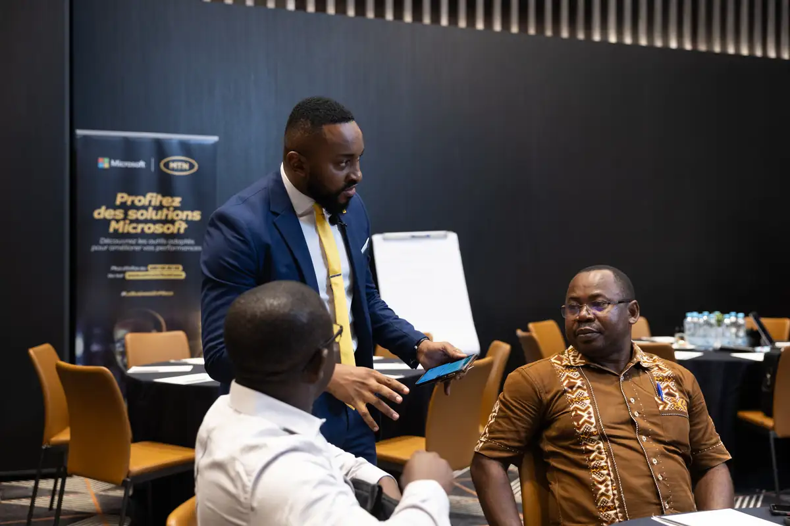
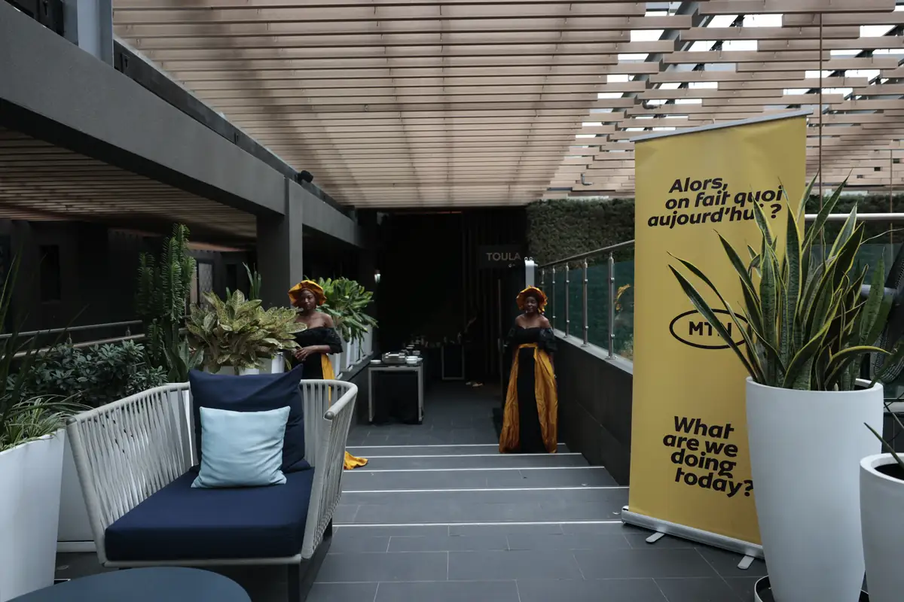

# MTN Y'ello Forum — rencontre entreprises (MTN Business × Microsoft)

<!-- wiki:infobox -->

| MTN Y'ello Forum — rencontre entreprises (MTN Business × Microsoft) | |
| --- | --- |
| Client | [MTN Cameroon](../organisations/mtn-cameroon.md) |
| Via | [UPgraders](../organisations/upgraders.md) |
| Période | 9 novembre 2023 |
| Casquette | Exécution |
| Catégorie | Événement |
| Rôle | Couverture photo et vidéo |
| Fait partie de | [MTN Cameroon — travaux](mtn-cameroon-travaux.md) |
| Folio | _pas encore sur le site_ |
| État de la fiche | Standard |
<!-- /wiki:infobox -->

**MTN Y'ello Forum — rencontre entreprises (MTN Business × Microsoft)** est un événement couvert en photo et en vidéo par Alexandre « Xtincell » Djengue (9 novembre 2023).

## Description

- **Lieu** : K Hotel, Douala (salle de conférence et restaurant Toula)
- **Organisateur ou client** : MTN Cameroon (MTN Business)
- **Ce que montrent les images** : 09/11/2023 : tables rondes, prises de parole au micro, roll-ups « Pro NoLimit » et « Profitez des solutions Microsoft », présentation « Insights », photo de groupe.
- **Identification** : roll-ups MTN et Microsoft ; écran « Y'ello… » ; diapositive « Insights by Mr. Blaise Ndongang, CIO – Boissons du Cameroun » ; logo K Hotel
- **Fiabilité** : confirmé

## Galerie

<!-- wiki:galerie -->

<!-- /wiki:galerie -->

## Archives

- `MTN Cameroon\2023\Yellow Forum (novembre)` (1 907 fichiers, disque P:)

## Sources

- Notes « Événements couverts » établies lors du rangement des disques (28/10/2026), à partir des images, des dates de prise de vue et des livrables

<!-- wiki:liens-entrants -->
<!-- /wiki:liens-entrants -->
