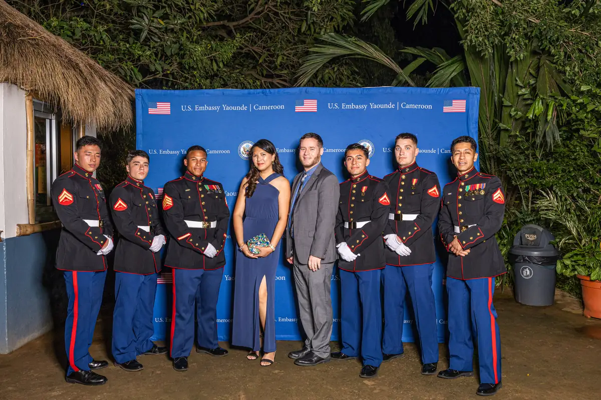
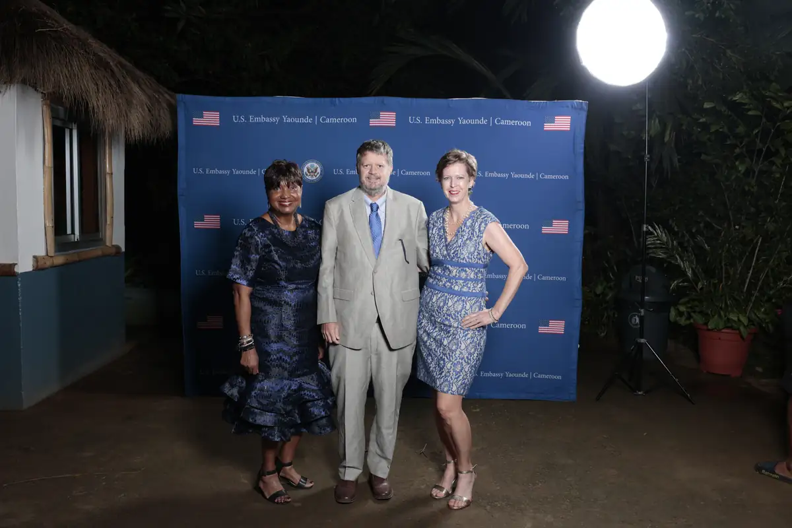
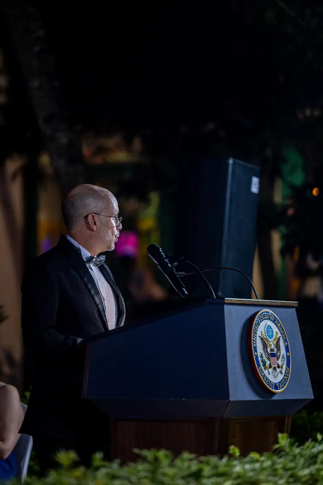
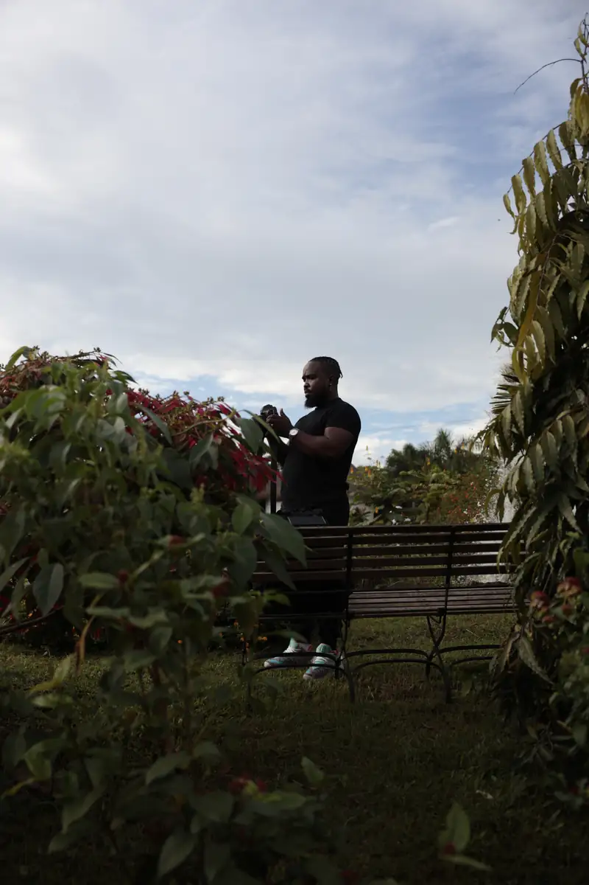

# Bal des Marines de l'ambassade des États-Unis (Marine Corps Ball)

<!-- wiki:infobox -->

| Bal des Marines de l'ambassade des États-Unis (Marine Corps Ball) | |
| --- | --- |
| Client | [Ambassade des États-Unis](../organisations/ambassade-des-etats-unis.md) |
| Via | [UPgraders](../organisations/upgraders.md) |
| Période | 11-12 novembre 2023 |
| Casquette | Exécution |
| Catégorie | Événement |
| Rôle | Couverture photo et vidéo |
| Fait partie de | [Ambassade des États-Unis — travaux](ambassade-des-etats-unis-travaux.md) |
| Folio | _pas encore sur le site_ |
| État de la fiche | Standard |
<!-- /wiki:infobox -->

**Bal des Marines de l'ambassade des États-Unis (Marine Corps Ball)** est un événement couvert en photo et en vidéo par Alexandre « Xtincell » Djengue (11-12 novembre 2023).

## Description

- **Lieu** : restaurant-jardin à paillotes, Yaoundé
- **Organisateur ou client** : Ambassade des États-Unis au Cameroun
- **Ce que montrent les images** : 11/11/2023 de 16 h 30 à 1 h : cocktail au jardin, photocall « U.S. Embassy Yaoundé », discours au pupitre officiel, dîner, soirée dansante.
- **Identification** : photocall « U.S. Embassy Yaoundé | Cameroon » ; pupitre au sceau du Département d'État
- **Fiabilité** : confirmé

## Galerie

<!-- wiki:galerie -->

<!-- /wiki:galerie -->

## Archives

- `Ambassade des États-Unis\2023\Bal des Marines` (2 544 fichiers, disque P:)

## Sources

- Notes « Événements couverts » établies lors du rangement des disques (28/10/2026), à partir des images, des dates de prise de vue et des livrables

<!-- wiki:liens-entrants -->
<!-- /wiki:liens-entrants -->
