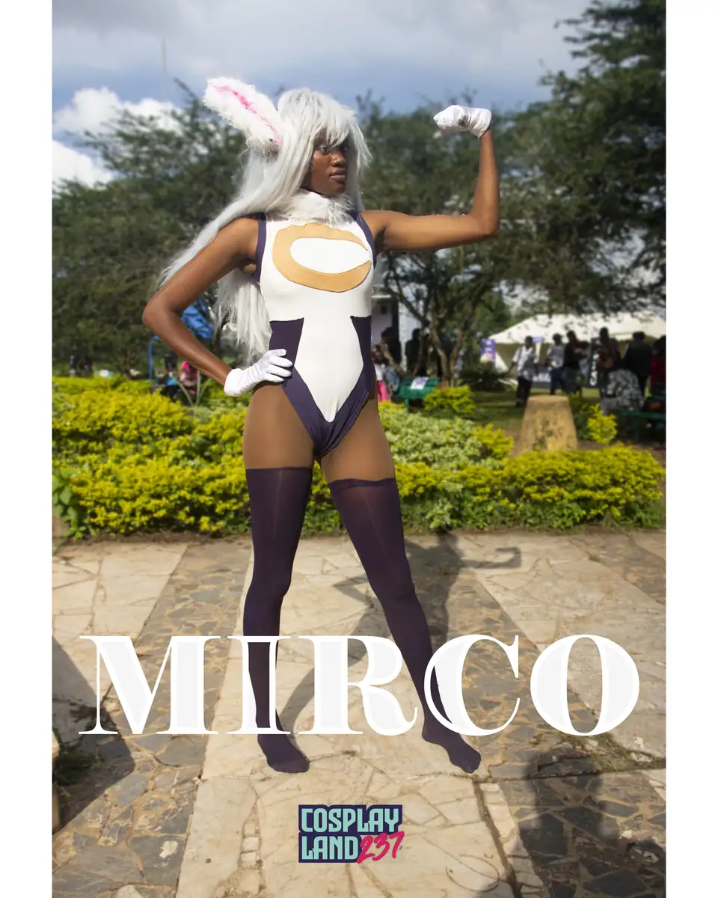
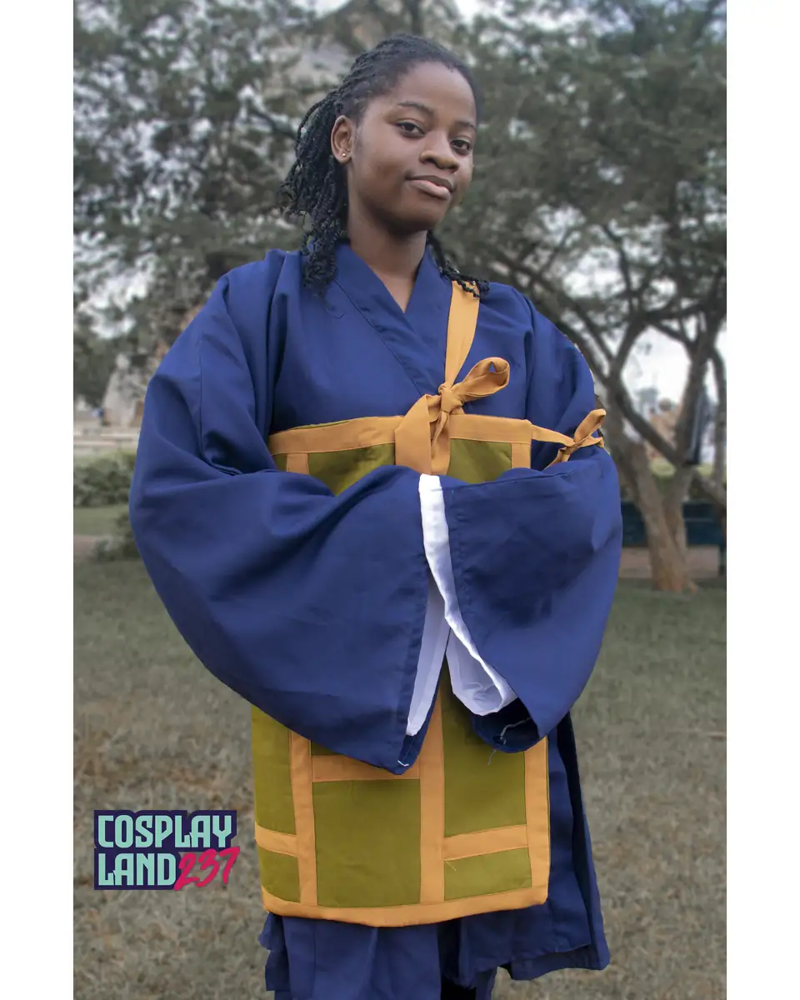
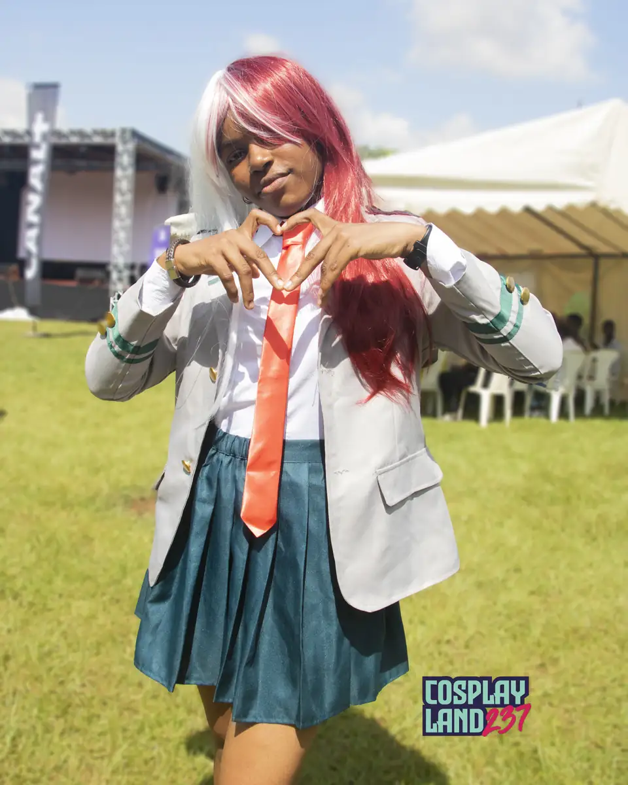
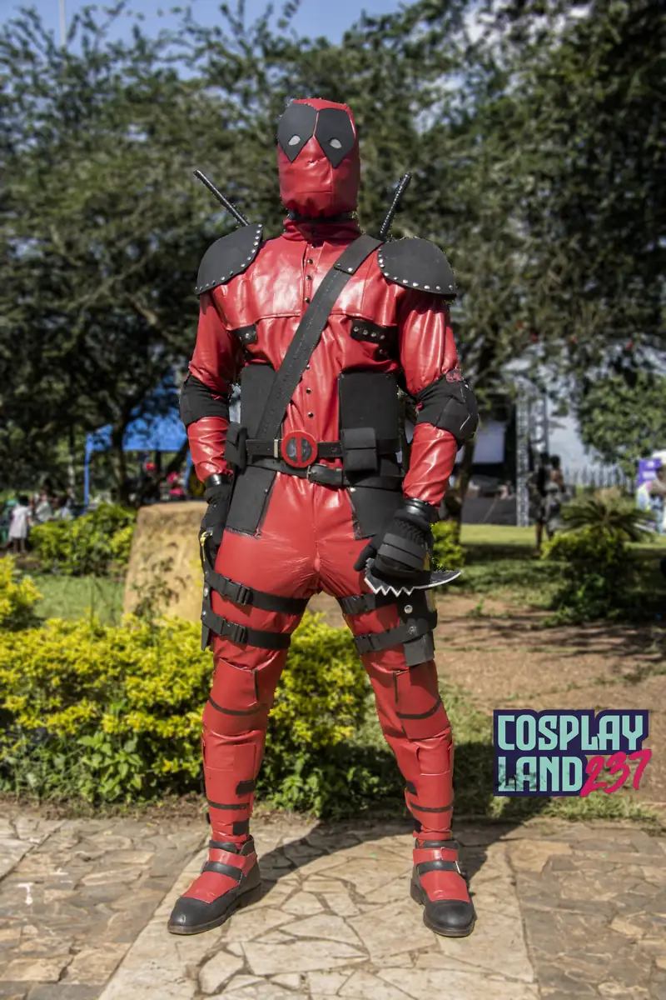

# Cosplay Land 237 — concours cosplay en extérieur

<!-- wiki:infobox -->

| Cosplay Land 237 — concours cosplay en extérieur | |
| --- | --- |
| Période | 25 novembre 2023 |
| Casquette | Exécution |
| Catégorie | Événement |
| Rôle | Couverture photo et vidéo |
| Fait partie de | [Kamer Otaku Festival — éditions 2022 à 2024](kof-2022-2024.md) |
| Folio | _pas encore sur le site_ |
| État de la fiche | À vérifier |
<!-- /wiki:infobox -->

**Cosplay Land 237 — concours cosplay en extérieur** est un événement couvert en photo et en vidéo par Alexandre « Xtincell » Djengue (25 novembre 2023).

## Description

- **Lieu** : jardin, en extérieur (lieu non lisible)
- **Organisateur ou client** : Cosplay Land 237
- **Ce que montrent les images** : Portraits de cosplayeurs dans un jardin, mis en page en affiches titrées (Deadpool, Raven, Chainsaw Man…).
- **Identification** : filigrane « Cosplay Land 237 » sur les affiches ; photos reçues par Telegram (Canon EOS 750D, pas le boîtier d'Alexandre)
- **Fiabilité** : probable

## Galerie

<!-- wiki:galerie -->

<!-- /wiki:galerie -->

## Archives

- `KOF - Kamer Otaku Fest\2023\Cosplay Land 237 — concours cosplay (25-11-2023, photos reçues)` (30 fichiers, disque P:)

## Sources

- Notes « Événements couverts » établies lors du rangement des disques (28/10/2026), à partir des images, des dates de prise de vue et des livrables

<!-- wiki:liens-entrants -->
<!-- /wiki:liens-entrants -->
