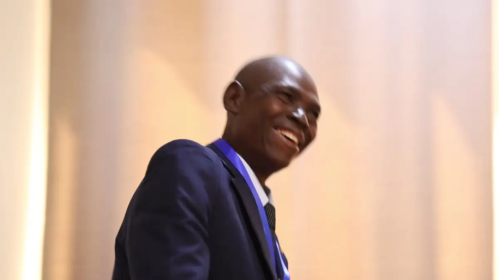
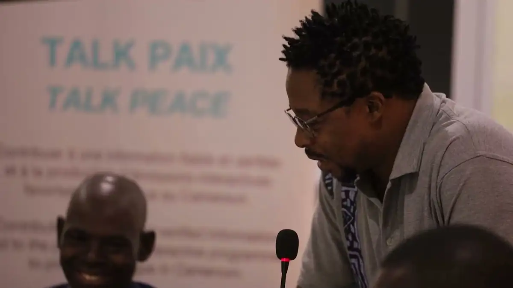
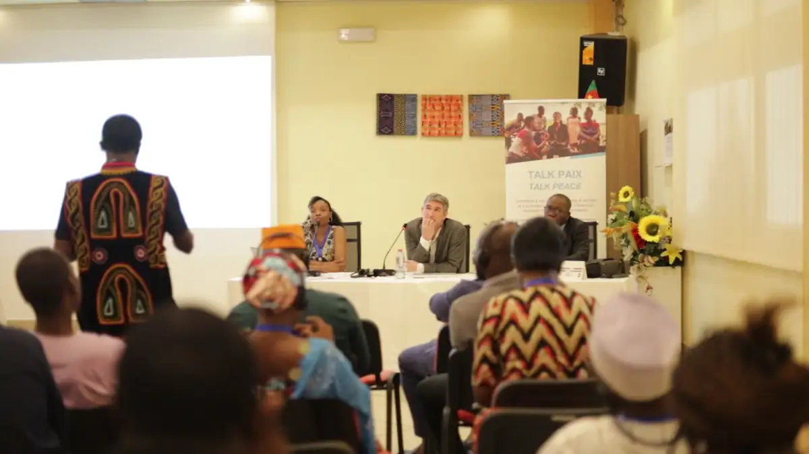
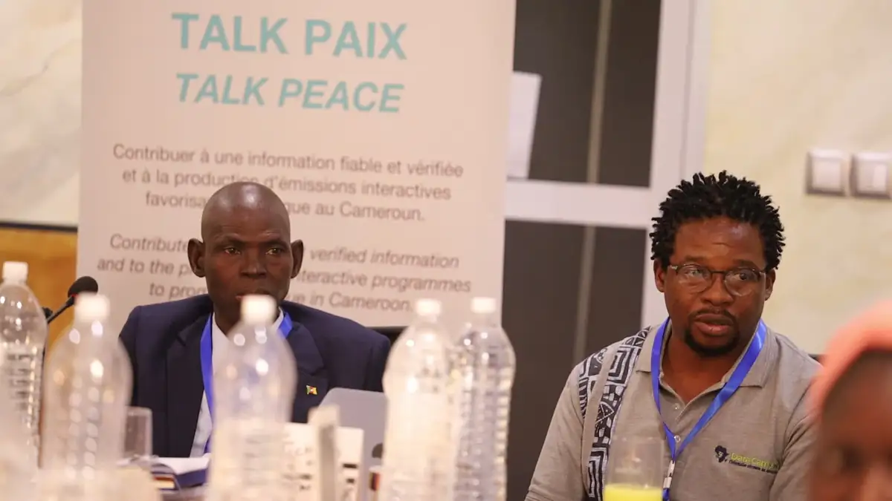
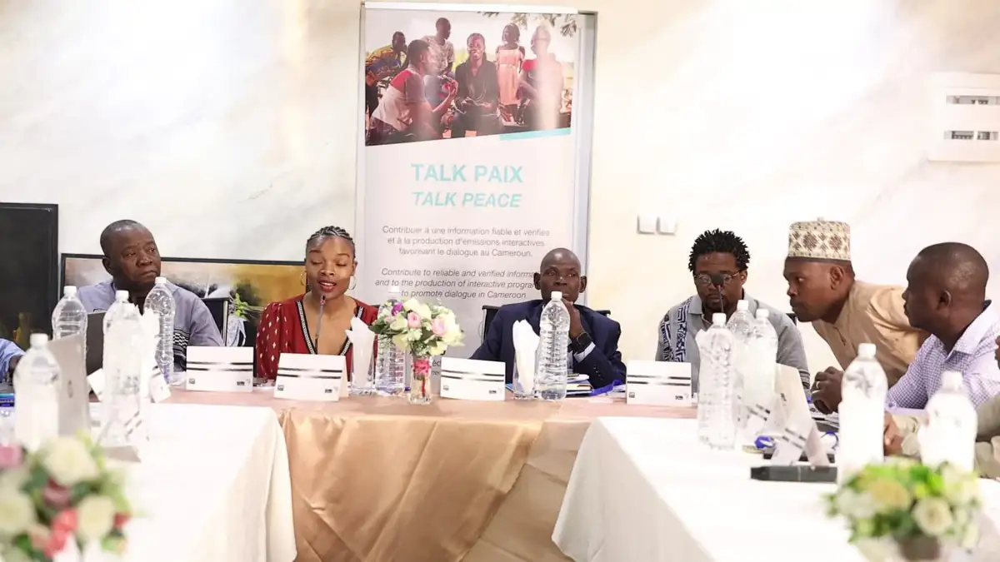
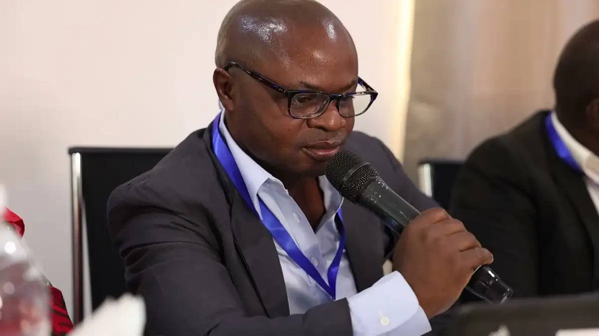

# Talk Paix (CFI) — rushes d'ateliers régionaux 2024 (dont Garoua)

<!-- wiki:infobox -->

| Talk Paix (CFI) — rushes d'ateliers régionaux 2024 (dont Garoua) | |
| --- | --- |
| Client | [Talk Paix (CFI)](../organisations/talk-paix-cfi.md) |
| Via | [UPgraders](../organisations/upgraders.md) |
| Période | 30 janvier → 24 avril 2024 |
| Casquette | Exécution |
| Catégorie | Événement |
| Rôle | Couverture photo et vidéo |
| Fait partie de | [Talk Paix (CFI) — travaux](talk-paix-cfi-travaux.md) |
| Folio | _pas encore sur le site_ |
| État de la fiche | Standard |
<!-- /wiki:infobox -->

**Talk Paix (CFI) — rushes d'ateliers régionaux 2024 (dont Garoua)** est un événement couvert en photo et en vidéo par Alexandre « Xtincell » Djengue (30 janvier → 24 avril 2024).

## Description

- **Lieu** : salles d'hôtel (Yaoundé et Garoua), résidence blanche à Garoua
- **Organisateur ou client** : CFI — Talk Paix / Talk Peace
- **Ce que montrent les images** : 30/01, 16/03 et 23-24/04/2024 : vidéos d'interventions au pupitre, débats, interviews, travaux de groupe.
- **Identification** : roll-up et affiche « Talk Paix — Talk Peace » ; porte-nom « Mohamadou Aly Ibrahim — DRCOM Nord »
- **Fiabilité** : confirmé

## Galerie

<!-- wiki:galerie -->

<!-- /wiki:galerie -->

## Archives

- `Talk Paix (CFI)\2024\Rushes (à monter)` (525 fichiers, disque P:)

## Sources

- Notes « Événements couverts » établies lors du rangement des disques (28/10/2026), à partir des images, des dates de prise de vue et des livrables

<!-- wiki:liens-entrants -->
<!-- /wiki:liens-entrants -->
