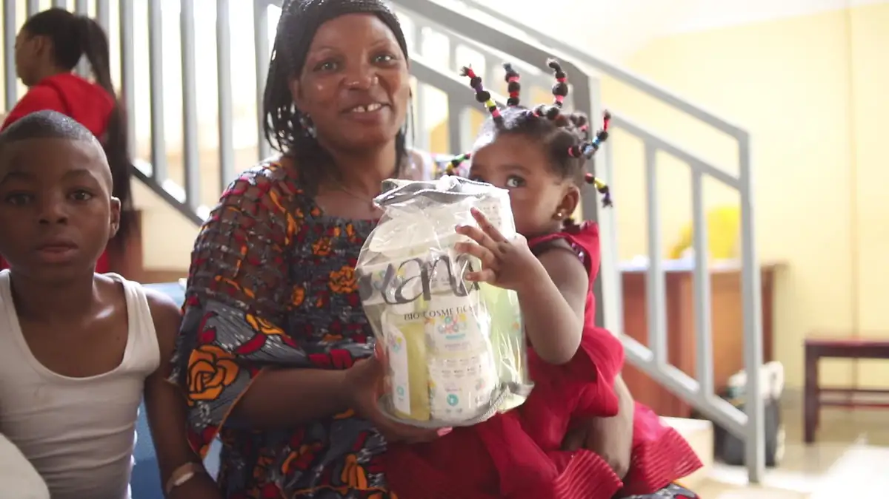
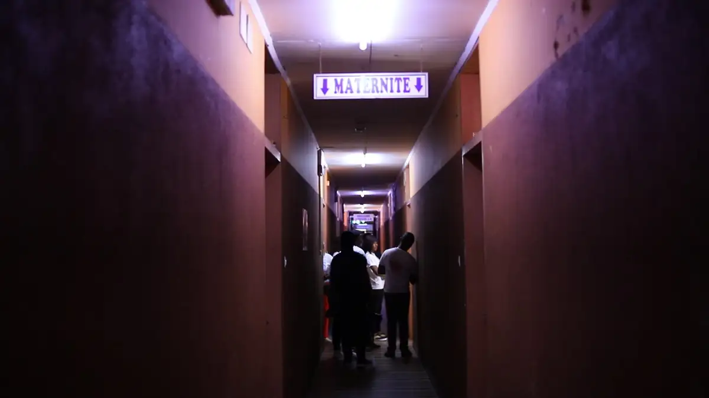
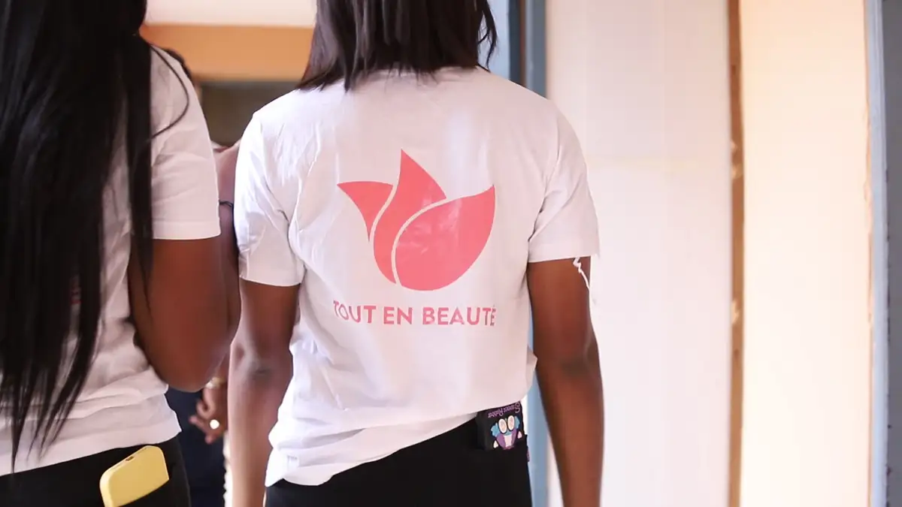
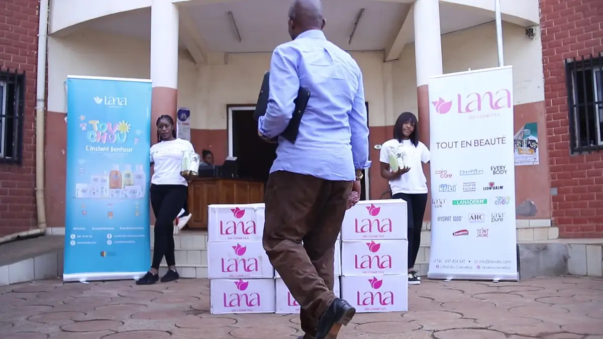
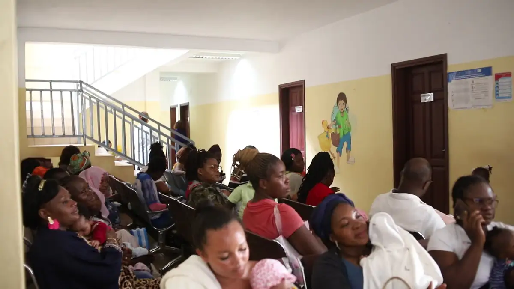
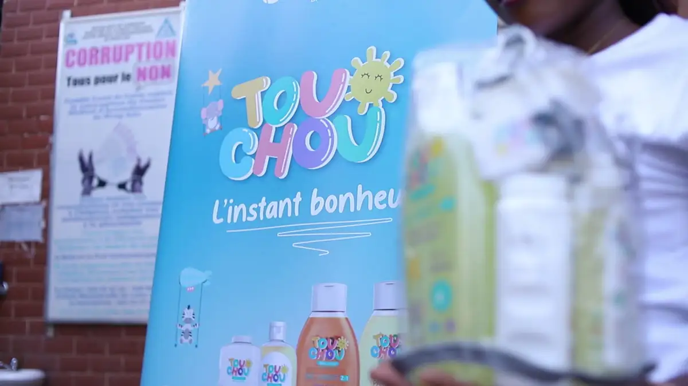

# Lana « Tout en beauté » — dons de produits pour bébés à l'hôpital de district de la Cité-Verte

<!-- wiki:infobox -->

| Lana « Tout en beauté » — dons de produits pour bébés à l'hôpital de district de la Cité-Verte | |
| --- | --- |
| Client | [Lana](../organisations/lana.md) |
| Via | [UPgraders](../organisations/upgraders.md) |
| Période | 9-12 avril 2024 |
| Casquette | Exécution |
| Catégorie | Événement |
| Rôle | Couverture photo et vidéo |
| Fait partie de | [Lana — travaux](lana-travaux.md) |
| Folio | _pas encore sur le site_ |
| État de la fiche | Standard |
<!-- /wiki:infobox -->

**Lana « Tout en beauté » — dons de produits pour bébés à l'hôpital de district de la Cité-Verte** est un événement couvert en photo et en vidéo par Alexandre « Xtincell » Djengue (9-12 avril 2024).

## Description

- **Lieu** : hôpital de district de la Cité-Verte, Yaoundé (maternité et pédiatrie)
- **Organisateur ou client** : Lana (marque de soins, gamme « Tout doux »)
- **Ce que montrent les images** : Vidéos d'avril 2024 : remise de kits de soins aux mères dans les salles d'attente et les chambres, photo de groupe devant les cartons et les roll-ups Lana.
- **Identification** : roll-ups et cartons « lana — Tout en beauté », « Tout doux » ; panneau « Hôpital de district de la Cité Verte » ; rien ne relie ce lot à Talk Paix ni à Garoua
- **Fiabilité** : confirmé (marque) ; mal classé

## Galerie

<!-- wiki:galerie -->

<!-- /wiki:galerie -->

## Archives

- `Lana\2024\Dons à l'hôpital de district de la Cité-Verte (avril 2024)` (205 fichiers, disque P:)

## Sources

- Notes « Événements couverts » établies lors du rangement des disques (28/10/2026), à partir des images, des dates de prise de vue et des livrables

<!-- wiki:liens-entrants -->
<!-- /wiki:liens-entrants -->
